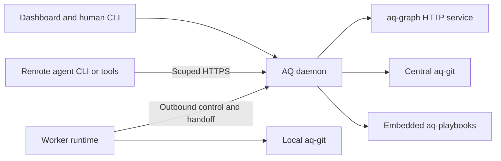

# Agent Q ecosystem and releases

**Status:** Required ecosystem design; foundation/component integration exists, while native workflows and assembled product acceptance remain open.

**Date:** 2026-10-30

**Reconciled:** 2026-10-31; the [implementation graph](../plans/0001-v2-milestones.md) and [checkpoint](../plans/2026-10-31-overnight-checkpoint.md) record actual coverage.

Agent Q v2 is a product assembled from independently developed and tested components. The `agent-q` repository owns the overall architecture, central daemon, integration adapters, installation, and product releases. Component repositories own their implementations and public contracts. A separate repository does not imply a separate deployed service.

## 1. Repository and runtime boundaries

| Repository | Responsibility | Product integration |
| --- | --- | --- |
| `agent-q` | Daemon, scheduling, execution authority, human/agent APIs, messaging, integration policy, deployment, updater, product acceptance | Central server image and installation/release tooling |
| `aq-worker` | Worker runtime, placement backends and sandbox lifecycle, in-sandbox runner, harness adapters, journal, capacity, transport, worker protocol, sandbox templates | Independently released worker image and sandbox base template; outbound HTTPS to AQ |
| `aq-graph` | Task and knowledge records, revisions, relationships, graph invariants and API | Released private HTTP service image |
| `aq-git` | Repository operations, workspaces, retained source, integration candidates and conditional publication | Versioned executable with a local process interface, packaged in central and worker runtimes |
| `aq-playbooks` | Workflow model, compiler, runner, storage adapter and authoring CLI | Versioned Rust libraries embedded in AQ; independently available CLI |
| `aq-dashboard` | Browser application, presentation, interaction and accessibility | Versioned static bundle packaged into the AQ server image |

Supervisors run centrally. Workers do not host supervisors, a graph database, or the playbook engine. The dashboard accesses the daemon; it does not contact workers, aq-git, PostgreSQL, or aq-graph directly.

The initial deployment uses Compose centrally and containers for remote workers. Each agent attempt runs in its own sandbox created by a worker node through a placement backend (`docker-local`, `boat`, `cloudflare-containers`); see [sandboxed execution and deployment topology](0005-sandboxed-execution-and-deployment-topology.md). The existing PostgreSQL deployment may host separately owned databases/schemas and roles; component ownership does not require one database server per component. AQ, graph, and playbook adapters must not query one another's private tables. Independent stores and schemas still require explicit delivery/reconciliation boundaries. No broker, Kubernetes cluster, worker database service, or private package-registry service is required by this design.

## 2. Authoritative facts

| Fact | Owner |
| --- | --- |
| Task requirements, knowledge, graph relationships and record revisions | aq-graph |
| Assignment grants, execution generations, scheduling, scoped authority and result dispositions | AQ daemon |
| Local process observations, reservations and unacknowledged local work | aq-worker |
| Git objects, revisions, checkpoints, retention and publication receipts | aq-git |
| Workflow run state, waits, child relationships and effect intents | aq-playbooks |
| Editable profile definitions | AQ configuration vault; validation produces immutable artifacts, not a second editable database catalog |
| Activated catalog selection, project execution bindings, frozen launch manifests and controller leases | AQ daemon; workers enforce the matching local execution/input permits |
| Live terminal output and process observations | Session host; bounded central/browser views carry sequence, epoch and freshness |
| Agent waits, continuation holds, wake delivery and stall episodes | AQ daemon; source outcomes stay with their domain owner |
| Normalized usage facts, cost estimates/corrections and notification delivery receipts | AQ daemon; worker parser journals retain unacknowledged facts; external acceptance is not human acknowledgment |
| User presentation state and disposable browser caches | aq-dashboard |

AQ applies task completion policy and delivers the resulting version-checked graph mutation; the resulting graph lifecycle is authoritative in aq-graph. AQ may expose an operation as awaiting graph confirmation. It must not maintain a second independently writable task lifecycle.

Observations identify their origin, revision/sequence and observation time. “Worker last reported running” and “daemon still authorizes execution” are separate facts. Materialized views are explicitly derived, rebuildable, and freshness-labelled. Durable operation records track delivery and provenance, not alternative copies of domain truth.

## 3. Design and contract ownership

| Material | Canonical location |
| --- | --- |
| Ecosystem architecture and product release policy | This document in `agent-q` |
| Cross-component execution guarantees and failure scenarios | [Execution and recovery](0002-execution-and-recovery.md) in `agent-q` |
| Profile composition, intelligence selection, mandatory tmux hosting and remote terminals | [Shared profile/session design](0003-agent-profiles-harnesses-and-terminals.md) in `agent-q`; [worker mechanisms](../../../aq-worker/docs/specs/0003-profiled-tmux-sessions.md) and dashboard section 8 reference it |
| Per-attempt sandboxes, placement backends, sandbox templates, delegated attempt permits, credential placement and the first deployment topology | [Sandboxed execution and deployment topology](0005-sandboxed-execution-and-deployment-topology.md) in `agent-q`; worker framework §3/§5 reference it |
| Session observability, stall policy, accounting, notification delivery and agent hibernation | [Shared operations/waits design](0004-session-operations-waits-and-notifications.md) in `agent-q`; [worker mechanisms](../../../aq-worker/docs/specs/0004-session-observation-and-suspension.md) and dashboard section 9 reference it |
| Daemon execution and graph gateway implementation requirements | [Daemon specification](../specs/0002-execution-and-agent-access.md) |
| Worker internals | [Worker framework](../../../aq-worker/docs/specs/0001-worker-framework.md) and [execution specification](../../../aq-worker/docs/specs/0002-execution-and-agent-access.md) |
| Worker wire contract, examples and conformance fixtures | [`aq-worker/protocol`](../../../aq-worker/protocol/README.md) |
| Human and agent API schemas and supported client contract | `agent-q`; schemas are published with daemon releases |
| Graph, Git and playbook component interfaces | Their owning repositories |
| Dashboard behavior and client compatibility | [Dashboard specification](../../../aq-dashboard/docs/specs/0001-dashboard.md) |

Shared requirements have one canonical definition and stable identifiers. Component specs reference those definitions and specify local mechanisms and tests. Cross-repository links are documentation references, not build dependencies. Repository documentation exports must retain resolvable versioned references when distributed outside sibling checkouts.

When a component changes incompatibly, update the shared contract and affected implementation specifications in coordinated changes. Resolve contradictions before declaring compatibility; a copied requirement in a component document cannot silently override the canonical contract. Release metadata identifies the contract revision actually implemented.

Wire changes require consumer and provider review and fixtures demonstrating both sides. A protocol package contains wire types, validation and fixtures only: no daemon storage models, scheduler code, worker process implementation, or transitive dependency on another component's internals. Existing foundation `aq-protocol` remains in place until an explicit extraction avoids duplicate definitions.

## 4. Dependency policy

Normal builds do not require sibling source checkouts or Git submodules. Each consumer declares a released dependency appropriate to its boundary:

- Rust libraries use Cargo dependencies and a committed application lockfile, built with `--locked`. Early unpublished libraries may use exact Git commit revisions. Floating branches are forbidden for release inputs.
- Executables use platform-specific release artifacts with verified digests and recorded source provenance. Consumer images pin the executable at build time; runtime startup does not download a moving version.
- Services and worker images use immutable OCI digests. Human-readable tags help discovery but are not the deployed identity.
- Dashboard bundles use versioned archives with a digest, API compatibility metadata and build provenance. The server image incorporates the selected bundle.

The baseline needs no new private registry. Public crates can be published when ready; Git revision pins, GitHub release artifacts and the existing OCI registry support early integration. Release artifacts must remain available for reproducible installation. Build records include toolchain, target, source revision, lockfile identity and dependency inventory. Local dirty builds cannot be labelled as official releases.

Submodules are reserved for a demonstrated need for nested source, not the default mechanism for consuming component releases. Independent release numbers are allowed; an AQ release does not require every component to share its version number.

## 5. Product release manifest

Extend AQ's existing signed [release manifest](../../crates/aq-release/src/manifest.rs) and updater through a separately versioned format. Do not add a second manifest with competing authority or silently reinterpret format 1. Old updaters reject unsupported formats and receive an explicit upgrade path.

The product manifest and its referenced build inventories identify:

| Field group | Required meaning |
| --- | --- |
| Product identity | AQ version, manifest version, source revision and signed creation metadata |
| Deployable artifacts | Exact server, graph and supported worker image digests; relevant platform identities |
| Embedded components | aq-git executable, playbook crate and dashboard bundle versions/digests or immutable source/package identities, tied to their containing image |
| Compatibility | Worker protocol/capability ranges, graph/Git API versions, dashboard API requirements, playbook artifact/storage compatibility |
| Persistent state | Per-owner schema/state compatibility, migration owner and allowed upgrade paths |
| Update plan | Ordered maintenance, drain, migration, readiness and recovery steps, including rollback constraints |

One authoritative input selects each artifact. Build-generated inventories describe what the selected images contain; CI rejects disagreement with the product manifest. Documentation must not become a second manually maintained component lockfile. A supported version range describes interoperability, while the manifest pins the exact shipped combination.

A release is admitted only after artifact verification, dependency and compatibility checks, and product acceptance of the exact assembled artifacts. Component publication does not automatically upgrade deployments. A dependency-update change in `agent-q` selects the new component and runs integration checks before an AQ release can include it.

Workers may be disconnected during central upgrades. Publish a recommended worker image and a tested compatibility window, initially covering the current execution protocol and the immediately preceding supported protocol where one exists. Connectivity-only foundation workers may remain visible but ineligible for execution. Do not imply compatibility with untested versions. Unsupported nodes receive an actionable reason rather than malformed assignments.

## 6. Deployment, upgrades and rollback

Target design: the central installation serves the dashboard and API at one origin, starts the private graph service, and supervises the local aq-git process. As of 2026-11-02, central installation startup of aq-graph and supervision of aq-git remain unimplemented; program tasks E0 (development) and E1a (production) deliver them. Playbooks run inside the daemon. Workers package their runtime and placement backend; sandbox templates package the in-sandbox runner, pinned aq-git, supported harnesses and toolchains. The first production topology — one Bluehost VPS hosting the server stack plus a cloud worker that creates boat.dev sandboxes, and one local desktop worker — is defined in [sandboxed execution and deployment topology](0005-sandboxed-execution-and-deployment-topology.md) §3 and §9. Development toolchains and standalone authoring CLIs need not ship in the production server image.

The existing updater evolves to orchestrate the central release. Each component owns its migrations; the product coordinates their order and records progress durably. No component reads another's tables to simulate an atomic cross-service upgrade. Use admission pauses, compatibility checks, backups and resumable migration steps. Define which existing attempts can continue during maintenance and preserve renewal/reporting paths, or explicitly drain before taking them down.

An image rollback is permitted only when that image can read the actual post-upgrade persistent state. Irreversible state changes require a forward repair or an explicit coordinated restore procedure. Restoring a database cannot undo remote external effects; execution grants, operation receipts, publication and pending messages require reconciliation. Persist an updater journal so restart resumes the known step rather than replaying migrations blindly.

Worker updates preserve identity and retained data, drain or stop owned execution, and reconcile under a new runtime incarnation. Central updates never assume every desktop upgraded simultaneously.

## 7. Development and independent verification

Normal component checks run in that component alone. An optional developer setup may create sibling checkouts and use local Cargo patches, executable paths or Compose overrides. Overrides are explicit, identify the substituted revision in diagnostics, and cannot leak into an official release. Do not create a giant cross-repository Cargo workspace merely to run tests.

| Layer | Owner and scope |
| --- | --- |
| Component correctness | Each repo; pure logic, local persistence, supported adapters and its required storage dependencies |
| Contract conformance | Contract owner publishes fixtures; both endpoints consume a pinned version and test valid, invalid, replay and compatibility cases |
| Product integration | `agent-q`; released components assembled with fake agents and real domain services |
| Deployment and scale | `agent-q`; actual images, ingress/authentication, migrations, recovery and representative load |

Large product suites are not prerequisites for every worker unit test. Product dependency updates and releases must run the relevant integration suites. Cross-component changes use a compatible contract release first, implementation changes next, and a product dependency update last. Temporary candidate artifacts can validate coordinated changes before release; they must be explicitly pinned and cannot imply a distributed atomic merge.

## 8. Delivery sequence

1. Keep Phase 1 scope and its working enrollment/update contracts intact.
2. Publish the execution protocol and fixtures from aq-worker, with daemon and worker implementations tested independently.
3. Extract the existing foundation connector from `agent-q` into `aq-worker`, preserving identity/configuration and testing against the foundation server. Remove the duplicated production implementation once the release is consumed.
4. Add graph, Git and playbook adapters to AQ through their released interfaces; assemble a minimal execution path.
5. Extend the product manifest/updater and exercise exact-artifact upgrades and recovery.
6. Introduce the dashboard bundle and its API contract tests when the UI work begins.

These are implementation work packages, not changes performed by adopting this document. In particular, no source extraction, runtime deployment or dashboard framework selection is implied by the specification.

## 9. Acceptance requirements

| ID | Required evidence |
| --- | --- |
| E1 | Build/test each component without sibling source checkouts; product builds resolve immutable dependencies without submodules. |
| E2 | Verify the manifest identifies the actual deployed and embedded components; reject missing, mismatched or unsupported artifacts. |
| E3 | Complete an assignment through execution, central source retention, accepted result, policy evaluation and confirmed graph mutation. |
| E4 | Run current and supported older workers against the selected server; unsupported execution remains ineligible without breaking allowed connectivity. |
| E5 | Upgrade and interrupt each migration/update boundary; recover without duplicate effects or unsafe rollback. |
| E6 | Run dashboard and CLI actions through the same domain authorization and lifecycle operations. |
| E7 | Demonstrate local development overrides and prove official release builds exclude them. |
| E8 | Run the execution load/recovery profile in the shared lifecycle design and retain deployment conditions and raw results. |

## 10. Related component contracts and tooling

See [aq-graph integration](../../../aq-graph/docs/aq-integration.md), [aq-git integration](../../../aq-git/docs/aq-integration.md), and [aq-playbooks design](../../../aq-playbooks/docs/specs/0001-aq-playbooks.md).

Dependency mechanisms follow [Cargo dependency declarations](https://doc.rust-lang.org/cargo/reference/specifying-dependencies.html), [Cargo local overrides](https://doc.rust-lang.org/cargo/reference/overriding-dependencies.html), and [Compose image references](https://docs.docker.com/reference/compose-file/services/#image). [Git submodules](https://git-scm.com/docs/gitsubmodules) remain a source-composition option rather than a required product dependency mechanism.
