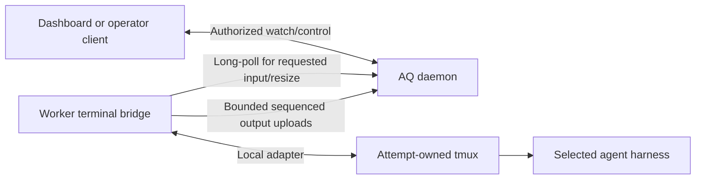

# Agent profiles, intelligence, tmux hosting and remote terminals

**Status:** Required design; profile/host/relay components are implemented and qualified within recorded scopes. Native harness and full terminal integration remain open.

**Date:** 2026-10-30

**Reconciled:** 2026-10-31; see the current implementation boundary below.

This is the canonical cross-component design for composing agent functionality,
selecting intelligence and execution settings, hosting every agent harness in
tmux, and accessing sessions on remote workers. It supplements [execution and
recovery](0002-execution-and-recovery.md), which remains authoritative for grants,
stopped-writer proof, retention and task completion. The [implementation
graph](../plans/0001-v2-milestones.md) assigns the work; prior M3/M4 qualification
does not establish tmux, real-harness or terminal support.

The [session operations extension](0004-session-operations-waits-and-notifications.md)
adds required peek/attach/nudge CLI surfaces, transcript readers, usage accounting,
the stall ladder, human notification delivery and dependency-aware hibernation.
Its accounting qualification refines the optional native-capability baseline
below; terminal access alone does not qualify those operational capabilities.

## 1. Product decisions and ownership

- Execution profiles and intelligence profiles are required product features.
- Every agent CLI harness, including central supervisor sessions, runs through
  the common tmux session host. Deterministic process fixtures remain useful
  tests; they do not qualify real-agent hosting.
- Required product targets are Codex CLI, Claude Code, Gemini CLI and OpenCode.
  One harness is the earlier M4 integration milestone; all four are required at
  the final product gate. Exact versions/configurations are selected and tested
  during implementation, not assumed compatible from these names.
- Workers initiate every network exchange. Remote terminal input arrives in
  responses to worker requests. No worker listener, SSH/reverse tunnel, broker,
  Kubernetes dependency or worker database service is introduced.
- The browser and operator clients connect only to AQ. Supervisors stay central;
  worker nodes do not acquire supervisor credentials.
- Profile composition is deterministic. Natural-language instructions are source
  content; no model interprets grants or resolves launch settings at runtime.

| Owner | Responsibility |
| --- | --- |
| agent-q | Profile catalog/compiler, intelligence selection, project bindings, authority, profile explanation APIs/CLI, central terminal authorization/relay and product acceptance |
| aq-worker | Published launch/terminal wire types, independently tested tmux host, harness adapters, local validation/journal, terminal capture/input and outbound transport |
| aq-dashboard | Profile/session inspection, terminal rendering, watch/control interaction, reconnect and uncertainty presentation |
| aq-playbooks | Policy can request work/selection constraints and react to typed observations; it does not implement harness flags, terminal transport or a second selector |

Start the pure profile compiler as a small Rust crate within agent-q, with no
PostgreSQL, daemon, worker-process or live-provider dependency in its core tests.
Expose the shared session host/adapters through narrowly scoped Rust crates in
aq-worker, usable by the central supervisor host through pinned public packages.
Do not import the worker scheduler/journal/database into the daemon. Separate
repositories or services for these libraries are not required now.

## 2. Composition model

| Definition | Owns | Must not own |
| --- | --- | --- |
| Agent profile | Role description, behavior/pack references, default intelligence and execution profile references | Copied harness launch logic or duplicated tool documentation |
| Behavior module | Reusable instructions with explicit purpose, version and required/optional delivery classification | Runtime authority or implicit permission changes |
| Capability pack | Registered tool/API requirements, requested grants, short startup instructions, optional reference documents and compatibility requirements | Arbitrary executable installer hooks or authority granted by prose |
| Intelligence profile | Ordered/conditional permitted model candidates, reasoning settings, budget requirements and fallback rules | Workspace grants, task state or provider secrets |
| Execution profile | Allowed harnesses/environments, confinement, mount aliases, local resource ceilings, credential-profile references, tmux/input policy | Provider-neutral role text or guessed physical paths on remote machines |
| Project execution binding | Project/repository/graph identity, allowed profiles, worker groups, policy/context references and project ceilings | Copies of graph task lifecycle or private aq-git metadata |
| Task/context input | Exact assignment, outcome contract and scoped revision-labelled context | Permission to override protected policy through document content |

Agent profiles are recipes. They do not form a deep inheritance tree or produce
one independently editable file for every role × model × harness combination.
Definitions use versioned TOML metadata referencing Markdown instruction files,
reusing AQ's existing configuration format. Pack dependencies are explicit and
acyclic. Files can be authored with an agent, but the deterministic validator
must accept them before activation.

Illustrative recipe (schema publication is CON-02 work):

```toml
schema_version = 1
id = "implementation-agent"
role = "Implement assigned changes and report evidence"
behaviors = ["engineering-basics@1", "verification-and-reporting@2"]
capabilities = ["aq-work@1", "aq-knowledge@1", "source-editing@1"]
intelligence = "standard-engineering@3"
execution = "confined-development@2"
```

The same recipe can resolve to different allowed harnesses without copying the
engineering rules. A review recipe can reuse knowledge and reporting packs while
requesting a narrower source scope. Harness adapters translate abstract tool and
confinement requirements into tested native configuration.

The seed catalog should include implementer, reviewer, researcher and central
supervisor recipes, shared engineering/reporting behaviors and small AQ work,
knowledge, messaging and source packs. Pack requirements can name an unavailable
future adapter, but that recipe stays ineligible until it exists. Tests assemble
multiple roles/harnesses and assert shared instruction identity appears once;
adding another model candidate must not create another role prompt file.

### 2.1 Sources of truth and revisions

Editable nonsecret definitions live in the AQ configuration vault. Validating a
catalog creates an immutable, content-addressed catalog artifact. An explicit
activation records its digest centrally. Invalid/partially written definitions
leave the previous active artifact intact. Editing a file alone cannot change a
running attempt. Database indexes and compiled caches are derived from artifacts;
they are not a second editable profile catalog.

Resolve friendly version references to exact artifact digests at activation;
record both. Definitions with the same ID/version and different bytes conflict.
Retain every catalog/launch artifact referenced by active or retained attempts.
Rollback selects an existing artifact for future work and does not rewrite old
attempts. No Git subprocess or directory scan is needed per scheduling poll.

Project bindings are central AQ domain records, changed through authenticated
revision-checked operations. Task/context bodies remain authoritative in
aq-graph; repository binding generations remain authoritative in aq-git. The
project record stores their public references and validates them through public
interfaces. This supplies the minimum registry needed for scheduling; clone/init,
GitHub repository creation and full onboarding UX remain separate work.

### 2.2 Resolution and conflict rules

1. Load one activated catalog and a revision-checked project binding; fetch only
   permitted, bounded task/context inputs.
2. Expand explicit behavior/pack dependencies in deterministic order. Include a
   module once by immutable identity. Reject cycles, missing references and two
   incompatible versions of one module; do not attempt semantic deduplication of
   arbitrary prose with a model.
3. Validate role/pack requirements and all explicitly permitted overrides.
   Protected settings cannot use a generic last-writer-wins merge. An override
   declares the field, source and reason; record it in explanation output.
4. Compute effective requested operations, tool support and folder access within
   installation, project, execution-profile and current caller/attempt ceilings.
   Required denied capabilities make the candidate ineligible. Optional ones may
   be omitted only when declared optional, with the omission visible.
5. Resolve eligible intelligence/harness/environment combinations centrally using
   explicit observed inputs and the selection rules in section 3.
6. Assemble bounded context and seal the concrete manifest before offering work.
   The node independently validates its installed capabilities, aliases and
   resource limits; local refusal never broadens the request.

Prompt ordering is fixed: platform requirements, role/behavior modules, pack
startup instructions, project conventions, assignment and labelled retrieved
context. Text cannot redefine the structured authorization calculation. Shared
rules should be referenced once; project/task content is never treated as a
trusted configuration source.

### 2.2.1 Acyclic policy and resolved access identity

Composition must not depend on a resolved graph access profile that itself
contains the model selected from that composition. Native composition schema2
therefore binds a typed preselection graph policy. Its inputs are the authorized
context projection, exact project/repository/task revisions, ordered instructions
and requested/effective permissions. Compile the instruction/permission draft,
seal that policy and composition, select the concrete model/harness, then derive
the actual API-01 resolved access profile and final launch manifest.

The resolved profile binds the genuine selected model and final scoped context;
its digest remains in the launch manifest and GraphBinding. No placeholder model,
whole-composition digest cycle or guessed graph profile is allowed. Task records
and knowledge records each require their corresponding permissions, including
pinned context. Policy scope uses canonical project/repository identities. A
source write grant is distinct from graph mutation permission. Frozen schema1
inspection/replay remains compatible but cannot authorize new native selection.
The [qualified contract correction](../implementation/AQ-08-acyclic-graph-policy.md)
defines the exact versioned artifacts and derivation.

### 2.3 Context delivery and explainability

Each instruction/reference declares startup-required or on-demand delivery.
Required rules and task acceptance conditions are never silently truncated.
Apply byte limits before expansion and a versioned tokenizer estimate where a
qualified tokenizer exists. If required content does not fit, fail resolution
with the offending sources. Remove optional context only in a declared order and
report omissions, source revisions and incomplete coverage. On-demand retrieval
uses current scoped agent authorization; possession of a pack is not a grant.

Required context planning also needs explicit model capacity and token-counting
or qualified conservative-bound evidence for the selected configuration. A byte
limit is not a tokenizer or model window. Missing counts/capacity stay unknown;
zero and an invented model window cannot satisfy a required planning bound.
Synthetic qualification facts must be labelled and cannot make a real harness
configuration eligible.

`aq profile validate`, `aq profile explain` and profile inspection API operations
are explicit deliverables of AQ-18. They show the flattened module order,
provenance, effective/requested permissions, denied requirements, byte/token
estimates, reference material, candidates and rejection reasons. Intelligence
selection explanation adds the concrete choice and observations used. Explanations
are scoped/redacted for the caller and never include credentials.

## 3. Intelligence and execution selection

An intelligence profile is a named policy such as standard-engineering or
deep-review, not a provider name. Its candidates explicitly identify provider,
model, required harness compatibility, reasoning configuration and support for
required limits/tools. Different providers' reasoning controls are not assumed
equivalent; the catalog lists tested concrete mappings. Profiles can pin a
provider or allow an ordered fallback set. There is no implicit downgrade to a
cheaper model, weaker reasoning setting or different provider.

The deterministic selector consumes catalog/project revisions, task constraints,
operator-authorized provider configuration, node capabilities and timestamped
provider observations. Outcomes distinguish eligible, unavailable, unsupported,
stale/unknown and policy-denied. Missing credentials are not equivalent to a
temporary quota limit. Provider observations have source, sequence and expiry;
they describe availability and cannot authorize a credential or provider.

Scope observations to the relevant provider account/credential profile, endpoint
and model where applicable. A failure from one node/account cannot automatically
disable unrelated credentials or the entire fleet. Authenticate the reporting
source, retain its provenance, and bound observation cardinality/retention.

AQ-20 implements a bounded availability registry, manual/operator observations
and structured harness failure feedback, with cooldown and explicit stale-data
policy. Automatic active quota probes are a separately extensible registered
check; no arbitrary provider probing is required to resolve every assignment.
Unknown availability can permit a bounded attempt only if policy allows it.

Selection uses a stable ordering/tie-break over the supplied snapshot and records
its decision trace. Recheck admission-sensitive revisions before issuing an
offer/grant. Once granted, model/harness changes require a replacement attempt
after stop/effect reconciliation. Failover never rewrites an attempt or replays
unknown external effects. Attempts share task-level retry and spending budgets;
replacement cannot reset them. Native token/time limits and observed usage are
labelled separately from estimated cost; a hard limit unsupported by the chosen
adapter makes it ineligible, rather than pretending telemetry enforces it.

### 3.1 Frozen launch manifest

The versioned manifest contains catalog/module digests; agent, intelligence and
execution profile identities; project policy revision; concrete model/provider/
harness and adapter version; required capabilities; environment identity;
instruction/context references and delivery plan; requested/effective scopes;
resource and termination limits; terminal policy; selection explanation reference;
and existing assignment/source/outcome bindings. Secret material is provisioned
separately. Use the published canonical serialization/digest algorithm, with
bounded strings/arrays and integer units instead of ambiguous floating budgets.

This is an extension of the existing immutable execution specification, not a
second writable launch record. CON-02 defines how its digest is bound by the
offer, acceptance and journal. Older peers may remain connectivity-visible and
must decline these required capabilities. Existing unbound fixture digests and
foundation protocol behavior must remain compatible.

API-01's **access profile** is an authorization object distinct from an agent,
execution or intelligence profile. Keep separate namespaces/types and bind the
existing graph access-profile digest explicitly. Neither a matching display name
nor a local compiled manifest can substitute for current daemon authorization.

## 4. Harness adapters and mandatory tmux host

Use one tested tmux hosting implementation, shared by harness adapters. The
reference M4 adapter is Codex CLI; Claude Code, Gemini CLI and OpenCode are
separate, parallel deliverables once the common contracts/host are available.
All four must pass the common minimum contract before GATE-06 can close.

| Common minimum | Explicit optional capabilities |
| --- | --- |
| Version/configuration validation, protected credential binding, scoped AQ client and initial context | Native message injection at safe prompt boundaries |
| Launch in attempt-owned tmux, observe actual process outcome and stop with tested ownership | Native conversation resume (does not imply worker live reattachment) |
| Tested default worktree confinement and refusal of unsupported explicit grants | Structured transcripts, usage accounting and provider-specific probes |
| Remote watch/control through the common terminal interface | Additional tools, richer context windows and model-specific settings |

An unsupported optional feature is visible to scheduling and the UI. Native
message delivery can fall back to the agent's authorized AQ inbox only when
declared by the execution profile. It cannot quietly become arbitrary keystroke
injection. CLI/provider versions are pinned in release manifests and checked at
startup. A generic custom-command adapter is experimental until independently
qualified; it does not count as one of the required four adapters.

Each attempt owns a private tmux socket/server/session and recorded pane identity.
Create the tmux server inside the guardian's process-ownership boundary before
any agent writer starts. Do not join a pre-existing shared server. The supported
tmux launch mode, daemonization behavior, descendant adoption and PTY lifecycle
must be demonstrated by WRK-10; a private socket alone is not containment proof.
Use direct argv/configuration construction and trusted launch helpers rather
than interpolating profile/prompt text into shell commands.

The guardian remains independent of terminal viewers and worker HTTP loops.
Stopping an agent covers the tmux server and all owned writer descendants.
Pane disappearance, terminal EOF and `kill-session` acknowledgement are not
stopped proof. Missing guardian proof keeps resources protected. Browser detach
does not stop execution, and viewer reconnect never creates/relaunches an agent.
Runtime crash recovery initially continues the existing stop-and-preserve policy;
tmux persistence does not enable unqualified live reattachment.

Central supervisor CLI sessions use the same public host/adapter libraries under
a central session identity and locally enforced expiring execution permit. They
are not fake remote worker assignments and expose no supervisor credentials to
nodes. AQ-17 owns that authority adapter and lifecycle qualification. Bounded
model judgment requests in AQ-14 remain provider requests, not agent CLI sessions.

## 5. Remote terminal access without inbound workers



The daemon routes by exact node/boot, attempt/generation, session and terminal
epoch. A browser cannot address a physical socket/path or arbitrary tmux command.
Central supervisors use a local bridge implementing the same public terminal
contract; no worker identity is fabricated to expose them.

Worker-to-daemon transport uses bounded HTTPS. Separate long polls retrieve
terminal commands; output uses bounded uploads. The daemon may stream to browsers
over an authenticated same-origin connection; that does not introduce server-push
to nodes. A full-duplex node WebSocket is outside this initial design and would
require a deliberate transport change and independent qualification.

Define three independently authorized operations:

| Operation | Meaning |
| --- | --- |
| Watch | Receive a scoped terminal snapshot and incremental output; no input or size changes |
| Message | Use the durable AQ mailbox and harness/inbox delivery contract |
| Control | Acquire a short-lived exclusive controller lease for literal input, paste and resize |

Multiple viewers may watch; one controller determines input and dimensions.
Read permission never implies control permission. Audit control acquisition,
handoff and input operation metadata. Raw keystrokes/pastes are sensitive and
are not retained as general audit text. Terminal output is sensitive untrusted
content; access is checked independently of agent graph credentials. Browser
rendering must restrict terminal escape features, links and clipboard access.
Credential provisioning never types secrets through the terminal; arbitrary agent
output cannot be guaranteed secret-free by a redaction heuristic.

### 5.1 Controller fencing and input uncertainty

Control leases bind the human principal, exact session/attempt/boot, monotonically
increasing controller generation and conservative expiry. AQ admits commands only
under current authority; the worker rechecks the tuple, lease and command deadline
before injection. Transfer of control waits for acknowledgement of the higher
fence or conservative expiry of the old permit. Revocation refuses new central
admissions immediately; already dispatched input cannot be undone, and a
disconnected node can enforce only its last observed fence/expiry.

Persist command identity/digest and receipt before injection. A replay with changed
bytes conflicts. States distinguish queued, received, injecting, applied,
delivery_unknown, expired and rejected. Record `injecting` before handing bytes
to the local terminal API. A crash around that call makes the operation unknown;
neither tmux nor an interactive program provides a general exactly-once keystroke
transaction. Do not replay unknown input. Pause subsequent interactive input
until the controller explicitly resolves the uncertainty using a fresh view.
Reacquiring control cannot replay earlier commands. Resize is an idempotent,
sequence-ordered setting and has a separate safe retry rule.

The current stage1 host's Applied receipt proves bounded tmux command acceptance
on the verified pane. It does not prove that the harness consumed the bytes,
that the model understood them, or that a PTY/rendering barrier completed. Any
stronger acknowledgement requires a separately qualified adapter contract.
Until a fresh-view resolution is implemented and qualified, Unknown remains
blocking even after controller takeover.

Queued input expires promptly and is not replayed after an offline reconnect.
Input cannot renew execution, revive a cancelled attempt, change profile grants,
approve an AQ domain decision, or replace typed cancellation. Terminal Ctrl-C is
an audited input gesture; the stop/cancel button uses the execution directive.

### 5.2 Output and resynchronization

Output frames bind epoch, sequence, byte length and digest. Identical retransmit
is deduplicated; a sequence reused with different bytes conflicts. Keep a bounded
local ring and bounded central replay buffer. Acknowledging output means received
by AQ, not read by a person. Missing/out-of-retention ranges are explicit gaps.

The terminal adapter must define a snapshot plus sequence-watermark barrier and
prove that buffered output cannot be lost or applied twice across the snapshot.
A new terminal epoch resets renderer state. Snapshot metadata includes dimensions
and required renderer state; capture-pane text is not assumed to reconstruct
every full-screen terminal mode. Prototype against actual target TUIs and test
resize, alternate screen, Unicode and reconnect. Until full interactive rendering
is qualified, a labelled read-only snapshot view is a development fallback and
does not pass final terminal acceptance.

Viewing a disconnected session shows last observation time and gaps; it does not
claim a live process. When the buffer fills, report dropped output/coverage and
resynchronize. Slow viewers must never block the agent PTY, guardian, grant renewal
or cancellation. Required result evidence is retained separately from lossy
interactive output. Full transcript export is an explicitly bounded artifact
feature, not unlimited terminal retention.

Subscription and controller operations bind an authenticated principal and have
independent expiry. Node output is accepted only for its registered session;
stale generations cannot overwrite a newer session's replay buffer. Only required
terminal delivery metadata is durable; transient output buffers are disposable
and a daemon restart may require a fresh snapshot with an explicit gap.

### 5.3 Initial bounded operating profile

These are implementation/qualification inputs, not measured performance claims.

| Limit | Initial default / requirement |
| --- | --- |
| Idle terminal polls | None without subscriptions/control work; ordinary worker polling remains separate |
| Terminal long poll | At most one per node, 20-second maximum hold, immediate response when work exists |
| Active viewers | At most 4 per session and 32 subscriptions per node; excess refused explicitly |
| Output | Frames at most 64 KiB; 256 KiB/s per watched session and 2 MiB/s aggregate per node; flush target 50 ms |
| Replay buffers | 1 MiB per session, 32 MiB aggregate per node; central active replay 128 MiB aggregate, bounded eviction with gap markers |
| Input | At most 4 KiB per operation, 32 KiB pending per session, 2-second command expiry; larger pastes split explicitly with uncertainty visible |
| Controller permit | At most 15 seconds, normally renewed every 5 seconds; never beyond execution authority |
| Control priority | Independent bounded pools/queues; terminal requests cannot consume reserved execution-renewal/cancellation capacity |

Operators may select smaller bounds. Larger bounds require a declared tested
deployment profile. Watched-terminal concurrency is distinct from total agent
capacity; 500 agents does not imply 500 simultaneous full-rate streams. Measure
input-to-observed-echo latency under a stated RTT, active viewer count, output load
and ingress configuration; target p95 <=250 ms for 10 watched sessions at <=50 ms
RTT in the initial profile. Refuse or revise the declared profile if measurements
fail; do not hide loss or relax execution-control guarantees.

## 6. API/package publication and independent testing

CON-02 publishes separately versioned wire schemas, canonicalization, limits,
capability identifiers and fixtures before consumers change. aq-worker owns
worker launch/terminal envelopes; agent-q owns human profile/selection/terminal
API schemas. Both reference the same terminal identity and operation semantics.
Exact routes/CLI outputs are implementation deliverables, not claimed existing
endpoints. No arbitrary tmux command endpoint is permitted.

Test the pure profile compiler with fixture catalogs and golden launch manifests;
the selector with fake provider observations/clocks; the host with a deterministic
interactive process and actual tmux; each harness adapter with configuration
fixtures and a separate explicit real-CLI suite; the relay/bridge with fake peers;
and the dashboard with contract-derived mocks. Routine tests require no live model
credentials or sibling source checkouts. Product qualification uses pinned real
harnesses, terminal rendering and declared model/credential configurations.

Failure tests include conflicting versions, duplicate modules, denied required
tools, required-context overflow, stale provider observations, candidate change
between resolve/admit, no permissible fallback, tmux server escape, guardian loss,
browser detach, node restart, lease handoff races, dropped acknowledgements before
and after input injection, replay conflicts, stale pane/boot reuse, output gaps and
sustained terminal floods while cancellation/renewal proceed.

## 7. Traceable requirements

| ID | Requirement |
| --- | --- |
| P1 | Agent recipes compose reusable behavior/capability modules without per-harness/model prompt copies; expansion is deterministic and rejects conflicts/cycles. |
| P2 | Validated immutable catalogs and launch manifests have pinned digests and retention; editable files are distinct from active artifacts and derived indexes. |
| P3 | Profile validation/explanation exposes provenance, flattened instructions, effective grants, context budgets and omissions through CLI/API and session UI. |
| P4 | Structured policy ceilings and local checks constrain requested capabilities; prose, packs and overrides cannot elevate authority. |
| P5 | Intelligence and execution profiles are distinct; selection records concrete compatible provider/model/harness settings without implicit downgrade. |
| P6 | Revisioned central project bindings connect public repository/graph identities, allowed profiles, node eligibility and scoped context without a second task-state owner. |
| P7 | Timestamped provider observations, explicit fallback and shared attempt budgets govern bounded selection/replacement; stale or unknown state is visible. |
| P8 | Required context fits before launch; on-demand references remain versioned, bounded and scoped; secret values are excluded from manifests and prompts. |
| H1 | Every real agent CLI, including central supervisors, uses an attempt/session-owned tmux host with independently enforced process ownership and expiry. |
| H2 | Codex CLI, Claude Code, Gemini CLI and OpenCode each qualify the minimum adapter contract at pinned versions; optional capabilities are explicit. |
| H3 | Tmux/PTY/server failure and runtime restart preserve conservative stop proof, protected resources and no-blind-relaunch behavior. |
| H4 | Profile compiler, host, adapters and transports have independent Rust/component tests; public versioned artifacts avoid private cross-repo dependencies. |
| R1 | All node connections are outbound HTTPS; dashboard/CLI terminal clients use the central authorized API only. |
| R2 | Watch, message and control are distinct; one fenced expiring controller binds exact session/node/boot/attempt identities. |
| R3 | Input replay, crash uncertainty, expiry and handoff cannot duplicate ambiguous injection or leak commands to reused sessions. |
| R4 | Sequenced bounded output, snapshot barriers and explicit gaps support correct renderer reconnect without relaunching execution. |
| R5 | Terminal load and slow viewers cannot starve execution control, block PTYs or create unbounded buffers; the declared latency/capacity profile is measured. |
| R6 | Terminal authorization, safe rendering, sensitive-data handling and control audit apply consistently to remote and central sessions. |

## 8. Delivery and remaining boundaries

CON-02 unblocks independent profile compiler, common host and relay contracts.
AQ-18/19/20 provide composition, project execution bindings and intelligence
selection before AQ-08 schedules real work. WRK-10 supplies the common host;
WRK-08 qualifies Codex CLI for GATE-04. Other harness adapters can develop in
parallel once those shared prerequisites exist. AQ-21 and WRK-14 implement the
two terminal endpoints, UI-03 the session inspector, and INT-02 qualifies the
assembled four-harness/terminal experience before GATE-06.

Full project onboarding, additional harnesses, arbitrary executable plugins,
automatic quota probes, durable conversation migration, hostile-process isolation,
unlimited transcript retention and worker WebSockets are outside this increment.
Their omission must not weaken the four named harnesses, mandatory tmux or remote
terminal requirements. Source [tmux control-mode documentation](https://github.com/tmux/tmux/wiki/Control-Mode)
describes commands and output notifications useful to the adapter; its use does
not itself establish the ownership or replay guarantees above.

## Revision-pinned implementation evidence

The [bounded v1 reference inventory](../research/2026-10-30-v1-implementation-reference-map.md) records implementation symbols, selected test obligations and per-file hashes at revision `9a9b8e8ef992d1ff699755a9383ed3c91e2844ea`. It distinguishes preserved behavior from remote-authority and retention adaptations. This evidence informs the owning v2 tasks; replacement coverage and product qualification remain pending.

## Current implementation boundary (2026-10-31)

AQ-18/19/20 provide versioned composition, project bindings and deterministic
selection, including the schema2 correction above. The guarded tmux host and
AQ terminal relay have independent retained qualification. WRK-14 stage1 adds
verified input/resize/fencing and outbound metadata transport; it does not
provide full renderer snapshots, live output or runtime adoption. The first
real harness, central supervisor integration, complete output path and browser/
four-harness qualification remain open. See the
[completion map](../plans/0002-execution-sessions-policy-completion.md) and
[worker integration evidence](../../../aq-worker/docs/implementation/WRK-14-integration.md).
The bounded operating profile remains an acceptance target, not a measured
product-capacity claim.
