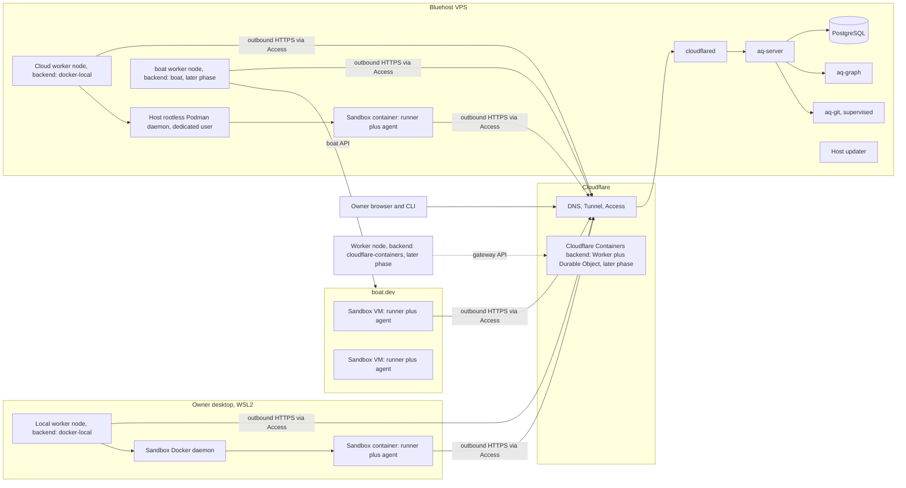

# Sandboxed execution, worker placement and deployment topology

**Status:** Required design. Nothing in this document is implemented yet.

**Date:** 2026-11-02. **Amended:** 2026-11-03 with the storage budget and continuous cleanup (review `rev-steady-rapids`; §§4, 5.1, 5.2, 9.2, 10, 11, 14 and 15). **Amended:** 2026-11-04 with the owner rescope of subscription-login refresh to a versioned login with compare-and-swap write-back (C5b; §§7, 8.3, 10, 11 and 15). **Amended:** 2026-11-04 with the Claude Code 2.1.318 and OpenCode 1.18.35 harness rows and the Claude `native` fail-closed rule (§8.3).

This is the canonical cross-component design for:

- running each agent attempt in its own disposable sandbox;
- building the images and snapshots those sandboxes start from ("sandbox templates");
- where worker nodes run, and how they create sandboxes locally and on remote platforms;
- how provider credentials (API keys and subscription logins) reach a sandbox;
- the first production deployment topology.

It supplements three existing documents:

- **[Execution and recovery](0002-execution-and-recovery.md)** stays authoritative for grants, stopped-writer proof, retention and task completion.
- **[Profiles, harnesses and terminals](0003-agent-profiles-harnesses-and-terminals.md)** stays authoritative for profile composition, mandatory tmux hosting and remote terminals. tmux runs *inside* the sandbox.
- **[Infrastructure foundation](../specs/0001-infrastructure-foundation.md)** stays authoritative for the Bluehost VPS, Cloudflare Tunnel/Access, enrollment and self-update.

Requirement IDs in this document use the prefixes `SBX` (sandboxed execution) and `DEP` (deployment). Short prefixes such as `R` and `P` are already used by more than one spec.

**Scope:** this document covers where and how agent work executes and how the product is deployed. The rest of the success bar is owned by the existing designs and tracked in the [implementation plan](../plans/0001-v2-milestones.md). That includes the dashboard, the supervisor conversation, task enqueueing and the v1-equivalent workflows. Section 15 lists the decisions made while reviewing this design.

## 1. Product decisions

These were decided by the product owner on 2026-11-02:

1. **One agent attempt per sandbox.** A sandbox never hosts two attempts at the same time and never runs a second attempt's processes. The single exception is a wake from hibernation: the continuation attempt may start from the hibernated sandbox's snapshot as a warm start (section 4, step 8). The sandbox is the unit of isolation, cleanup and stop proof. **This applies to worker-placed agent attempts. Central supervisor sessions are not worker attempts; they run on the VPS (section 3.1).**
2. **Agents run from sandbox templates that we build.** A template is a versioned image containing the agent-side runtime, pinned aq-git, tmux, the harness CLIs and a project toolchain. The same template runs locally and in the cloud.
3. **Worker nodes are long-lived controllers that run no agents themselves.** A worker node enrolls once and holds its node identity, capacity accounting, caches and credentials. It creates and destroys sandboxes for the attempts it accepts.
4. **Target topology:**
   - One Bluehost VPS runs the server stack and a cloud worker container.
   - The cloud worker runs `docker-local` sandboxes on the VPS itself (decided 2026-11-02 after review). boat.dev sandboxes come later through a second enrolled VPS worker node with the `boat` backend, because each worker node has exactly one backend (section 2).
   - One local worker on the owner's desktop, itself running as a container on WSL2, runs the same templates locally for extra compute.
5. **Cloud placement must support both boat.dev and Cloudflare.** boat.dev is the first remote backend. Cloudflare Containers is a second remote backend behind the same interface.
6. **Provider authentication is a mix of API keys and subscription logins** (for example, a ChatGPT login for Codex CLI or a Claude subscription for Claude Code). **Subscription logins are the primary path, and no API key is required** (product owner, 2026-11-02). API-key profiles remain supported as an option. **Both are allowed on every backend.** AQ is a personal deployment: running the owner's own agent with the owner's login on cloud compute is ordinary use, because the cloud only supplements limited desktop compute (product owner, 2026-11-02). The per-credential backend list (section 7) remains available as an operator restriction.

The success bar for this design is the product owner's definition of "finished":

- The dashboard is fully working.
- The server is hosted on the VPS.
- Cloud and local workers connect to it.
- The owner can talk to the supervisor and enqueue work the way they do in v1.
- It all works as expected.

## 2. Terms

| Term | Meaning |
| --- | --- |
| **Worker node** | An enrolled, long-lived aq-worker runtime that owns one node identity and boot incarnation (worker spec §4.1), capacity, local journal, caches and credential leases. It runs no agent processes. |
| **Placement backend** | The mechanism a worker node uses to obtain sandboxes. Initial backends: `docker-local`, `boat`, `cloudflare-containers`. Each worker node has exactly one backend. |
| **Sandbox** | One isolated execution environment created for one attempt: a container (`docker-local`, `cloudflare-containers`) or a VM (`boat`). |
| **Sandbox runner** | The agent-side runtime inside a sandbox: guardian, attempt-owned tmux host, harness adapter, aq-git client, observation and terminal transports. It is the same software that currently runs the native single-attempt path (`aq-worker run-native`), adapted to run under a delegated attempt permit. |
| **Sandbox template** | A versioned, content-addressed image definition. It is materialized as an OCI image (for container backends) and as a boat saved snapshot (for the boat backend), both derived from the same image digest. |
| **Environment** | The existing profile concept (architecture 0003 §2, worker spec §7). In this design, an environment ID resolves to exactly one sandbox template digest. |

## 3. Topology

### 3.1 What runs where

| Location | Runs | Does not run |
| --- | --- | --- |
| VPS, server stack (Compose) | `aq-server` (including the dashboard bundle built into the image), PostgreSQL, `aq-graph`, a supervised `aq-git serve`, `cloudflared`, and the existing host updater as a host service | Agent processes; Docker socket access for the application container (infrastructure spec, "Application container does not receive the Docker socket") |
| VPS, supervisor host container | Central supervisor CLI sessions (AQ-17): the shared tmux host and harness adapters, running under a central session identity and an expiring execution permit (architecture 0003 §4). Supervisor provider credentials come from the central vault. | Worker-placed attempts; Docker access. This is not a worker node, and supervisor credentials never reach worker nodes or sandboxes (W1). |
| VPS, cloud worker container (`aq-worker-cloud`) | aq-worker with the `docker-local` backend, connected to the dedicated host rootless Podman daemon through its Docker-compatible API. It holds its journal volume and a credential-lease cache. The controller has Compose limits; sandbox limits and the aggregate user slice are separate (section 9). | Agent processes outside sandboxes; the host's main Docker socket; the boat API key |
| VPS, sandbox daemon (host service) | Rootless Podman ≥ 5 owned by a dedicated user, with the `systemd` cgroup driver on cgroup v2. The daemon and all its sandboxes share the capped `user-<uid>.slice` (section 9). | A Compose service; the host's main Docker daemon |
| VPS, boat worker container (`aq-worker-boat`, later phase) | A second enrolled aq-worker node with the `boat` backend. It holds its own node identity, service tokens, journal volume, the boat API key and a credential-lease cache. Its sandboxes run on boat.dev, not on the VPS. | Agent processes; any Docker socket |
| VPS, agent sandboxes | One container per attempt, created by the cloud worker on its sandbox daemon | Node, backend, Git remote or supervisor credentials |
| boat.dev | One sandbox VM per attempt, forked from the template's saved snapshot | Node credentials, any other attempt |
| Desktop | aq-worker running as a container on WSL2 with the `docker-local` backend, plus a dedicated rootless sandbox daemon (section 5.1). The WSL VM is kept alive while the worker is enabled. | Agents directly on the desktop filesystem |
| Cloudflare (later) | A small Cloudflare Worker and Durable Object that creates Containers on request from an enrolled worker node | AQ server functions |

The cloud worker (and later the boat worker) runs on the same VPS as the server for cost and simplicity. If the VPS goes down, the server and the VPS worker nodes go down together, and that is accepted. Each VPS worker node still connects to the server through the public machine hostname and Cloudflare Access, exactly as a remote worker would, not over the internal Compose network. This keeps one authentication and transport path for all workers and lets a VPS worker node move to another host without changing configuration semantics.

**E1c sandbox daemon decision (2026-11-03).** The dedicated host user (for example `aq-sandbox`, with linger enabled) runs `podman system service` at `/run/user/<uid>/aq-sandbox/podman.sock`. `aq-worker-cloud` runs as that user's UID:GID and bind-mounts only the socket directory at `/run/aq-sandbox`, with `DOCKER_HOST=unix:///run/aq-sandbox/podman.sock`. No Compose service receives the host's main Docker socket. Rootless `dockerd` remains an equivalent alternative subject to the cgroup delegation requirements in SBX10.

Running `docker:29.3.1-dind-rootless` as a Compose service was rejected: it reported `CgroupDriver none` and silently dropped per-sandbox `NanoCpus`, `Memory` and `PidsLimit`, failing SBX10 despite reporting `name=rootless`. The selected host Podman setup reports `CgroupDriver systemd` and `CgroupVersion 2`. See [E1c evidence](../implementation/E1c.md) for the qualification and its limits.

### 3.2 Scheduling across workers

Placement stays central (worker spec §8). Additions:

- Each worker node advertises its backend kind, the maximum number of concurrent sandboxes it may create, an optional spend ceiling, the template digests it can launch, and an estimated cold-start cost per template.
- Project and pool policy orders eligible nodes by an explicit **placement preference**. The default ordering prefers `docker-local` nodes (no marginal cost), then `boat`, then `cloudflare-containers`. This default is the designer's call and is configurable per project.
- A node at its sandbox or spend ceiling refuses offers with a typed reason. Refusals are explainable (W13).

**As implemented (C4, `calm-delta-18.6`).** Central selection turns these advertisements into typed eligibility refusals. The field-level contract is in [intelligence selection](../specs/0004-intelligence-selection.md#sandbox-placement-facts-c4), and the evidence is in `docs/implementation/C4.md`.

- **Scope.** Placement facts apply only to nodes with a B1 registration in `delegated_node_boots`, using that registration's authenticated `BackendAdvertisement`. A host-native node without a registration gets no placement facts and is unchanged.
- **Preference.** The default order is `docker-local`, `boat`, `cloudflare-containers`. A project overrides it with `placement.preference` in its `ProjectPolicy` ([execution spec §3.2](../specs/0002-execution-and-agent-access.md#32-sandbox-placement-policy)). Kinds the list leaves out rank last.
- **Bounded hold.** A lower-preference node gets no offer while a higher-ranked peer is eligible. Eligible means the peer is registered, has an unexpired `intelligence_node_snapshots` snapshot, is under its ceilings, has the required capabilities and advertises the pinned template. The refusal reason is `placement_preferred_backend_available`. The hold ends no later than when that peer's snapshot expires, and the peer scan is capped at 256 nodes.
- **Ceilings.** A node at its concurrency ceiling is refused with `node_concurrency_ceiling_reached`. Its active count is the attempts with `holds_task` set, compared against `max_concurrent_sandboxes`. A node at its spend ceiling is refused with `node_spend_ceiling_reached`. If the node advertises a spend ceiling but has no accounted spend in the same currency, it is refused with `node_spend_unaccounted`; unknown spend never counts as zero. Boat compares its ceiling to **VM running time in the current UTC calendar month**, priced at the size rates in §5.2. Other backends retain the H2 lifetime provider-call accounting. See [monthly Boat accounting](../implementation/H2-monthly-boat-budget.md) for lifecycle reporting and migration.
- **Where it applies.** Selection and admission fences re-derive ceilings. Preference holds apply only at selection. Existing running VMs are governed by their sandbox hard deadlines; reaching the spend ceiling refuses new placement rather than terminating a VM.

**Owner monthly Boat budget (2026-11-03).** The owner selected the $20/month plan, with **$18/month** as AQ's VM-time placement ceiling (`spend_ceiling = { currency = "USD", micros = 18000000 }`) and `max_concurrent_sandboxes = 4`. This decision is recorded in the [supervision log](../research/2026-11-02-v2-build-supervision-log.md). This replaces the `sound-vault-88` interim guidance that the advertised ceiling did not account for VM time. Enforcement requires the controller's lifecycle facts; an older controller that does not report them is unaccounted, not a zero-cost node. Subscription/token usage, fixed plan charges and snapshot extras are separate from the VM-time estimate.

## 4. Sandbox lifecycle

Each accepted attempt goes through these steps:

1. **Reserve.** On accepting an offer, the worker node reserves one sandbox slot and the attempt's resource request (W3/W5). It records a durable journal intent *before* calling the backend, so that a crash cannot leave an unrecorded sandbox.
2. **Create.** The worker node creates the sandbox from the exact template digest in the launch manifest, records the backend's sandbox identifier in the journal, and labels it with node, boot and attempt identity. Labelling uses backend labels where they exist; boat sandboxes have no tags, so the journal mapping is authoritative there.
3. **Provision.** Sandboxes are created during *preparation*. The native protocol issues a PreparationPlan at acceptance, and the grant only after the Prepared receipts. A sandbox therefore exists, and is paid for, before the grant. The worker node delivers to the sandbox:
   - a **delegated permit**, preparation-scoped until the grant, then upgraded to execution scope (section 6);
   - the scoped AQ agent credential;
   - provider credential material (section 7);
   - the frozen launch manifest.

   Delivery goes over the backend's control channel (Docker API, boat command/file API, Cloudflare Durable Object). Nothing secret goes in the template, in command-line arguments or in environment listings visible to the agent user.
4. **Hydrate.** The sandbox runner obtains source:
   - It always fetches source from central retention through the authorized artifact export path.
   - On a cold first attempt, the **central** aq-git first fetches from the project's configured remote and retains the base. Git remote credentials stay central; sandboxes never hold them. Publication is central too (AQ-15).

   Templates may include pre-fetched objects only from repositories whose template images are stored in a private registry (section 8).

   Preparation receipts (Prepared) are submitted under the preparation-scoped permit.
5. **Run.** The runner reports Started, runs the harness in an attempt-owned tmux host under the in-sandbox guardian, streams observations and terminal output, and renews against the server (section 6).
6. **Hand off.** Before the attempt can be reported finished, retained source and result evidence must reach central retention with receipts (execution and recovery, X12). A sandbox's disk is never the only copy of work that has been reported done.
7. **Stop, preserve, then destroy.**
   - On completion, cancellation, expiry or failure, the runner stops the harness.
   - **Stopped-writer proof** is either of these backend confirmations:
     - the sandbox is destroyed;
     - the sandbox is stopped with no running processes (container stopped; boat sandbox archived).

     Either replaces per-process proof for writers that existed only inside that sandbox. Without confirmation, resources stay protected and the attempt stays uncertain (X3 rules apply unchanged).
   - **Destruction additionally requires that no unretained work remains** (W8, W14):
     - If handoff has not completed, the worker node first tries to extract the workspace and evidence through the runner or the backend file API.
     - If extraction fails, the node *stops* the sandbox and keeps its disk: container stopped with its volume kept, or boat sandbox archived (billing stops; snapshot storage is charged).
     - It keeps retrying handoff under the existing stop-and-preserve rules (X4, X5).
     - A preserved sandbox is deleted only after retention succeeds or an operator explicitly releases it (including a standing release configured under SBX22).
8. **Hibernation and warm wake.** The waits design (architecture 0004 C2/C3) stays authoritative:
   - Hibernation checkpoints to central retention and ends the attempt.
   - Wake is a **new attempt** with fresh authority, which never *requires* the original sandbox.

   *Deferred by the owner on 2026-11-02; not part of the current plan.* On backends with `suspend-snapshot` (boat), the original sandbox may be kept as a **warm start**:
   1. Before archiving, the runner deletes the permit, the agent credential and the subscription-login material.
   2. The sandbox is archived, which also serves as stop proof.
   3. On wake, the continuation attempt may be placed on the same node and resume or fork from that snapshot, with new credentials delivered.

   Central retention remains the authoritative copy. If the snapshot is missing, stale or on a node that can't take the work, the continuation hydrates normally. A warm-start snapshot may outlive the original grant, because it contains no running writers and no credentials. It is deleted when the continuation starts, when the wait is cancelled, or at a configured maximum age.

### 4.1 Reconciliation and orphan control

- **Worker node restart.** The worker node reconciles against both its journal and the backend's live inventory (`list` on the backend).
  - A sandbox with a current grant is re-adopted for monitoring. The runner inside it has been reporting directly to the server, so no work is lost.
  - A sandbox with no current grant, or one the journal does not know, is stopped and destroyed after a bounded grace period. Destruction is logged with its reason.
- **Worker node restart and authority.** Grants and permits are bound to the node *and* its boot incarnation (worker spec §4.1). A new incarnation must explicitly **re-adopt** each live sandbox:
  1. It lists the sandbox's attempt and grant generation in its re-registration.
  2. The server re-binds those permits to the new boot.
  3. Until re-adoption, the server answers the runner's renewals with "awaiting node re-adoption", without extending them.
  4. If re-adoption does not happen before the renewal deadline, the runner stops and preserves.
- **Runner disappearance.** If a runner stops renewing, the grant expires under existing rules. The worker node stops the sandbox, applies the preserve-before-destroy rule in step 7, and settles the attempt as uncertain or failed. Retry is a new attempt in a new sandbox.
- **Cost safety.** Every remote sandbox carries a hard deadline equal to the grant's hard deadline plus a small margin.
  - On boat, auto-stop (TTL) is set to that deadline rather than the platform's 1-hour default or "off". Each extension is bounded by the attempt's hard deadline.
  - A periodic sweep **stops** (archives) any backend sandbox running past its deadline, then applies the preserve-before-destroy rule. No remote sandbox may keep *running*, and billing compute, indefinitely because of a lost journal entry.
  - The sweep only touches sandboxes in the node's dedicated backend scope (section 5.2).

## 5. Placement backends

All backends implement one Rust trait in aq-worker:

- create from template digest
- deliver private material
- run the runner
- inspect
- list owned sandboxes
- suspend/resume (optional)
- destroy with confirmation
- report capabilities

Backend capabilities are advertised to placement and are part of eligibility. Examples are `vm-isolation`, `nested-docker`, `suspend-snapshot` and `persistent-disk-during-attempt`.

As implemented (C4), a project lists the capabilities it needs in `placement.required_capabilities` (at most 4). A node that lacks any of them is refused with `required_backend_capability_unsupported` (candidate state `Unsupported`). The work never falls back to a lesser backend.

**Proposed C1 contract extension:** add a template-presence operation, `ensure_template`, to `PlacementBackend` so admission can preflight an exact allowlisted digest through the common interface. It must confirm that the backend's materialization is present, or return a typed refusal or uncertainty; a failed check is not template availability. It does not create a sandbox or grant execution authority. C1 currently has no such trait operation, and C2's `pull_template` is backend-specific. The C1/admission owners should settle the signature and conformance coverage before adoption; this is a recommendation, not a claim that the method is implemented.

**Terminal and observation transport per sandbox:** runners talk to the server directly, so the terminal and observation long polls are held per *sandbox*, not per node. This amends architecture 0003 §5.3 ("at most one per node") and worker spec 0003 §5. The existing per-node aggregate limits still apply: subscriptions, viewers and bytes are counted server-side across all of a node's sandboxes. No poll is held for a sandbox with no subscriptions or pending work.

### 5.1 `docker-local` (desktop and any self-managed host)

- The worker node runs as a container with access to a **dedicated rootless sandbox daemon** through its Docker-compatible API on a dedicated per-user Unix socket. The selected implementation is rootless Podman ≥ 5; rootless `dockerd` is an equivalent alternative. The backend requires `/info` `SecurityOptions` to include `name=rootless`, and refuses a rootful daemon. The socket is never the host's main Docker socket.
- That daemon is used only for sandboxes. It holds only template images and sandbox containers, with its own storage and configuration separate from the host's main daemon.
- This deliberately revises the worker spec's "no host Docker socket" baseline for this node class. The worker spec already requires that projects needing extra capabilities be routed to an explicitly configured node class.
- The worker node's launch policy is fixed. Sandbox containers:
  - run only allowlisted template digests;
  - are never privileged;
  - drop all capabilities, set no-new-privileges, and retain the seccomp policy;
  - have no host bind mounts except the worker-managed per-attempt volume and declared mount aliases (worker spec §5);
  - have CPU, memory and PID limits taken from the reservation;
  - are disk limited per SBX20;
  - get a default bridge network with outbound access only.
- **Resource-limit prerequisite:** the host must use cgroup v2 and delegate the `cpu`, `memory` and `pids` controllers to the daemon's user. A host without that delegation is not admissible: Podman can otherwise silently drop the reservation limits. Qualification must read back effective limits (`cpu.max`, `memory.max`, `pids.max`) inside a sandbox; setting create-request fields alone is not proof of enforcement.
- **Private material:** upload an archive through the control API before the container starts (`PUT /containers/{id}/archive?path=/`). Its directory has mode `0700`, its file has mode `0600`, and both are owned by the intended runner identity. The material path is outside the work volume and every mount alias; aliases must not overlap or expose it. Material never goes in environment variables, command-line arguments or labels. These permissions provide runner/agent separation only with the distinct UID mappings required by SBX7.
- **WSL2 UID mapping:** install the `uidmap` package providing setuid `newuidmap` and `newgidmap`, and configure the daemon user's subordinate ranges in `/etc/subuid` and `/etc/subgid`. The C2 host lacked those helpers. `AQ_SANDBOX_SINGLE_UID=1` allowed diagnostic qualification with a single mapped host UID, but loses in-sandbox runner/agent UID separation. Mode `0600` does not restore that boundary. This fallback does not satisfy SBX7 or qualify agent execution requiring that separation; install the helpers and restart without the fallback before qualifying it. It is not a silent admission downgrade.
- Isolation claim: separate attempts cannot see each other's files, processes or credentials. **Local containers share the host kernel and are not claimed to be hostile-code isolation** (consistent with W6). The single-UID diagnostic run does not prove the SBX7 in-sandbox boundary.
- Nested Docker for agents is not provided by default. A template or node can advertise `nested-docker` only through an explicitly configured runtime, for example Sysbox. Projects that require it route only to such nodes.

### 5.2 `boat` (cloud, first remote backend)

boat.dev provides persistent Ubuntu VMs that include Docker, through an HTTP API (`https://boat.dev/api/v1`, bearer API keys). The API covers create, fork from a snapshot, stop-and-archive (snapshot), resume, delete, command execution, file transfer, scoped API keys, auto-stop and webhooks.

- **Template:** a boat saved snapshot built from a base VM by pulling and verifying the template's OCI image digest. The snapshot ID is recorded against the template digest as provenance.
- **Execution layout:** the runner and agent run **inside the template's OCI container** under the VM's Docker, so behaviour is identical to `docker-local`. VM root and the VM's Docker daemon belong to the sandbox host side. The agent user has no access to them, so the runner/agent separation (SBX7) still holds.
- **Create:** fork the template's saved snapshot. Size is the smallest that satisfies the CPU, memory and disk request (SBX21).
- **Machine sizes** (docs.boat.dev, accessed 2026-11-03; `boat.dev/pricing` returned 404, so pricing comes from the docs pages):

  | Size | vCPU / RAM | Disk (user files only; the OS and preinstalled tools are not counted) | Price while running |
  | --- | --- | --- | --- |
  | small | 2 / 4 GB | 51 GB | $0.018/h |
  | default | 4 / 8 GB | 51 GB | $0.036/h |
  | large | 8 / 16 GB | 111 GB | $0.072/h |
  | xlarge ($100 plan or higher) | 16 / 32 GB | 251 GB | $0.200/h |

- **Disk and snapshot facts** (same source):
  - **Custom disk:** not available. Resizing needs a stop and then a resume. Shrinking below the used size fails with `type_too_small`.
  - **Disk alerts:** sent by email only, at 85% and 95%. **At 95%, snapshots fail, so the newest work is not saved, and stop also fails.** Preserve-before-destroy (SBX5) relies on stop-and-archive, so a boat sandbox must never be allowed to reach 95% (SBX21).
  - **No live disk API:** `/sandboxes/{id}/usage` reports time only. Disk use has to be measured with `df` inside the VM. Snapshot sizes are reported: `GET /snapshots` and `/sandboxes/{id}/snapshots` return `sizeBytes` (the delta) and `contentSizeBytes`, `/saved-snapshots` returns `sizeBytes`, and `/snapshots/{id}/tree` returns `totalSizeBytes`.
  - **Stopped sandboxes:** cost nothing and keep their disk for at least 14 days. After cleanup (report-only in production today), resume or fork fails with `409 snapshot_data_expired`.
  - **Automatic snapshots:** free, with no count limit.
  - **Saved snapshots** (used for templates): 10 are included per $20 of plan per seat, never fewer than 10. Each extra costs $0.056 per day (about $1.68 per 30 days). There is no maximum and no expiry, and unpaid extras may be deleted after 7 days. No per-GB storage price is published.
  - **Size limits:** no maximum snapshot or template size is published, and there is no OCI import.
- **Isolation:** each attempt is its own VM, which is stronger than containers. The backend advertises `vm-isolation`. `nested-docker` for agents is **not** offered initially. Exposing the VM's Docker daemon to the agent would undo the separation between the runner and agent users. It needs a separate design, for example a rootless daemon owned by the agent user.
- **Hibernation warm start:** stop-and-archive snapshots the VM. Resume uses the newest snapshot of that sandbox. Advertise `suspend-snapshot` (section 4, step 8).
- **Dedicated scope:** each `boat` worker node uses a boat organization (or account) dedicated to AQ attempt sandboxes. Template builds use a separate organization or key scope. Sandboxes are named with the node's prefix and attempt identifier. Reconciliation and sweeps act only on sandboxes in that dedicated scope that carry the node's prefix.
- **Destroy:** `DELETE /sandboxes/{id}`, followed by confirming the sandbox is gone. Policy also deletes that sandbox's retained snapshots unless the attempt is suspended.
- **Credentials:** the worker node's boat API key is a node-local secret. Use a scoped key with only sandbox-lifecycle, command and file permissions. It is never delivered into a sandbox. boat's own "AI credentials" and AI-proxy features are **not** used initially. AQ's credential handling in section 7 stays the single owner. This can be revisited as an explicit option.
- **Inbound exposure:** none. No public URLs, no SSH keys for agents, desktop streaming off.
- **Constraints to accept or qualify:**
  - EU-only regions, so there is transatlantic latency to a US VPS. Renewal, stop and preserve margins must assume an RTT of 250 ms or more. The terminal latency target (architecture 0003 §5.3, defined at ≤50 ms RTT) is not claimed on boat.
  - Running sandboxes allowed at once (verified 2026-11-03): trial 2, $20 plan 100, $100 plan 300, $500 plan 1000, $2000 plan 2000. Stopped sandboxes don't count. No per-account storage quota is published.
  - The vendor is young, so it sits behind the backend interface and has no product-specific coupling outside the backend module.

### 5.3 `cloudflare-containers` (cloud, second remote backend, later phase)

Cloudflare Containers are started and controlled from a Cloudflare Worker through Durable Objects. They cannot be driven directly by an outside process.

- **Architecture:**
  - Deploy a small AQ-owned Cloudflare Worker ("sandbox gateway") that exposes a narrow authenticated API: create from template, deliver material, start runner, inspect, list, destroy.
  - The enrolled worker node calls this gateway outbound. A single worker node with the `cloudflare-containers` backend owns the gateway's credentials.
  - The gateway is part of the aq-worker repository and is released with it.
- **Template:** the OCI image digest, pushed to the registry Cloudflare Containers pulls from.
- **Constraints:**
  - Ephemeral disk, so step 6 handoff must complete before the sandbox ends.
  - No snapshot suspend, so continuation goes through central retention.
  - Instance size and image-size limits.
  - Outbound internet must be enabled for the sandbox to reach AQ, provider endpoints and Git remotes.
  - Nested Docker is not expected, so `nested-docker` is not advertised unless verified.
- **Acceptance:** this backend must pass the same backend conformance suite as the others (section 10). It is required before the final product gate. It is not required for the first cloud deployment.

## 6. Authority: delegated attempt permits

The worker protocol currently binds grants to one node identity and boot incarnation. A sandbox runner is a separate process, and often a separate machine, that must report for that attempt.

- When the node accepts an offer, the server issues the grant to the node as today. The node then requests a **delegated attempt permit**: a credential scoped to one attempt, one grant generation, one sandbox identity, and the grant's hard deadline.
- The runner uses the permit directly against the server for Started, renewal, observations, terminal transport, material fetch where allowed, artifact transfer and result reporting. The node is not a relay for these. This is required for remote backends, where the node is not on the data path.
- The permit cannot accept offers, register incarnations, act for other attempts or outlive the grant. Revoking the node revokes all of its permits. Revoking or cancelling the attempt revokes its permit.
- Cancellation, renewal refusal and expiry reach the runner in responses to its own outbound requests (W2/R1 unchanged). The node also observes cancellation and destroys the sandbox if the runner does not stop by the deadline.
- The permit is a published contract change, owned by aq-worker protocol per the ecosystem design, with daemon and worker fixtures.

## 7. Credentials

| Credential | Held by | Reaches sandbox? |
| --- | --- | --- |
| Node credential and the node's Cloudflare Access service token | Worker node | Never |
| Runner Access service token: a separate Access service token per worker node, used only by that node's runners to pass Cloudflare Access on the machine hostname | Runner | Yes, readable only by the runner's OS user. It only gets requests through Access; every request still needs a valid permit. Revoked together with the node. |
| Git remote credentials | Central aq-git | Never (cold fetch and publication are central) |
| Supervisor provider credentials | Central vault, supervisor host | Never |
| Backend API key (boat, Cloudflare gateway) | Worker node | Never |
| Delegated attempt permit | Runner | Yes, readable only by the runner's OS user |
| Scoped AQ agent credential (graph context, messaging) | Agent user | Yes, short-lived, per attempt. The agent's AQ client reaches the server through the runner's loopback proxy, which adds the runner Access token, so the agent never holds an Access token. |
| Provider API key | Runner's credential proxy | The key is present in the sandbox, readable only by the runner user; the agent user reaches the provider through a loopback proxy (the existing `aq-responses-transport` pattern) |
| Subscription login material (for example Codex `auth.json`, Claude credentials) | Central credential vault, leased per attempt | Yes, installed into the agent user's harness home (these CLIs must read it directly) |

Rules:

- **Separate OS users inside every sandbox:** `runner` and `agent`. Permit, proxy keys and runner state are not readable by `agent`. This is the in-sandbox boundary. It is not a claim of protection against a hostile agent on a shared-kernel container.
- **Subscription logins are leased, written back and wiped:**
  - Material is delivered through the existing private material lease (`/v1/worker/profiled/material`), extended to the delegated permit.
  - If the harness refreshes its login during the attempt, the runner returns the refreshed material to the vault before teardown, through a new lease-scoped write endpoint (`POST /v1/worker/profiled/material/refresh`). A refresh-token rotation must not silently invalidate the stored copy.
  - **One versioned login per credential.** Each subscription credential stores one login with a monotonic version. The configured file is version 0, and each accepted write-back or operator import adds the next version. The vault holds the bytes; SQL holds only digests and sizes.
  - **Compare-and-swap write-back.** The runner sends the refreshed file with the version it was based on. The server accepts version N+1 only if its current version is still N. Otherwise it keeps its current version and answers `409` with that version, because a newer write won. A replay of the same lease and content is idempotent.
  - **Operator import/replace always wins.** An operator command stores a login file or token as the newest version, even if its bytes equal the current version. Leases issued before it can no longer renew or write back.
  - **Renewal compares credential identity, not bytes.** Renewal fencing (0002 §5) accepts a lease whose material is any version of the same credential, including versions written back by any lease. Only a newer operator replace, or a rotated configured file plus reload, refuses renewal. Revocation still refuses renewal.
  - **The next attempt fetches the newest version.** Issuance uses the newest version, so one node's refresh reaches every other node on its next attempt.
  - Teardown deletes the material.
  - Logins the CLI never rewrites need no write-back. Claude Code subscription logins are a long-lived, env-only token (`CLAUDE_CODE_OAUTH_TOKEN`), so they are leased env-only; they are still stored and versioned. Write-back serves logins rewritten in place, such as Codex `auth.json`.
  - Implementation and tests: [C5b](../implementation/C5b.md).
- **Concurrent leases are not capped yet.** A per-credential concurrent-lease limit (`max_concurrent_leases`, with `refresh_safe` for providers that do not rotate refresh tokens on use) is deferred to `calm-delta-18.8.2`. Until then, two concurrent attempts may refresh the same login: the version CAS keeps the first write-back and refuses the second with `409`, and that attempt's login may stop working if the provider rotated the refresh token.
- **Placement policy per credential profile:** each credential profile lists the backends it may be used on. The default is every enabled backend, for API keys and subscription logins alike (section 1.6). An operator may narrow the list for a credential.
- **The agent can read subscription logins.** Harness CLIs read their login file directly, so the material sits in the agent user's harness home. The `runner`/`agent` separation does not protect it. It protects only the permit, the proxy-held API keys and runner state. The controls for subscription logins are: lease scope, one attempt per sandbox, wipe at teardown, and the J4 security review.
- Template images and boat saved snapshots must contain no credentials. The template pipeline scans the images and snapshots it produces for known credential paths and fails if any are found.

## 8. Sandbox templates

### 8.1 One template family for all harnesses

Templates vary by **project toolchain**, not by harness. Every template contains every qualified harness CLI at its pinned version. The launch manifest selects which harness runs. There is no image per harness and no harness × project image matrix.

Why:

- All four harnesses are CLI programs of modest size.
- The installed but unselected harnesses are inert: they hold no credentials, because only the selected harness's credential material is delivered (section 7).
- The axis that actually multiplies images is the toolchain.

A separate per-harness image is justified only if two qualified harnesses need conflicting system dependencies. The adapter qualification must record that before a split is allowed.

**Maintained artifacts.** Three kinds of artifact are maintained, and a template is assembled from them:

| Artifact | Contents | Maintained by | Rebuild cadence |
| --- | --- | --- | --- |
| `aq-sandbox-os` base image | OS, Git, tmux, bubblewrap (section 8.3), CA certificates, the `runner`/`agent` users | AQ, released with the worker | OS security updates (scheduled) |
| Project toolchain images | `FROM aq-sandbox-os` (or another allowlisted base, see below) plus that project's declared toolchain recipe, such as Rust, Node or Python. Toolchains may also derive from another toolchain image, for example `rust-node` from `rust`, with parents declared. | Per project, recipe in the vault | When the recipe or its parent changes |
| `aq-sandbox-runtime` bundle | Everything AQ owns inside a sandbox, under `/opt/aq`: the sandbox runner, aq-git pinned by digest, the credential and AQ loopback proxies, and every qualified harness CLI at its pinned version. It includes a private Node runtime for harnesses that need one, so no harness depends on the project's Node version. | AQ, released with the worker | Every worker or harness release |

A **template** is a project toolchain image plus the runtime bundle copied in as the final layer (`COPY --from=aq-sandbox-runtime@sha256:… /opt/aq /opt/aq`), followed by a fixed finalize step. That step checks the users, tmux, bubblewrap and Git, and refuses the build if any is missing.

The layer order is deliberate. The parts that change most often (runner and harness versions) sit on top. A harness update therefore rebuilds every template quickly, as one copied layer, instead of forcing every project to reinstall its toolchain. Adding a project means writing a toolchain recipe, not a whole image.

**Alternative base.** A general-purpose "universal" toolchain may use OpenAI's [`codex-universal`](https://github.com/openai/codex-universal) reference image (`ghcr.io/openai/codex-universal`) as its base instead of `aq-sandbox-os`. That image preinstalls Python, Node, Rust, Go, Ruby, PHP, Swift and JDK, with versions selected by `CODEX_ENV_*_VERSION`. The finalize step adds what `aq-sandbox-os` would have provided. Image size, license terms and update cadence must be checked first. It is an option; slim per-project toolchains remain the default.

**On boat,** "fork" is literal: each template has a saved snapshot in which that template's image is already pulled, and every attempt forks that snapshot (section 5.2). Rebuilding a template produces a new snapshot. Old snapshots are deleted once no active attempt, warm start or rollback target references their digest.

A template advertises the exact harness versions it contains. Selection requires that the chosen template contain the chosen harness version (P5, SBX13). As implemented (C4), a pinned template that the node does not advertise is refused with `template_not_advertised`. A template whose advertised harnesses do not include the selected harness's exact `cli_version` is refused with `template_missing_selected_harness_version`.

### 8.2 Template artifacts

- **Project templates:** a project template is the layers above with a declared toolchain recipe, optionally with pre-fetched repository objects.
- **Definition:** template recipes are editable non-secret definitions in the configuration vault, alongside profiles. Building produces immutable artifacts:
  - an OCI image digest;
  - per backend, a materialization record (boat snapshot ID, Cloudflare image reference) with provenance (recipe digest, base digest, build time, builder identity).
- **Resolution:** an execution profile's environment resolves to exactly one template digest at catalog activation. The launch manifest pins it (architecture 0003 §3.1). Rebuilding a template creates a new digest. Running attempts are unaffected.
  - *As implemented (C4):*
    - **Allowlist.** The server reads the C3b allowlist from `[templates] allowlist = "<path>"` once, at startup.
    - **Resolution and refusals.** Activation resolves every `Execution.environments` entry against that allowlist. A missing environment refuses activation with `environment_template_missing`, and one that matches more than one digest refuses with `environment_template_ambiguous`.
    - **Storage.** The pins are stored in `profile_catalog_environment_templates` and returned as `environment_templates` in the activation receipt.
    - **Manifest pin.** The manifest gains no new field. Selection requires the selected harness's environment digest to equal the pin, and that digest is already frozen in the manifest.
    - **No allowlist.** If no allowlist is configured, nothing is pinned and every B1-registered sandbox node refuses with `environment_template_unresolved`.
    - Details are in [intelligence selection](../specs/0004-intelligence-selection.md#environment-template-allowlist-and-activation-pins-c4).
- **Cost:** template builds run on an explicitly configured build node, not on ordinary attempt capacity. The local desktop is acceptable for the first deployment.
- Arbitrary images are not allowed. Only templates built by the pipeline and allowlisted by digest may launch.
- **Registry:** base templates are published with releases. A project template that bakes in pre-fetched objects from a private repository must be pushed to a private registry or package, never to the public release registry.

### 8.3 Harness configuration inside sandboxes

Each harness adapter documents how it maps the vendor's headless/container guidance onto these rules. That mapping is part of adapter qualification (H2; WRK-08, WRK-11, WRK-12, WRK-13).

**Common rules:**

- **Private config directory.** Each attempt gets its own harness configuration and credential directory in the agent user's home. Never a shared home, and never the template's.
- **Credentials are stored as files.** OS keyrings are unavailable or unreliable in sandboxes, and a keyring-held login cannot be leased or written back.
- **Non-interactive operation.** No approval prompts that would wait for a human who isn't watching. Human-facing interaction goes through AQ messaging and decisions, and the tmux session remains watchable and controllable (architecture 0003).
- **Declared filesystem confinement.** Every attempt's confinement mode is declared, tested and visible (W6). The two allowed modes are below.

**Confinement modes,** declared per execution profile and qualified per template × backend:

| Mode | Meaning | Allowed when |
| --- | --- | --- |
| `native` (preferred) | The harness's own sandbox is active inside the sandbox. This gives defence in depth: the agent's commands are confined to the workspace even inside the container. | The template contains the harness's sandbox dependencies and the backend permits them. For Codex on Linux, that means bubblewrap plus unprivileged user-namespace creation and UID mapping (see below). |
| `container` | The harness's own sandbox is disabled and the sandbox itself is the boundary. Codex calls this `danger-full-access`, which OpenAI says to use "only in a controlled environment". | Only when the execution profile explicitly allows it, the backend provides the sandbox boundary (SBX10/SBX11), the runner/agent user separation is in place (SBX7), and the attempt holds only its own credentials. Never selected as a silent fallback when `native` fails (SBX13). |

**Codex CLI,** from OpenAI's [authentication](https://developers.openai.com/codex/auth), [non-interactive mode](https://learn.chatgpt.com/docs/non-interactive-mode.md) and [sandboxing](https://learn.chatgpt.com/docs/sandboxing.md) documentation:

- **Config directory and credential store.** Set `CODEX_HOME` to the attempt's private directory and `cli_auth_credentials_store = "file"`, so the login lives in `$CODEX_HOME/auth.json`.
- **ChatGPT login.** OpenAI's documented headless/CI pattern matches the lease in section 7:
  1. Put `auth.json` in place from secure storage.
  2. Run Codex, which refreshes the file in place.
  3. Save the updated file between runs.

  OpenAI calls ChatGPT-managed auth on runners an advanced option for trusted runners and says API keys are the right default for automation. It also warns not to use this workflow for public repositories that run untrusted code. AQ sandboxes run only the owner's agents on the owner's projects, which is the trusted-runner case. Projects that run untrusted contributions should restrict their credentials to API keys (section 7).
- **Getting a ChatGPT login into the vault.** The current path is the operator import/replace command (section 7), which stores an existing `auth.json` as the newest version. The planned path runs `codex login --device-auth` in a one-off *enrollment sandbox* whose `CODEX_HOME` is captured straight into the vault, so the file is never copied off a desktop by hand. Device-code login must be enabled in the ChatGPT account's security settings. Device-auth enrollment is deferred by the 2026-11-04 C5b rescope.
- **API keys.** OpenAI warns against job-level `OPENAI_API_KEY`/`CODEX_API_KEY` environment variables where repository code runs. AQ goes further: Codex is configured with a custom model provider pointing at the runner's loopback Responses proxy (the existing `aq-responses-transport`). The key never reaches the agent user's environment or files.
- **Native sandbox on Linux.** Codex uses `bwrap` (bubblewrap) from `PATH`. Without it, Codex falls back to a bundled helper that needs unprivileged user-namespace creation.
  - Templates install bubblewrap.
  - On `boat`, a full VM, the `native` mode is expected to work and must be qualified.
  - On `docker-local`, C2's WSL2 probe under the fixed launch policy recorded `CapEff=0`, `NoNewPrivs=1` and `Seccomp=2`. `unshare -U true` succeeded, but `unshare -Ur id` failed when writing the UID map with `EPERM` ("Operation not permitted"). User-namespace creation alone is therefore insufficient for Codex's bubblewrap sandbox. **Codex `native` is unavailable in the qualified docker-local configuration; confinement stays `container`.** Profiles must explicitly permit `container`; a profile requiring `native` is refused. The probe does not establish which host or runtime control denied mapping. Reconsidering `native` requires a new qualification under the fixed policy, not an automatic fallback or relaxed launch policy. Shared-kernel containers are not hostile-code isolation. See section 14 for the evidence and the single-UID qualification limit.
  - On `cloudflare-containers`, user-namespace creation and UID mapping remain to be qualified independently. The docker-local probe establishes no Cloudflare result.
- **Scripted invocation.** The adapter may run `codex exec` inside the attempt's tmux session, with these options:
  - `--json` as the structured event source for observation (architecture 0004 S2);
  - `--output-schema` for the result contract;
  - `codex exec resume` only for same-attempt continuation where the adapter qualifies it.

  Codex requires a Git repository, and the attempt workspace is always an aq-git worktree, so `--skip-git-repo-check` is never needed.

**Claude Code 2.1.318,** checked on 2026-11-04 against Anthropic's [CLI reference](https://code.claude.com/docs/en/cli-reference), [headless mode](https://code.claude.com/docs/en/headless), [permission modes](https://code.claude.com/docs/en/permission-modes), [`.claude` directory](https://code.claude.com/docs/en/claude-directory), [sessions](https://code.claude.com/docs/en/sessions), [settings reference](https://code.claude.com/docs/en/settings-reference), [authentication](https://code.claude.com/docs/en/authentication), [environment variables](https://code.claude.com/docs/en/env-vars), [LLM gateway protocol](https://code.claude.com/docs/en/llm-gateway-protocol), [network configuration](https://code.claude.com/docs/en/network-config), [sandboxing](https://code.claude.com/docs/en/sandboxing) and [changelog](https://code.claude.com/docs/en/changelog) documentation. "Witnessed" means observed on the pinned CLI in the live qualification run, not stated in the docs. Adapter evidence: aq-worker `docs/implementation/I1.md` (task `azure-horizon-22.4`).

- **Headless invocation.** `claude -p` (print mode) with `--output-format stream-json --verbose` and `--input-format text`. The prompt goes on stdin, never in argv. Exit 0 means success and non-zero means failure. AQ adds:
  - `--setting-sources user --settings <home>/settings.json`, so workspace project and local settings are ignored;
  - `--strict-mcp-config`, so project MCP servers are off;
  - `--session-id <uuid>`, so the transcript path is known in advance;
  - `--disable-slash-commands`.
- **Non-interactive permissions.** `--permission-mode` accepts `default`, `acceptEdits`, `plan`, `auto`, `dontAsk` and `bypassPermissions`. AQ uses `acceptEdits` in `native` mode and `bypassPermissions` in `container` mode.
  - Claude refuses `bypassPermissions` as root or under sudo "unless inside a recognized sandbox". The recognition variable, `IS_SANDBOX=1`, is **undocumented** (witnessed).
  - The production agent is the non-root `agent` user (SBX7), so the recipe never sets `IS_SANDBOX`. Only the single-UID docker-local test runner, which runs as in-container uid 0, exports it.
- **Config directory.** `CLAUDE_CONFIG_DIR` moves every `~/.claude` path, including `settings.json`, `.claude.json`, `projects/` and `.credentials.json`. AQ sets both `HOME` and `CLAUDE_CONFIG_DIR` to the attempt's private home.
- **Transcripts and retention.** The session is JSONL at `projects/<project>/<session-id>.jsonl` under the config directory.
  - The `<project>` slug rule is **undocumented** (witnessed): every non-alphanumeric character becomes `-`, and slugs longer than 200 bytes are hash-shortened. A missing transcript is therefore an observation gap, not silence.
  - `cleanupPeriodDays` defaults to 30 with a minimum of 1. AQ sets 1, and the home is wiped with the sandbox anyway.
- **Credential file and refresh.**
  - On Linux, `/login` writes `~/.claude/.credentials.json` with mode 0600.
  - `claude setup-token` prints a long-lived token without saving it, for use as `CLAUDE_CODE_OAUTH_TOKEN`. The refresh mechanism is undocumented, and Claude Code cannot refresh an expired token.
  - AQ leases the setup token env-only (section 7), so it needs no write-back. With only the env token, Claude writes no `.credentials.json` (witnessed). This is the one exception to the "credentials are stored as files" rule: the token is still stored and versioned in the vault, but it reaches the agent as a spawned-environment variable.
  - Enrollment is operator import only: the owner runs `claude setup-token` on a trusted desktop and the operator imports the token as the newest login version (section 7). In-sandbox enrollment capture is parked.
- **Credential precedence.** Claude Code picks the first credential present, in this order:
  1. cloud-provider variables;
  2. `ANTHROPIC_AUTH_TOKEN`;
  3. `ANTHROPIC_API_KEY`;
  4. `apiKeyHelper`;
  5. `CLAUDE_CODE_OAUTH_TOKEN`;
  6. the `/login` OAuth credentials.

  Bare mode (`--bare` or `CLAUDE_CODE_SIMPLE`) never reads OAuth. AQ forbids every non-subscription variable in the agent environment and sets `forceLoginMethod: "claudeai"`, so a stray key can't silently take precedence over the leased login.
- **API keys: not supported (owner decision, 2026-11-04).** AQ runs Claude Code on the subscription login only. A Claude credential profile therefore cannot use an API key, and that limitation is recorded here. If the route is built, the documented gateway shape is its specification:
  - `ANTHROPIC_BASE_URL` points at the runner's loopback proxy;
  - the proxy serves `POST /v1/messages` (`/v1/messages/count_tokens` is optional) and `GET /v1/models?limit=1000` for model discovery;
  - it forwards `anthropic-version` and `anthropic-beta` verbatim;
  - redirects fail by design, so the proxy must answer directly;
  - the agent authenticates with a per-attempt dummy bearer (`ANTHROPIC_AUTH_TOKEN` or `apiKeyHelper`), and the proxy injects the real `x-api-key` upstream.
- **Network and telemetry.** The recipe sets `DISABLE_AUTOUPDATER`, `DISABLE_TELEMETRY`, `DISABLE_ERROR_REPORTING` and `CLAUDE_CODE_DISABLE_NONESSENTIAL_TRAFFIC`; any non-empty value turns each one on. The documented hosts include `api.anthropic.com`, `claude.ai` and `platform.claude.com`.
- **Native sandbox on Linux.** Claude Code uses bubblewrap plus socat, with seccomp to block Unix sockets.
  - It confines **shell commands only**. The file tools, MCP servers and hooks run outside it, so `native` mode for Claude is narrower than for Codex.
  - It is **fail-open by default**: if the sandbox can't start, commands run unconfined. **Rule: AQ's `native` mode for Claude must set `sandbox.failIfUnavailable: true`**, so an unavailable sandbox fails startup instead (SBX13, SBX19). The adapter's `native` settings don't set it yet (follow-up `azure-horizon-22.4.1`).
  - The kernel minimum is **undocumented**, and Ubuntu's AppArmor user-namespace restriction can block it.
  - On docker-local, C2's UID-map `EPERM` applies just as it does to Codex, so confinement stays `container`. `native` is not qualified on any backend yet.

**OpenCode 1.18.35** (npm `opencode-ai@1.18.35`, binary package `opencode-linux-x64@1.18.35`), checked on 2026-11-04 against the [CLI](https://opencode.ai/docs/cli/), [providers](https://opencode.ai/docs/providers/) and [permissions](https://opencode.ai/docs/permissions/) documentation and against the pinned binary's behaviour. Adapter evidence: aq-worker `docs/implementation/I3.md` (task `azure-horizon-22.6`).

- **Headless invocation.** `opencode run --format json --pure --model <provider>/<model>`.
  - The prompt goes on stdin, which OpenCode reads when stdin is not a TTY.
  - Events (`step_start`, `tool_use`, `text`, `step_finish`) arrive as JSON lines on stdout.
  - `--pure` disables external plugins.
  - `opencode export <session>` writes the session as JSON, and that export is the transcript reader's input.
- **Config directory.** The adapter sets only `OPENCODE_CONFIG`, which names the config file inside the private home. It refuses `OPENCODE_CONFIG_DIR` and `OPENCODE_CONFIG_CONTENT`, which the docs also list.
  - It sets the documented `OPENCODE_DISABLE_PROJECT_CONFIG=1` and `OPENCODE_DISABLE_AUTOUPDATE=1`.
  - It also sets these, which the binary reads: `OPENCODE_DISABLE_MODELS_FETCH`, `_LSP_DOWNLOAD`, `_SHARE`, `_CLAUDE_CODE` and `_EXTERNAL_SKILLS`, plus `_DEFAULT_PLUGINS` on the proxy route.
  - `HOME` and every `XDG_*` directory sit inside the private 0700 home.
- **Credential file and refresh.** `opencode auth login` writes `$XDG_DATA_HOME/opencode/auth.json` (by default `~/.local/share/opencode/auth.json`).
  - Entries are either `{type:"oauth", refresh, access, expires, accountId?}` or `{type:"api", key}`.
  - The OpenAI "ChatGPT Pro/Plus (headless)" method is a device-code login.
  - OpenCode refreshes OAuth entries in place in `auth.json`. The C6b write-back (section 7) triggers when `openai.expires` advances.
- **API-key routing through a loopback proxy.** OpenCode documents `provider.<id>.options.baseURL` "for proxies or custom endpoints". The proxy route points `openai` at `http://127.0.0.1:<port>/v1`, the runner's `aq-responses-transport` proxy.
  - `auth.json` then holds only the proxy's attempt-local capability, as an `api` entry. The real key stays with the runner.
  - The proxy admits OpenCode's typeless "easy input messages" (`{role, content}`) as `message` items, and nothing else in that shape.
- **Native sandbox: none.** The docs describe only approval rules (`allow`/`ask`/`deny`), with no OS isolation. Only `container` confinement is qualified, and `native` is refused.
  - The adapter allows every tool without prompting, except `external_directory`, `question`, `webfetch` and `websearch`, which are `deny`.
- **Qualification status (owner deferral).** The owner deferred both credentialed routes:
  - The live qualification ran on a local Ollama provider, which needs no credential.
  - The ChatGPT subscription route and the API-key proxy route (B6b) are built and unit-tested, but neither has been qualified live.

**Gemini CLI:** the same rows must be filled in from Google's current headless documentation during WRK-12. That covers:

- headless invocation;
- config directory variable;
- credential file location and refresh behaviour;
- API-key routing through a loopback proxy;
- availability of a native sandbox and its kernel requirements.

A harness whose subscription credential cannot be stored as a file, or whose API-key traffic cannot be routed through a proxy, records that limitation. Its credential profiles are restricted accordingly.

## 9. Deployment topology requirements (first production deployment)

The VPS follows the infrastructure spec, with these additions:

- **Compose services:** [compose.yaml](../../compose.yaml) defines `postgres`, `server` (aq-server with the dashboard bundle built into the image), `aq-graph` (pinned image digest), `aq-git` (pinned, supervised, restarted on failure, readiness-checked by aq-server), `cloudflared`, and the one-shot init jobs. [compose.workers.yaml](../../compose.workers.yaml) adds `aq-supervisor-host` and `aq-worker-cloud` (backend `docker-local`); use both files for this topology. The sandbox daemon is a host service owned by a dedicated user (section 3.1). When boat is added, a second worker service, `aq-worker-boat` (backend `boat`), is enrolled as its own node; `aq-worker-cloud` stays on `docker-local`.
- **Hostnames:** the existing human hostname, behind Cloudflare Access with owner login, and machine hostname, behind Access service tokens. All workers and sandbox runners use the machine hostname. Each worker node has two service tokens, one for the node and one for its runners (section 7).
- **Supervisor host:** a supervisor host container (section 3.1) runs supervisor CLI sessions. Its memory is part of the sizing below.
- **VPS sizing:** the owner's Bluehost NVMe 8 VPS has **4 vCPU, 8 GB RAM and 200 GB NVMe**. Budget for **one concurrent sandbox** (`max_concurrent_sandboxes = 1` on this node), including the supervisor host and central services, as in §9.1. The older 8 vCPU / 16 GB, two-sandbox assumption is superseded by the approved storage amendment's one-sandbox topology. Check actual host `MemTotal` and sustained-CPU terms during deployment.
- **Local desktop:** the worker container plus the dedicated sandbox Docker daemon on WSL2. It must survive desktop reboot. On restart it reconciles as in section 4.1.
- **Backups** follow the infrastructure spec. Sandboxes are never backed up; central retention is the durable copy.

### 9.1 Service limits and aggregate sandbox budget

The NVMe 8 limits below replace E1c's larger-host budget. Every Compose service sets `memswap_limit` equal to `mem_limit`, allowing no swap beyond its memory ceiling. CPU and memory values are ceilings, not reservations or guaranteed throughput. Memory limits use binary MiB/GiB (`m`/`g` in Compose, `G` in systemd); the host budget conservatively treats the advertised 8 GB as **8,000,000,000 bytes** (7.451 GiB), pending deployment measurement.

| Service | CPU ceiling (vCPU) | Memory ceiling | PID ceiling |
| --- | --- | --- | --- |
| `postgres` | 0.5 | 768 MiB | 256 |
| `server` | 0.5 | 512 MiB | 512 |
| `aq-graph` | 0.25 | 256 MiB | 256 |
| `aq-git` | 0.25 | 256 MiB | 512 |
| `cloudflared` | 0.125 | 128 MiB | 128 |
| `graph-db-init`, `server-db-init`, `prod-state-init`, `aq-worker-state-init` (each, startup/update only) | 0.25 | 128 MiB | 64 |
| `aq-supervisor-host` | 0.25 | 1536 MiB (1.5 GiB) | 512 |
| `aq-worker-cloud` (controller only) | 0.125 | 128 MiB | 256 |
| Sandbox user slice (daemon and one active sandbox) | 2.0 (`CPUQuota=200%`, `CPUWeight=50`) | 3 GiB (`MemoryMax=3G`, `MemorySwapMax=0`) | 4096 (`TasksMax`) |

Install [deploy/systemd/aq-sandbox-user.slice.conf](../../deploy/systemd/aq-sandbox-user.slice.conf) as `/etc/systemd/system/user-<uid>.slice.d/50-aq-sandbox.conf` for the dedicated sandbox user, then run `systemctl daemon-reload`. Every process of that user, including the Podman API service, conmon and each sandbox, is charged to this slice. This aggregate cap applies in addition to each sandbox's C2 limits and requires no `CgroupParent` support in `docker-local`. Limiting the worker controller's Compose container alone would not cap its sandboxes, which run outside that container. Configure the node for one concurrent sandbox; this slice bounds aggregate use but does not enforce the attempt count. The sandbox's own memory allowance must leave room inside the slice for Podman and conmon; 3 GiB is the whole slice, not a guaranteed usable payload allocation.

**Steady-state budget:** long-running Compose services total **2.0 vCPU and 3.5 GiB**; with the sandbox slice the ceilings total **4.0 vCPU and 6.5 GiB** (6,979,321,856 bytes). Against decimal 8 GB this leaves **1,020,678,144 bytes (0.951 GiB)** for the host kernel, Docker, other host daemons and uncharged cache. If the VM exposes 8 GiB, headroom is 1.5 GiB. The static budget check requires at least **1 decimal GB** outside the service and slice ceilings. Check actual `MemTotal` against that requirement before admitting work; do not assume the vendor's unit convention. Cache charged to a service or sandbox cgroup consumes its ceiling. The sandbox CPU ceiling is 2 vCPU on the 4-vCPU host, so CPU is not oversubscribed; quotas do not reserve CPU for host work or establish service latency. `CPUWeight=50` is a relative preference under contention within the applicable cgroup hierarchy, not a guarantee against Compose siblings.

**Startup and update budget:** one-shot init jobs are excluded only from the steady-state sum. They can overlap Postgres and other services. Stop admitting attempts and finish or stop the active sandbox before running initializers during installation or updates. All four initializers plus all central services would total **3.0 vCPU and 4 GiB**, leaving room for host work and the idle sandbox daemon; do not resume sandbox admission until initializers have exited. This is an operator deployment requirement, not an automatic admission interlock implemented by these Compose files.

**Sizing evidence (2026-11-03):** a read-only `docker stats --no-stream` sample of the running local `aq-demo` development stack reported:

| Container | CPU sample | Memory usage reported by Docker | Proposed ceiling |
| --- | --- | --- | --- |
| `aq-demo-postgres-1` | 1.76% | 70.25 MiB | 768 MiB |
| `aq-demo-server-1` | 1.29% | 12.87 MiB | 512 MiB |
| `aq-demo-aq-graph-1` | 0.00% | 9.523 MiB | 256 MiB |
| `aq-demo-aq-git-1` | 0.00% | 3.02 MiB | 256 MiB |
| `aq-worker-local` (controller comparison) | 0.44% | 3.395 MiB | 128 MiB |

These are single desktop snapshots on a host with about 31.34 GiB RAM, not peak measurements or a 4-vCPU VPS qualification. No supervisor host or cloudflared container was running for measurement. The Postgres ceiling retains margin for shared buffers, connections and queries; server and Git limits retain burst room over the small sampled working sets. Supervisor memory is a provisional 1.5 GiB allowance for the guardian, tmux and native harness sessions. Concurrent supervisor sessions and large Git operations still need production measurement. [E1c](../implementation/E1c.md) records historical load evidence for the old limits, not evidence that these reduced limits meet readiness deadlines.

**Rust build concurrency:** a full `aq-server` workspace test build in a **3 GiB, 4-vCPU sandbox may need `CARGO_BUILD_JOBS=2`** to stay inside memory. Use `CARGO_BUILD_JOBS=2` as the initial VPS build setting, alongside the template's `CARGO_INCREMENTAL=0`; this VPS slice actually caps aggregate sandbox CPU at 2 vCPU and includes daemon overhead in its 3 GiB. Job count limits compiler concurrency, not total memory or a single linker's peak. No full workspace build under this reduced slice was run for this revision. E5 must qualify one real build and representative supervisor activity on the VPS, including readiness, cgroup memory peaks and OOM events, before treating these proposed ceilings as a proven workload capacity.

### 9.2 Storage budget for the 200 GB VPS

In v1, per-slot Cargo caches filled a 1 TB disk to 99% overnight (W36, `rev-azure-crest`). The owner's production VPS is the Bluehost **NVMe 8** plan: 4 vCPU, 8 GB RAM, 200 GB NVMe. This section budgets its storage; SBX20–SBX26 and DEP6–DEP8 enforce the budget, clean up continuously and report usage.

**Evidence (measured 2026-11-03):**

| Fact | Value | Source |
| --- | --- | --- |
| Clean `cargo test --workspace --locked --no-run` of aq-server (26 crates), `CARGO_INCREMENTAL=0`, profile from `Cargo.toml` (`debug = "line-tables-only"`, `incremental = false`, deps `debug = false`) | **20.2 GB** (20,203,679,989 bytes) of target directory: `deps/` 18 GB across 1,376 files, `examples/` 0.8 GB, binaries about 0.4 GB. **10 min 38 s** at `-j 6` on a 24-thread desktop; expect it to be slower on 4 vCPU (not measured). | Scratch target directory on the desktop, deleted afterwards |
| Long-lived slot target directories on the desktop (no cleanup) | 12, 21, 25, 49, 51, 56 and 72 GB (seven slots, about 286 GB in total). slot-2 alone had 5.8 GB of `incremental/` despite `incremental = false`, left over from earlier builds or environment overrides. | `du -sh .aq/worktrees/slot-*/target` |
| aq-server source checkout | About 0.3 GB working tree and 0.17 GB `.git`. The other five repositories have 2–50 MB `.git` each. | `du` |
| Cargo registry cache for the workspace | About 0.65 GB | `du -sh ~/.cargo/registry` |
| Existing AQ images | Worker 106 MB, server about 0.29 GB, supervisor host 97 MB, a native worker/runtime image 1.14 GB | `docker images` |
| Compose log rotation | Already `json-file`, `max-size: 10m`, `max-file: 3` on every service (`x-runtime` in `compose.yaml` and `compose.workers.yaml`) | `compose.yaml` |
| Updater backups | `pg_dump --format=custom` into `/var/lib/agent-q/backups/`. `backups_keep = 5` is commented out, so it is not configured. | `docs/operations.md` |
| Central source staging | `[source_retention] max_staging_bytes = 4 GiB`, `max_bundle_bytes = 1 GiB`, `incomplete_ttl_secs = 86400`. Staging and the aq-git store share `/var/lib/aq` (`aq_source` volume). | `docs/source-retention.md` |
| aq-git retention lifecycle | `retention.release` and `repo.cache-evict` exist in the API (`aq-git/docs/api.md`). Nothing in aq-server calls release after accept or merge. | aq-git `e05d4e6` |
| Worker disk accounting | `inventory()` reserves `request.disk_bytes` for every attempt not `Destroyed`/`Abandoned`, so preserved attempts keep their reservation. An unknown orphan reserves the whole configured `capacity.disk_bytes`. Capacity is configured, never measured, except the 16 MiB journal floor (`minimum_free_disk_bytes`, `fstatvfs`). | aq-worker `f4703fe`, `controller/mod.rs`, `controller/storage.rs` |
| docker-local launch policy | One named volume per attempt plus mount aliases; `HostConfig` sets `NanoCpus`, `Memory`, `MemorySwap` and `PidsLimit` only | aq-worker `backend/docker_local/policy.rs` |
| Postgres pruning today | Only notification policy tables (batched `LIMIT 512` deletes, `notifications/policy.rs`) and acknowledged or expired terminal outbox and receipts per terminal (`terminal/persistence.rs`). Observation, mailbox, intelligence and other outbox tables grow without a bound. | aq-server `main` |

The budget uses decimal GB, as the vendor does: 200 GB is about 186 GiB, and ext4 reserves about 5% for root. **The planned steady state stays at or below 70% (140 GB).** The remaining 30% absorbs bursts: an update pulling new images while the old ones are kept, a backup being written, and a sandbox overshooting its limit by up to one watchdog interval.

The VPS has two filesystems:

- **Root filesystem** (about 90 GB): the OS, Docker (Compose) and server state.
- **Sandbox filesystem** (110 GB, fixed size, created once by the installer as root): a dedicated filesystem holding the sandbox user's Podman storage and volumes (SBX20). If sandboxes fill it, only sandbox attempts fail. Postgres, aq-git and the server never see `ENOSPC` from agent work.

| # | Item | Filesystem | Planned (GB) | Bounded by |
| --- | --- | --- | --- | --- |
| 1 | OS, packages, kernel, `/tmp` | root | 10 | Distribution; journald capped (DEP7) |
| 2 | Compose images: current and previous release of server, Postgres, aq-graph, aq-git, cloudflared, supervisor host and worker | root | 6 | DEP7 prune keeps the current and previous release |
| 3 | Container and system logs | root | 2 | 10 MB × 3 per Compose service (already set); journald `SystemMaxUse=1G`; Podman `log_size_max` (DEP7) |
| 4 | Server state `/var/lib/aq`: aq-git store, staging, `aq_git_run`, `aq_runtime` | root | 14 | 4 GiB staging cap (existing); aq-git retention GC (SBX24) |
| 5 | Postgres data (`aq_postgres`) | root | 8 | Row retention (DEP6); `storage.pressure` alert |
| 6 | Backups `/var/lib/agent-q/backups` and off-host staging | root | 10 | `backups_keep = 5` made explicit; staging deleted after upload (DEP8) |
| 7 | Supervisor host (sessions, harness homes) | root | 3 | Session homes pruned on session end |
| | **Root filesystem: 53 GB planned of 90 GB (59%)** | | **53** | |
| 8 | Allowlisted template images (current and previous digest of about 2 templates of about 3 GB each) | sandbox | 12 | DEP7 prune of non-allowlisted images |
| 9 | One active sandbox: limit `sandbox.disk_limit_bytes`, default **32 GB** | sandbox | 32 | Enforced (SBX20) |
| 10 | Preserved sandboxes: cap 1 on the VPS × the same limit (worst case; usually far less after SBX23) | sandbox | 32 | SBX22 cap and age |
| 11 | Optional node-shared sccache | sandbox | 0 (10 when enabled) | `SCCACHE_CACHE_SIZE=10G` (SBX26) |
| | **Sandbox filesystem: 76 GB planned (86 GB with sccache) of 110 GB** | | **76–86** | Dedicated filesystem (SBX20) |
| | **Planned total** | | **129–139 of 200 (64.5–69.5%)** | ≤ 70% |
| | Unallocated, for bursts and updates | | 61–71 | |

Notes:

- **One sandbox is the VPS concurrency.** The NVMe 8 plan has 4 vCPU and 8 GB, which is half of §9's assumed "8 vCPU / 16 GB for two concurrent Rust-building sandboxes". The node's `max_concurrent_sandboxes` is therefore 1 on this VPS, and the sandbox limit above is sized for one Rust build. The §9/§9.1 CPU and memory table (13.375 GiB of ceilings) does not fit 8 GB and must be re-budgeted. That is a separate follow-up (§14, "VPS memory"), not part of this storage budget.
- **Sizing the sandbox limit:** the measured workspace test build (20.2 GB), plus about 1 GB of source and git, about 1 GB of Cargo registry, about 2 GB of harness home, tmux and evidence, and roughly 30% margin for a second toolchain or a dirty `target/` from a resumed attempt: 24.2 GB × 1.3 ≈ 32 GB. Test binaries dominate, because each integration-test binary links its dependencies statically; consolidating test binaries is a possible later saving, not part of this budget.
- **The desktop node** is not budgeted here. It applies the same mechanisms (SBX20–SBX23, DEP7) with its own configured `capacity.disk_bytes` and a larger preserve cap.
- **Out of scope:** off-host encrypted backups remain deferred (infrastructure spec), as do Cloudflare Containers storage limits. Whether rootless Podman 5 applies XFS project quotas without privilege is not verified; SBX20 therefore makes the watchdog the baseline and the hard quota an advertised upgrade.

## 10. Requirements

| ID | Requirement |
| --- | --- |
| SBX1 | Each worker-placed agent attempt runs in its own sandbox. A sandbox never hosts more than one attempt. A hibernated sandbox may only be warm-started by that attempt's continuation, after its credentials have been wiped. |
| SBX2 | Worker nodes run no agent processes; they own capacity, journal, backend credentials, credential leases and sandbox lifecycle. |
| SBX3 | Sandbox creation is journaled before the backend call; the backend identifier is recorded; restart reconciles journal against backend inventory and destroys unknown or ungranted sandboxes after a bounded grace. |
| SBX4 | Backend-confirmed destruction, or a confirmed stop with no running processes, counts as stopped-writer proof for writers inside that sandbox. Without confirmation, resources stay protected. |
| SBX5 | Work reported finished has reached central retention. A sandbox holding unretained work is stopped and preserved, never destroyed, until retention succeeds or an operator releases it. |
| SBX6 | Runners report directly to the server under a delegated permit. The permit is preparation-scoped until the grant, then execution-scoped, and is bound to attempt, grant generation, sandbox identity, node boot and hard deadline. A new node boot must explicitly re-adopt live sandboxes. Permits cannot act beyond their scope. |
| SBX7 | Node and backend credentials never enter a sandbox; runner and agent are separate OS users; provider API keys are reached through a loopback proxy. |
| SBX8 | Subscription login material is leased per attempt, written back if refreshed by a compare-and-swap on the credential's version, and wiped at teardown. An operator import/replace always wins, and renewal compares credential identity, not bytes. The next attempt receives the newest version. A concurrent-lease cap is deferred (`calm-delta-18.8.2`). It is allowed on every enabled backend unless the operator narrows that credential's backend list. |
| SBX9 | Templates are pipeline-built, digest-pinned, credential-free and allowlisted; each backend materialization records provenance back to the image digest. |
| SBX10 | `docker-local` uses a dedicated per-user rootless Podman ≥ 5 or rootless `dockerd` daemon through its Docker-compatible API; `/info` must report `name=rootless`. Its fixed, non-privileged launch policy enforces reservation CPU, memory and PID limits through cgroup v2 user delegation; hosts lacking `cpu`, `memory` or `pids` delegation are not admissible. Private material is archived before start into a `0700` directory and `0600` file outside the work volume and mount aliases. On WSL2, `uidmap` and subordinate UID/GID ranges are prerequisites for SBX7 separation; `AQ_SANDBOX_SINGLE_UID=1` is a diagnostic fallback that loses that separation and does not meet SBX7. Shared-kernel containers do not claim hostile-code isolation. |
| SBX11 | `boat` creates sandboxes by forking a template snapshot, sets auto-stop to the grant's hard deadline, supports snapshot suspend for the same attempt, and confirms deletion. |
| SBX12 | `cloudflare-containers` operates through an AQ-owned gateway Worker, completes handoff before ephemeral teardown, and passes the same conformance suite. |
| SBX13 | Backend capabilities (isolation level, nested Docker, suspend, limits) are advertised and used in eligibility; unsupported requirements refuse, never degrade silently. |
| SBX14 | Placement preference across nodes is explicit and explainable; the default prefers `docker-local`, then `boat`, then `cloudflare-containers`. |
| SBX15 | Every remote sandbox has a hard deadline and is stopped by a sweep if it runs past it. Sweeps act only within the node's dedicated backend scope. Spend and concurrency ceilings per node refuse further offers when reached. |
| SBX16 | Terminal and observation polls are held per sandbox, with the existing per-node aggregate limits enforced server-side across a node's sandboxes. |
| SBX17 | Sandboxes never hold Git remote, node, backend or supervisor credentials. Cold fetch and publication are central. The agent reaches AQ and providers only through the runner's loopback proxies. |
| SBX18 | Templates vary by toolchain, not harness. Each template is a toolchain image (normally `FROM aq-sandbox-os`) plus the `aq-sandbox-runtime` bundle as its final layer, carrying all qualified harness CLIs at pinned versions. Templates advertise those versions, and selection requires a match. |
| SBX19 | Each attempt uses a private, file-based harness credential directory and a declared confinement mode (`native` or `container`); `container` mode requires explicit profile permission and backend isolation, and is never a silent fallback. |
| SBX20 | **Per-sandbox disk limit.** Every attempt has a disk limit equal to its reservation's `disk_bytes`, defaulting to the node's `sandbox.disk_limit_bytes`. Exceeding it fails the **attempt** with the typed reason `sandbox_disk_limit_exceeded`. It never takes down the node, the sandbox daemon or the central services. `docker-local` enforces it in two layers. (1) **Node isolation (required):** the sandbox user's Podman graphroot and volume path live on a dedicated filesystem, separate from root and of fixed size. Examples are an LVM volume, a separate partition, or an ext4/XFS image file attached by root at install time. A host whose sandbox storage shares the root filesystem is admissible only with an explicit `sandbox.shared_root_fs = true` override, which is reported in the node inventory. (2) **Per-sandbox enforcement:** if the dedicated filesystem is XFS mounted with `prjquota` and qualification shows rootless Podman applies `--storage-opt size=` and volume `size`, the backend advertises `disk-limit: hard` and sets both. Otherwise it advertises `disk-limit: watchdog`. The controller then samples the container's writable layer (`GET /containers/json?size=true`, `SizeRw`) and the attempt volume's usage (`podman system df -v`) every `disk_watch_interval` (default 10 s), stops the attempt at the limit, and preserves it under SBX5. `boat` enforces it through SBX21. |
| SBX21 | **boat disk.** Placement maps the attempt's `disk_bytes` to the smallest size whose disk × 0.8 covers it: 51 GB (small/default) covers 40 GB, 111 GB (large) covers 88 GB, and 251 GB (xlarge) covers 200 GB. A request above the largest size is refused with `backend_disk_request_unsatisfiable`. The runner samples `df` on the VM's user-files mount every `disk_watch_interval`. At **80%** of the size's disk it fails the attempt with `sandbox_disk_limit_exceeded`, completes handoff or stop-and-archive, and reports the bytes used. This leaves margin below boat's 85% alert and well below the 95% point at which snapshots and stop fail. |
| SBX22 | **Bounded preserved sandboxes.** Each node has `preserve.max_count` (VPS default 1, desktop 4, boat 10) and `preserve.max_age` (default 72 h; boat at most 7 days, below the 14-day retention of stopped-sandbox data). (a) Every preserve emits an F4 notification of the new kind `sandbox.preserved` (subject: attempt ID). It carries the node, the bytes held and the age at which it is released. (b) When handoff later succeeds, the sandbox is destroyed within one sweep interval, as SBX5 already allows. Handoff retries use bounded backoff. (c) At `max_count`, the node refuses new offers with `node_preserved_capacity_reached` until a preserved sandbox is released, so preservation never pushes the disk past its budget. (d) At `max_age`, the configured `preserve.expiry_action` applies. `notify` (the default) re-notifies through the same F4 episode at most once a day and keeps the sandbox. `destroy` is a **standing operator release**, recorded in the journal as the operator release SBX5 requires, and runs after a final F4 notice 24 h before expiry. Preserved sandboxes keep their disk reservation (current behaviour). |
| SBX23 | **Reconstructible paths are dropped before preserving.** If the runner is reachable when a sandbox is preserved, it first deletes the template's declared reconstructible paths, by default `CARGO_TARGET_DIR`, `~/.cache` and `node_modules`. Only source, evidence and harness state are kept. This deletion never runs on paths the template does not declare. |
| SBX24 | **Central source retention GC.** After a task's outcome is accepted, or its change merged, aq-server releases that task's aq-git retention handles (`retention.release`) except the newest `source_retention.keep_per_task` (default 2), and releases every handle of a settled task after `source_retention.max_age` (default 30 days). Handles for open, uncertain or preserved attempts are never released. aq-git's existing reconstructible-cache eviction runs after release. Each release records its reason and the handle generation. |
| SBX25 | **Node storage reporting and placement refusal.** Each node's inventory reports filesystem `disk_total_bytes`, `disk_used_bytes`, `disk_free_bytes`, `disk_reserved_bytes` (active and preserved reservations), `preserved_count` and `preserved_bytes`. For boat it also reports the summed `contentSizeBytes` of retained snapshots and the count of saved snapshots beyond the plan's included allowance. These are measured with `statvfs` on the sandbox filesystem and backend size APIs, never only from configuration. The server rejects a placement on a node above **85%** used with `node_disk_pressure`, using the existing `NodeCeiling` reason family. It emits the F4 kind `storage.pressure` (subject: node ID, or `central` for the VPS root filesystem and Postgres) when usage crosses **80%**, and resolves the episode below 75%. The server reports the central root filesystem and the Postgres database size in the same shape. |
| SBX26 | **Build hygiene in templates.** Toolchain templates set `CARGO_INCREMENTAL=0`; the line-tables-only debug profile already lives in each repository's `Cargo.toml`. Node-shared sccache is **opt-in per node** (`sandbox.shared_sccache = true`): a node-owned volume mounted at `/var/cache/sccache` with `SCCACHE_CACHE_SIZE=10G`. It is advertised as the capability `shared-build-cache`. All attempts on the node can write to it, which is a cross-attempt integrity trade-off, so it is off by default and never enabled on nodes running untrusted projects. |
| DEP1 | The VPS runs the full server stack (server with built-in dashboard, PostgreSQL, aq-graph, supervised aq-git, cloudflared) from pinned images through Compose. |
| DEP2 | The cloud worker runs on the VPS as a separate enrolled worker using the public machine hostname through Access, with `docker-local` sandboxes on the VPS. `boat` is added later as a second enrolled VPS worker node (`aq-worker-boat`) under the same rules; each node keeps exactly one backend. |
| DEP3 | A local desktop worker runs as a container on WSL2 with a dedicated rootless sandbox daemon, survives reboot and reconciles on restart. |
| DEP5 | Central supervisor sessions run in a supervisor host container on the VPS under central session identity, separate from worker nodes. |
| DEP4 | Releases include the worker image, sandbox base template and runner versions as manifest-pinned artifacts (product release manifest, ecosystem §5). |
| DEP6 | **Postgres retention.** A server retention job runs every 10 minutes and deletes in batches (bounded `LIMIT` per transaction, as `notifications/policy.rs` does). It covers the tables in this table: observation events, facts, packets and projections (keep 14 days after the task settles); delivered or acknowledged `*_outbox` rows (7 days); terminal tables beyond the existing per-terminal pruning (7 days after the session ends); `mailbox_messages` that were read or have expired (30 days); `intelligence_observations` and `intelligence_node_snapshots` (30 days, keeping the latest snapshot per node). Rows that are still the authoritative record for an open task, an unsettled attempt or an unsatisfied idempotency window are never deleted. Each table's age and state predicate is defined next to the table, and a retention run reports rows deleted per table. Autovacuum stays enabled. A periodic `VACUUM (ANALYZE)` is enough; `VACUUM FULL` is not used routinely. |
| DEP7 | **Daily node hygiene.** A daily timer on each docker-local host, and in the boat template build scope, does the following. (a) It removes sandbox-daemon images whose digest is not allowlisted, keeping the current and previous allowlisted digest of each template. (b) It prunes builder cache (`podman builder prune` / `buildah prune`), stopped containers that are not journaled sandboxes, and dangling volumes that are not journaled attempt volumes; journaled and preserved resources are never pruned by this timer. (c) On the VPS it prunes Docker (Compose) images other than the current and previous release. (d) It applies log caps: journald `SystemMaxUse=1G`, Podman `log_size_max=10m` for sandbox containers, and the existing Compose `json-file` 10 MB × 3. Each run reports bytes freed per category. |
| DEP8 | **Backup rotation.** `backups_keep = 5` becomes an explicit default. The updater refuses to start a backup when free space on the root filesystem is below the size of the newest backup plus 10%. Off-host staging files are deleted after a verified upload (when off-host backup lands). |

## 11. Acceptance scenarios

| Scenario | Required evidence |
| --- | --- |
| Backend conformance | One suite run against every backend: create, provision, run fixture agent, observe, hand off, destroy with confirmation; create-then-crash before recording; crash after create; unknown sandbox in inventory; destroy failure keeps resources protected. |
| Real agent on each deployed backend | Codex CLI with an API key and with a ChatGPT login on desktop `docker-local`, VPS `docker-local` and `boat`; graph context, edit, handoff, version-checked outcome. |
| Isolation | Two concurrent attempts on one node cannot read each other's workspace, credentials or processes; the agent user cannot read the permit, proxy key or runner state. |
| Harness confinement | For each template × backend: Codex `native` mode either works (writes outside the workspace are refused inside the sandbox) or the backend is recorded as `container`-only; a profile requiring `native` is refused on a `container`-only backend. |
| Credential refresh | A subscription login refreshed during an attempt is written back as version N+1 and the attempt keeps renewing; the next attempt succeeds with the newest version. A stale write-back based on an older version gets `409` with the current version and changes nothing. After an operator replace, earlier leases can no longer renew or write back. |
| Recovery | Kill the worker node during a remote attempt: the runner keeps reporting, and on restart the sandbox is re-adopted. Kill the runner: the grant expires, the sandbox is destroyed, and a retry starts in a new sandbox. Lose a journal entry: the orphan sweep destroys the sandbox before its deadline margin. |
| Hibernation and wake | Hibernate a waiting attempt; wake starts a new attempt with fresh authority. On boat, from the credential-wiped snapshot, with the workspace intact; with the snapshot deleted, from central retention. In both cases there are no duplicate effects, and no credentials remain in the archived snapshot. |
| Preserve before destroy | Partition a remote sandbox from the server mid-attempt: the sandbox is stopped and preserved, not destroyed, and handoff completes after reconnection. Operator release is required to discard it. |
| Node re-adoption | Restart a worker node during an attempt: renewals report "awaiting re-adoption" until the new boot re-adopts the sandbox. Without re-adoption, the runner stops and preserves at the renewal deadline. |
| Cost control | A sandbox exceeding its hard deadline is destroyed; a node at its spend or concurrency ceiling refuses with a typed reason. |
| Deployment | Fresh VPS install brings up the full stack; local and cloud workers enroll; an owner can enqueue a task from the dashboard, talk to the supervisor, and watch the attempt in the terminal view. |
| Disk limit, docker-local | A fixture agent writes past a 1 GiB limit. The attempt fails with `sandbox_disk_limit_exceeded` and is preserved. Another sandbox on the node keeps running, and the server keeps serving. The test uses a fake backend or a small loop filesystem, with no real multi-GB writes. |
| Disk limit, boat | Using the fake boat transport: the `df` sample reaches 80%, and the attempt fails and is archived before 85%. A size mapping test covers the 40, 88 and 200 GB thresholds and the refusal above them. |
| Preserve bounds | A preserve emits one `sandbox.preserved` notification. A successful handoff destroys the sandbox. At `max_count`, a new offer is refused with `node_preserved_capacity_reached`. `expiry_action = destroy` journals a standing release and destroys the sandbox at `max_age`. |
| Placement under pressure | A node reporting 86% used is refused with `node_disk_pressure`. Crossing 80% opens one `storage.pressure` episode, and dropping below 75% resolves it. |
| Central GC | After acceptance, only `keep_per_task` handles remain for the task, and an open task's handles are untouched. The retention job deletes expired observation and outbox rows in batches and leaves rows that are still authoritative. |
| Hygiene | Against a fake daemon, prune removes non-allowlisted images, dangling unjournaled volumes and stopped unjournaled containers. It keeps preserved and journaled resources. |

## 12. Changes to existing documents

These documents are updated to reference this design:

- **Ecosystem and releases:** runtime boundaries, ownership table and deployment section.
- **Infrastructure foundation:** "disposable execution sandboxes" moves from deferred to specified here.
- **Worker framework:**
  - Worker nodes no longer host agent processes directly; the "N agent attempts" topology becomes "N sandboxes".
  - The "no host Docker socket" baseline gains the `docker-local` node-class exception.
  - The "stronger per-attempt isolation can later be added" note is fulfilled.
- **Profiles, harnesses and terminals:** tmux and the guardian run inside the sandbox; environments resolve to template digests. The "at most one terminal long poll per node" limit becomes per sandbox, with per-node aggregates (SBX16).
- **Worker profiled tmux sessions (0003 §5):** same per-sandbox polling amendment.
- **Intelligence selection (spec 0004) and execution coordination (spec 0002 §3.2):** C4 adds the `[templates]` allowlist and activation pins, the `ProjectPolicy.placement` override, and the typed placement reason codes (sections 3.2, 5 and 8.2).

The existing guarantees on grants, stop proof, retention, tmux, terminals and outbound-only networking are unchanged. This design changes *where* they are enforced.

## 13. Left to the implementer

- The Rust shape of the backend trait, the permit wire format and the gateway API, within the requirements above.
- The sandbox daemon choice is resolved by C2: rootless Podman ≥ 5 via its Docker-compatible API on a dedicated per-user socket; rootless `dockerd` is an equivalent alternative. The backend checks `/info` `SecurityOptions` for `name=rootless`. Socket layout and service installation must preserve the dedicated scope and the cgroup/UID-mapping prerequisites in section 5.1.
- Template build tooling.
- Exact grace periods, sweep intervals and deadline margins. They must be bounded and configurable.

## 14. To verify during implementation

The C2 docker-local qualification on 2026-11-02 used rootless Podman 5.8.8 (Docker-compatible API 1.44) on WSL2 kernel `6.18.33.2-microsoft-standard-WSL2`. Its confinement probe is recorded in `aq-worker` task `calm-delta-18.2`, `docs/implementation/C2-evidence/confinement-probe.log`; the findings and setup are in `docs/implementation/C2.md`. Under `CapEff=0`, `NoNewPrivs=1`, `Seccomp=2`, `unshare -U true` returned 0, while `unshare -Ur id` failed writing the UID map with `EPERM`. This configuration does not support Codex `native`; `container` remains the explicit confinement mode. The run used `AQ_SANDBOX_SINGLE_UID=1` because setuid UID-mapping helpers were missing, so it did not qualify SBX7 runner/agent separation. Install `uidmap` and requalify with distinct mappings; any future native-mode claim requires a fresh probe under the fixed policy. Do not infer results for other hosts or backends from this run.

Evidence is pinned to aq-worker commit `267e9bdf094a93fcf77752ca53e6a551fa00e6a9`: [C2 findings and setup](https://github.com/ElectricJack/aq-worker/blob/267e9bdf094a93fcf77752ca53e6a551fa00e6a9/docs/implementation/C2.md) and [confinement probe](https://github.com/ElectricJack/aq-worker/blob/267e9bdf094a93fcf77752ca53e6a551fa00e6a9/docs/implementation/C2-evidence/confinement-probe.log). The [design patch handoff](https://github.com/ElectricJack/aq-worker/blob/20791e356df9f5d5b45031ca14304672b071d500/docs/implementation/C2-0005-patch.md) records their SHA-256 hashes and the verification limits. This documentation update does not rerun or extend that qualification.

These platform facts remain to be verified:

- **boat:**
  - API details for create, fork, delete and auto-stop.
  - Scoped-key permissions.
  - Snapshot and resume time.
  - Outbound firewall controls.
- **Cloudflare Containers:**
  - Instance and image limits.
  - Outbound network configuration.
  - Registry requirements.
  - Whether nested Docker is possible.
- **Provider terms** for running each subscription login in remote sandboxes.
- **Confinement follow-up:** qualify runner/agent separation on WSL2 after installing `uidmap` and disabling the single-UID fallback. Codex `native` remains unavailable for the C2 docker-local configuration; any proposed change needs both user-namespace creation and UID-mapping evidence under the fixed policy. Qualify bubblewrap independently in Cloudflare Containers.
- **`codex-universal`:** image size, license and suitability as a universal toolchain base.
- **VPS CPU and memory:** qualify the §9.1 limits on the 4 vCPU / 8 GB NVMe 8 host with one sandbox and representative supervisor sessions; verify actual `MemTotal`, host headroom, readiness under load and build memory with `CARGO_BUILD_JOBS=2`.

Record the findings in the backend qualification evidence. A finding that contradicts a requirement here requires a design revision, not a silent workaround.

## 15. Decisions made during design review

These calls were made by the designer while resolving a builder review on 2026-11-02. Each one follows rules already in the referenced documents. The product owner should check them.

1. **Supervisors** run centrally in a supervisor host container on the VPS, not in sandboxes. This follows W1 and architecture 0003 §4.
2. **Cloudflare Access for runners:** each worker node has a separate per-node runner service token. The agent reaches AQ through the runner's proxy.
3. **Hibernation:** wake is always a new attempt (architecture 0004). A boat snapshot is only an optional warm start, archived with its credentials wiped first.
4. **Preserve before destroy:** sandboxes with unretained work are stopped and kept, not destroyed. Deadline sweeps stop sandboxes; they don't delete them.
5. **Permits** have a preparation phase, so a sandbox exists before the grant. Permits are boot-bound, and the node re-adopts its sandboxes after a restart.
6. **Subscription refresh write-back** is a refresh-lineage revision that renewal fencing accepts. Concurrent leases above 1 require `refresh_safe`. *Superseded 2026-11-04 by the owner rescope of C5b:* one versioned login per credential, a compare-and-swap write-back, an operator import/replace that always wins, renewal by credential identity, and issuance of the newest version (section 7). The concurrent-lease cap is deferred (`calm-delta-18.8.2`).
7. **Terminal and observation polls** are per sandbox, with the per-node limits counted on the server.
8. **boat:** a dedicated organization for attempts, a separate scope for builds, and name-prefix scoping for sweeps. Runner and agent run in the OCI container inside the VM. Nested Docker is not offered initially.
9. **Git remote credentials** stay central. Templates that contain private source go only to a private registry.
10. **Templates vary by toolchain, not harness.** AQ maintains an `aq-sandbox-os` base and an `aq-sandbox-runtime` bundle (runner, aq-git, proxies, all harnesses, private Node). Projects maintain only a toolchain recipe `FROM aq-sandbox-os`. The bundle is copied in last, so harness updates are cheap.
11. **Harness confinement:** the harness's own sandbox (`native`) is preferred inside our sandbox. `container` mode, with the harness sandbox off, is explicit only. Codex follows OpenAI's documented headless patterns: file credential store, device-code enrollment, refresh written back, and API keys through a proxy.

Decisions after the independent review and owner answers (2026-11-02):

12. **Cloud worker rollout:** the VPS cloud worker runs `docker-local` sandboxes first. boat follows as a second enrolled VPS worker node, `aq-worker-boat`, because each worker node has exactly one backend; `aq-worker-cloud` stays on `docker-local` (program plan revision log, 2026-11-02). Cloudflare Containers is built after the core product (owner). The desktop worker itself runs as a container on WSL2 (owner).
13. **Subscription logins are allowed on every backend** (owner, personal deployment). The design states plainly that the agent can read them.
14. **`docker-local` stays at `container` confinement.** C2 showed that the fixed policy permits user-namespace creation but refuses the UID-map write Codex's bubblewrap sandbox needs (sections 8.3 and 14). Codex `native` is unavailable in that configuration; shared-kernel containers are not hostile-code isolation.
15. **boat warm-start hibernation is deferred.** Hibernation uses checkpoint-to-retention only (owner deferral).

Decisions in the approved storage amendment (review `rev-steady-rapids`, 2026-11-03):

16. **Preserve expiry default** is `notify`: keep the sandbox and re-notify. `destroy` (a standing release after `preserve.max_age`) is opt-in per node, because SBX5 forbids silently losing unretained work (SBX22).
17. **Shared sccache** is opt-in per node and off by default, because of the cross-attempt integrity trade-off (SBX26).
18. **Sandbox filesystem on the VPS** is a fixed-size dedicated filesystem of 110 GB, leaving about 90 GB for root, which the installer creates once as root (§9.2, SBX20).
