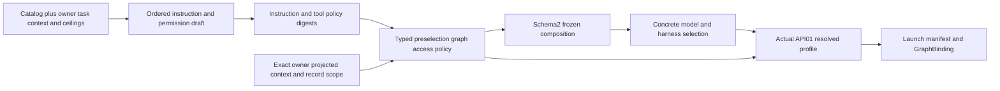

# AQ08 acyclic graph policy contract correction

`aq-profiles`0.1.1 adds native composition schema2 and `aq-selection`0.1.2
requires it for new selection. The legacy compiler and schema1 DTO remain for
inspection/replay, with original optional fields omitted exactly as before.
`select_legacy_for_inspection` is explicitly separate from the native selector.
The frozen installed-selection0.1.0 input/outcome and original catalog still
round-trip without changed values or canonical digests. Original server fixture
bytes remain at `selection.json`; current synthetic tests use a separate
`selection-v2.json` generated from actual draft compilation.

The dependency order is now:

`compile_draft` needs no profile digest, policy digest, or placeholder model.
The typed policy binds project/revision, repository/workspace/task, exact context
bytes and record scope, original context revision, effective permissions,
canonical ordered-instruction digest and tool-policy digest. Its artifact kind
is `preselection_graph_access_policy_v1`. Sealing produces
`graph_access_policy_digest` and typed kind in schema2; the old
`graph_access_profile_digest` is absent. Actual API01 profile bytes are produced
only after selection, using the genuine selected provider/model/native reasoning
and configuration reference. The profile's instruction/tool-policy hashes are
independent of the composition digest. Its final actual digest remains in the
runtime manifest and GraphBinding. No published session/agent API bytes change.

Policy scope uses canonical `project:<UUID>` and `repository:<UUID>` references.
Unsupported example aliases refuse explicitly. Every required projected task
record requires `task.read`; every knowledge record requires `knowledge.read`.
This is checked at sealing and again at resolved-profile derivation, including
pinned records. Mixed context cannot turn task-only permission into knowledge
access, or the reverse. Root, exact record set, edge endpoints/types and complete
required projection are checked against the supplied context bytes. The initial
native profile grants read capabilities only over this exact record projection;
repository writes remain a distinct source grant. Unknown permissions refuse.
Generic dynamic permission aliases and native graph mutation policy are not
implicitly granted by this correction.

Tests choose two different models on the same harness from one unchanged
composition/policy and derive two distinct actual API01 profiles. They also
refuse missing typed policy, mixed/denied record kinds, wrong project/repository,
unsupported aliases, changed context/instruction provenance and a schema1
composition submitted to native selection. These contract facts convey no live
authentication, source retention, credential delivery, or execution authority.
