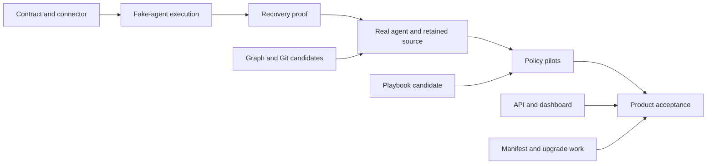

# Agent Q v2 implementation milestones

**Planning baseline:** 2026-10-30

This is the execution plan for the [implementation audit](../research/2026-10-30-v2-implementation-audit.md). The [JSON task graph](0001-v2-milestones.json) is the canonical planning source. This Markdown view is generated with `python3 scripts/check-v2-plan.py --render`; edit the JSON and regenerate it.

Repository planning format; not an AQ daemon import schema. No live tasks or issues are created by this file.

## How to execute this plan

Start with the ready tasks below. Before claiming a task, compare the [audit snapshot](../research/2026-10-30-implementation-audit-snapshot.json) with current work and identify any overlapping implementation. Qualify existing component code rather than rebuilding it. Pin contract/candidate revisions in each task's evidence.

depends_on contains hard prerequisites. Milestones group acceptance, not automatic start barriers. Ready means planned with all explicit dependencies complete; it is not permission to deploy or publish.

Each task has one owning repository. Contract work is reviewed by both endpoints, while integration gates are owned by agent-q. When a task is too broad after investigation, split it into bounded child tasks with explicit dependencies and keep the original gate dependent on them. A failed benchmark or newly discovered capability gap adds work to the graph; it is not grounds to mark a gate complete.

The original planning baseline completed AUD-00; current statuses below record subsequent implementation and qualification. Existing code and recorded tests are reusable evidence, not proof that the new product integration tasks have already passed. No elapsed-time estimates or staffing assumptions are encoded.

### Definition of done

- Implementation and tests reviewed in the owning repository against an immutable source revision.
- Acceptance evidence records exact commands, environment, artifact identity and remaining limits.
- Consume public interfaces only; no sibling private state or mandatory sibling source checkout.
- Update requirement evidence and dependent product pins when applicable. A passing component suite does not close a product gate.

### Design additions

- [0003-agent-profiles-harnesses-and-terminals.md](../architecture/0003-agent-profiles-harnesses-and-terminals.md): Required compositional agent/execution/intelligence profiles, explicit project bindings and provider selection, mandatory tmux for every real agent CLI, four qualified harnesses, and outbound-only remote terminal watch/control. M4 proves the first adapter; M6 requires all four and the browser terminal experience. Existing completed task evidence is unchanged.
- [0004-session-operations-waits-and-notifications.md](../architecture/0004-session-operations-waits-and-notifications.md): Required session peek/attach/nudge, transcript and usage accounting, bounded stall recovery, Discord notification delivery, escalation/digest policy and verified agent suspension/hibernation with cross-node wake. M5 mechanisms and M6 product qualification are mandatory; earlier completed evidence remains unchanged.

### V1 implementation evidence

Read the mapped source and regression cases before implementing an affected task. The pinned references inform the v2 contract; inventory inclusion is not passing v2 coverage. Normal builds and plan checks require no v1 checkout.

- [Reference guide](../research/2026-10-30-v1-implementation-reference-map.md) and [pinned symbol/test inventory](../research/2026-10-30-v1-implementation-reference-map.json).

### Ready work

| Task | Owner | Deliverable |
| --- | --- | --- |
| [WRK-05](#wrk-05) | aq-worker | Provision the AQ agent client and bounded context cache |
| [WRK-07](#wrk-07) | aq-worker | Implement resumable artifact handoff and retention release |
| [CON-03](#con-03) | aq-worker | Publish session observation and continuation contracts |
| [REL-01](#rel-01) | agent-q | Version the composite product manifest and component inventory |
| [AQ-21](#aq-21) | agent-q | Implement authorized terminal relay and controller leasing |
| [WRK-14](#wrk-14) | aq-worker | Implement the bounded outbound terminal bridge |

The daemon authority track can start after BASE-01 and CON-01. The worker runtime track follows connector extraction. Graph, Git and playbook qualification are independent early tracks; they are not artificial prerequisites for fake-agent execution. Dashboard work waits for a versioned inspection/action API, but does not wait for production deployment.

## Milestone outcomes

| Milestone | Acceptance gate | Observable result |
| --- | --- | --- |
| M0: Implementation audit and executable task plan | [AUD-00](#aud-00) | Evidence-labelled baseline and validated dependency graph. |
| M1: Execution contract and independently packaged connector | [GATE-01](#gate-01) | Compatible foundation connector extracted and consumed as a pinned artifact; execution contract shared by both sides. |
| M2: Minimal distributed fake-agent execution | [GATE-02](#gate-02) | One daemon and worker complete a durable synthetic assignment without duplicate launch. |
| M3: Recovery and cancellation proof | [GATE-03](#gate-03) | Ambiguous launch, restart, lease expiry, cancellation and late results remain safe and explicit. |
| M4: Real agent context, source handoff and graph outcome | [GATE-04](#gate-04) | One profile-resolved Codex CLI agent runs in guarded tmux, reads scoped context, edits a supported repository, hands source off and records a version-checked outcome. |
| M5: Policy-driven coding and operational workflows | [GATE-05](#gate-05) | Embedded playbooks invoke real AQ adapters for coding/review/check, routing, watcher and reporting pilot flows. Session health/stall policy, accounting, verified waits/hibernation and notification/escalation/digest services pass integration with designated fake external peers. |
| M6: Usable, measured and upgradeable product candidate | [GATE-06](#gate-06) | All four named harnesses, profile/session inspection and remote terminal control, exact-artifact assembly, upgrades, target-host recovery and a declared capacity envelope pass product acceptance. Session operations, actual external human delivery and retained cross-node wake pass INT-03. |

The milestone spine below is a summary. The task dependencies in the JSON are authoritative.



## Task graph

Requirements name implementation responsibility, not passing test coverage. E refers to ecosystem acceptance; X to shared failure scenarios; D to daemon requirements; W to worker requirements; U to dashboard acceptance; P to profile/intelligence requirements; H to harness/host requirements; R to remote terminal requirements; S to session observability/recovery; N to human notifications; C to agent waits/continuations.

### M0 overview

| Task | Owner | Hard prerequisites | Status |
| --- | --- | --- | --- |
| [AUD-00](#aud-00): Record implementation audit and validate the task graph | agent-q | None | complete |

### M1 overview

| Task | Owner | Hard prerequisites | Status |
| --- | --- | --- | --- |
| [BASE-01](#base-01): Qualify the existing foundation baseline | agent-q | [AUD-00](#aud-00) | complete |
| [CON-01](#con-01): Publish the execution contract and conformance fixtures | aq-worker | [AUD-00](#aud-00) | complete |
| [WRK-01](#wrk-01): Extract the foundation connector into aq-worker | aq-worker | [BASE-01](#base-01), [CON-01](#con-01) | complete |
| [AQ-01](#aq-01): Consume the standalone connector and remove duplicate ownership | agent-q | [WRK-01](#wrk-01) | complete |
| [INT-01](#int-01): Add reproducible integration assembly and explicit local overrides | agent-q | [AQ-01](#aq-01) | complete |
| [GATE-01](#gate-01): Accept contract and connector compatibility | agent-q | [INT-01](#int-01), [CON-01](#con-01), [BASE-01](#base-01) | complete |

### M2 overview

| Task | Owner | Hard prerequisites | Status |
| --- | --- | --- | --- |
| [AQ-02](#aq-02): Persist execution authority and immutable attempt inputs | agent-q | [BASE-01](#base-01), [CON-01](#con-01) | complete |
| [AQ-03](#aq-03): Implement worker exchanges and durable result dispositions | agent-q | [AQ-02](#aq-02) | complete |
| [WRK-02](#wrk-02): Implement local journal, capacity reservation and grant admission | aq-worker | [WRK-01](#wrk-01) | complete |
| [WRK-03](#wrk-03): Launch and report one deterministic fake agent | aq-worker | [WRK-02](#wrk-02) | complete |
| [AQ-04](#aq-04): Add test-only deterministic assignment scheduling | agent-q | [AQ-03](#aq-03) | complete |
| [GATE-02](#gate-02): Demonstrate minimal distributed execution | agent-q | [GATE-01](#gate-01), [AQ-04](#aq-04), [WRK-03](#wrk-03) | complete |

### M3 overview

| Task | Owner | Hard prerequisites | Status |
| --- | --- | --- | --- |
| [AQ-05](#aq-05): Implement cancellation, reconciliation and bounded retry policy | agent-q | [AQ-03](#aq-03) | complete |
| [WRK-04](#wrk-04): Prove process ownership, expiry and restart recovery | aq-worker | [WRK-03](#wrk-03) | complete |
| [GATE-03](#gate-03): Accept distributed recovery and cancellation | agent-q | [GATE-02](#gate-02), [AQ-05](#aq-05), [WRK-04](#wrk-04) | complete |

### M4 overview

| Task | Owner | Hard prerequisites | Status |
| --- | --- | --- | --- |
| [GRAPH-01](#graph-01): Qualify an immutable graph integration candidate | aq-graph | [AUD-00](#aud-00) | complete |
| [GIT-01](#git-01): Qualify and package an immutable Git integration candidate | aq-git | [AUD-00](#aud-00) | complete |
| [API-01](#api-01): Publish scoped agent API contracts | agent-q | [AQ-02](#aq-02), [GRAPH-01](#graph-01) | complete |
| [AQ-06](#aq-06): Implement session credentials and scoped graph reads | agent-q | [API-01](#api-01), [AQ-03](#aq-03) | complete |
| [AQ-07](#aq-07): Implement durable graph mutation delivery and recovery | agent-q | [AQ-06](#aq-06) | in_progress |
| [AQ-08](#aq-08): Schedule real graph candidates with explicit eligibility | agent-q | [AQ-04](#aq-04), [AQ-07](#aq-07), [GATE-03](#gate-03), [AQ-19](#aq-19), [AQ-20](#aq-20) | planned |
| [WRK-05](#wrk-05): Provision the AQ agent client and bounded context cache | aq-worker | [WRK-04](#wrk-04), [AQ-06](#aq-06), [CON-02](#con-02), [AQ-18](#aq-18) | planned |
| [WRK-06](#wrk-06): Integrate local aq-git workspaces and storage admission | aq-worker | [WRK-04](#wrk-04), [GIT-01](#git-01) | complete |
| [AQ-09](#aq-09): Implement authenticated source transfer and central retention | agent-q | [AQ-03](#aq-03), [GIT-01](#git-01) | complete |
| [WRK-07](#wrk-07): Implement resumable artifact handoff and retention release | aq-worker | [WRK-06](#wrk-06), [AQ-09](#aq-09) | planned |
| [WRK-08](#wrk-08): Qualify Codex CLI as the first real tmux harness | aq-worker | [WRK-05](#wrk-05), [WRK-06](#wrk-06), [GATE-03](#gate-03), [CON-02](#con-02), [WRK-10](#wrk-10), [AQ-20](#aq-20) | planned |
| [AQ-10](#aq-10): Apply evidence-based result disposition and graph completion | agent-q | [AQ-05](#aq-05), [AQ-07](#aq-07), [AQ-09](#aq-09) | planned |
| [CON-02](#con-02): Publish profile launch, harness capability and terminal contracts | aq-worker | [CON-01](#con-01), [API-01](#api-01) | complete |
| [AQ-18](#aq-18): Build the compositional profile catalog, compiler and explanation CLI | agent-q | [CON-02](#con-02) | complete |
| [AQ-19](#aq-19): Implement project execution bindings and policy administration | agent-q | [AQ-18](#aq-18), [AQ-03](#aq-03) | in_progress |
| [AQ-20](#aq-20): Resolve intelligence and execution choices with bounded provider availability | agent-q | [AQ-18](#aq-18), [AQ-19](#aq-19), [AQ-03](#aq-03) | planned |
| [WRK-10](#wrk-10): Implement the guarded tmux session host and reusable adapter interface | aq-worker | [CON-02](#con-02), [WRK-04](#wrk-04) | complete |
| [GATE-04](#gate-04): Demonstrate a real agent with retained source and graph outcome | agent-q | [GATE-03](#gate-03), [AQ-08](#aq-08), [AQ-10](#aq-10), [WRK-07](#wrk-07), [WRK-08](#wrk-08) | planned |

### M5 overview

| Task | Owner | Hard prerequisites | Status |
| --- | --- | --- | --- |
| [PB-01](#pb-01): Qualify the existing playbook implementation as a library candidate | aq-playbooks | [AUD-00](#aud-00) | complete |
| [AQ-11](#aq-11): Implement durable supervisor and agent messaging | agent-q | [AQ-03](#aq-03), [API-01](#api-01) | complete |
| [WRK-09](#wrk-09): Deliver messages through the real harness safely | aq-worker | [WRK-08](#wrk-08), [AQ-11](#aq-11) | planned |
| [AQ-17](#aq-17): Host bounded supervisor sessions centrally | agent-q | [AQ-11](#aq-11), [AQ-06](#aq-06), [AQ-18](#aq-18), [AQ-20](#aq-20), [WRK-08](#wrk-08), [WRK-10](#wrk-10) | planned |
| [AQ-12](#aq-12): Embed the qualified playbook runner with bounded execution | agent-q | [PB-01](#pb-01), [AQ-07](#aq-07) | planned |
| [AQ-13](#aq-13): Implement core work, context and operation host adapters | agent-q | [AQ-12](#aq-12), [AQ-08](#aq-08), [AQ-05](#aq-05), [AQ-11](#aq-11), [AQ-20](#aq-20) | planned |
| [AQ-14](#aq-14): Implement judgment, decision and check host adapters | agent-q | [AQ-13](#aq-13), [AQ-10](#aq-10), [AQ-17](#aq-17), [WRK-09](#wrk-09) | planned |
| [AQ-15](#aq-15): Implement candidate preparation and guarded publication policy | agent-q | [AQ-14](#aq-14), [AQ-09](#aq-09), [GIT-01](#git-01) | planned |
| [AQ-16](#aq-16): Implement findings reconciliation and durable calendar/report coordination | agent-q | [AQ-13](#aq-13), [AQ-14](#aq-14) | planned |
| [CON-03](#con-03): Publish session observation and continuation contracts | aq-worker | [CON-02](#con-02) | planned |
| [WRK-15](#wrk-15): Implement harness transcript readers and durable observation delivery | aq-worker | [CON-03](#con-03), [WRK-10](#wrk-10) | planned |
| [AQ-22](#aq-22): Implement session observations, transcript inspection and usage accounting | agent-q | [CON-03](#con-03), [AQ-03](#aq-03), [AQ-20](#aq-20) | planned |
| [AQ-23](#aq-23): Implement the evidence-based session stall ladder | agent-q | [AQ-22](#aq-22), [AQ-11](#aq-11), [WRK-09](#wrk-09), [AQ-05](#aq-05) | planned |
| [AQ-24](#aq-24): Implement durable external notification delivery with Discord | agent-q | [AQ-11](#aq-11), [CON-03](#con-03) | planned |
| [AQ-25](#aq-25): Implement verified agent waits and source subscriptions | agent-q | [CON-03](#con-03), [AQ-07](#aq-07), [AQ-11](#aq-11), [AQ-08](#aq-08) | planned |
| [WRK-16](#wrk-16): Implement safe suspension, checkpoint handoff and continuation bootstrap | aq-worker | [CON-03](#con-03), [WRK-07](#wrk-07), [WRK-10](#wrk-10), [WRK-05](#wrk-05) | planned |
| [AQ-26](#aq-26): Implement durable hibernation and continuation wake scheduling | agent-q | [AQ-25](#aq-25), [AQ-08](#aq-08), [AQ-09](#aq-09), [AQ-10](#aq-10), [AQ-22](#aq-22) | planned |
| [AQ-27](#aq-27): Integrate escalation, digest and wait policy with existing playbook commands | agent-q | [AQ-24](#aq-24), [AQ-16](#aq-16), [AQ-14](#aq-14), [AQ-23](#aq-23), [AQ-26](#aq-26) | planned |
| [GATE-05](#gate-05): Accept real policy-driven pilot workflows | agent-q | [GATE-04](#gate-04), [AQ-15](#aq-15), [AQ-16](#aq-16), [WRK-09](#wrk-09), [AQ-23](#aq-23), [AQ-27](#aq-27), [AQ-26](#aq-26), [WRK-15](#wrk-15), [WRK-16](#wrk-16) | planned |

### M6 overview

| Task | Owner | Hard prerequisites | Status |
| --- | --- | --- | --- |
| [PB-02](#pb-02): Establish the playbook storage and scheduling operating envelope | aq-playbooks | [PB-01](#pb-01) | in_progress |
| [API-02](#api-02): Expose task, attempt and workflow explanation views | agent-q | [AQ-10](#aq-10), [AQ-11](#aq-11), [AQ-12](#aq-12), [AQ-18](#aq-18), [AQ-20](#aq-20) | planned |
| [UI-01](#ui-01): Create the independent dashboard application and mock suite | aq-dashboard | [API-02](#api-02) | planned |
| [UI-02](#ui-02): Implement pending-safe actions and browser compatibility | aq-dashboard | [UI-01](#ui-01) | planned |
| [REL-01](#rel-01): Version the composite product manifest and component inventory | agent-q | [INT-01](#int-01), [GRAPH-01](#graph-01), [GIT-01](#git-01), [PB-01](#pb-01) | planned |
| [REL-02](#rel-02): Implement multi-component update and recovery orchestration | agent-q | [REL-01](#rel-01), [GATE-05](#gate-05) | planned |
| [REL-03](#rel-03): Package and verify the dashboard in the server release | agent-q | [REL-01](#rel-01), [UI-02](#ui-02), [UI-03](#ui-03), [UI-04](#ui-04) | planned |
| [PERF-01](#perf-01): Run the complete product capacity and recovery profile | agent-q | [GATE-05](#gate-05), [PB-02](#pb-02), [REL-03](#rel-03), [INT-02](#int-02), [INT-03](#int-03) | planned |
| [OPS-01](#ops-01): Qualify the deployment target and component recovery profile | agent-q | [BASE-01](#base-01), [REL-02](#rel-02), [REL-03](#rel-03), [GIT-01](#git-01), [GRAPH-01](#graph-01), [INT-02](#int-02), [INT-03](#int-03) | planned |
| [AQ-21](#aq-21): Implement authorized terminal relay and controller leasing | agent-q | [CON-02](#con-02), [AQ-03](#aq-03), [AQ-06](#aq-06) | planned |
| [WRK-11](#wrk-11): Qualify the Claude Code harness adapter | aq-worker | [CON-02](#con-02), [WRK-05](#wrk-05), [WRK-06](#wrk-06), [WRK-10](#wrk-10) | planned |
| [WRK-12](#wrk-12): Qualify the Gemini CLI harness adapter | aq-worker | [CON-02](#con-02), [WRK-05](#wrk-05), [WRK-06](#wrk-06), [WRK-10](#wrk-10) | planned |
| [WRK-13](#wrk-13): Qualify the OpenCode harness adapter | aq-worker | [CON-02](#con-02), [WRK-05](#wrk-05), [WRK-06](#wrk-06), [WRK-10](#wrk-10) | planned |
| [WRK-14](#wrk-14): Implement the bounded outbound terminal bridge | aq-worker | [CON-02](#con-02), [WRK-10](#wrk-10) | planned |
| [UI-03](#ui-03): Build profile/session inspection and terminal watch/control | aq-dashboard | [UI-01](#ui-01), [CON-02](#con-02) | planned |
| [INT-02](#int-02): Qualify composed profiles, four harnesses and remote terminals | agent-q | [GATE-04](#gate-04), [AQ-17](#aq-17), [AQ-21](#aq-21), [WRK-09](#wrk-09), [WRK-11](#wrk-11), [WRK-12](#wrk-12), [WRK-13](#wrk-13), [WRK-14](#wrk-14), [UI-03](#ui-03) | planned |
| [UI-04](#ui-04): Expose session health, accounting, waits and notification delivery | aq-dashboard | [UI-01](#ui-01), [CON-03](#con-03) | planned |
| [INT-03](#int-03): Qualify session operations, external delivery and cross-node hibernation | agent-q | [GATE-05](#gate-05), [INT-02](#int-02), [AQ-22](#aq-22), [AQ-23](#aq-23), [AQ-24](#aq-24), [AQ-25](#aq-25), [AQ-26](#aq-26), [AQ-27](#aq-27), [WRK-15](#wrk-15), [WRK-16](#wrk-16), [UI-04](#ui-04) | planned |
| [GATE-06](#gate-06): Accept a usable, measured and upgradeable AQ product candidate | agent-q | [GATE-05](#gate-05), [REL-02](#rel-02), [REL-03](#rel-03), [PERF-01](#perf-01), [OPS-01](#ops-01), [INT-02](#int-02), [INT-03](#int-03) | planned |

## Task contracts

### AUD-00

**Record implementation audit and validate the task graph**

Owner: `agent-q`. Milestone: M0. Kind: audit. Status: complete.

Hard prerequisites: None.

Inspect local source, test definitions and existing evidence; identify missing product behavior and hard dependencies.

Acceptance:

- Audit distinguishes implemented, recorded validation, partial, design-only and externally unverified behavior.
- Snapshot and graph are retained; all links, IDs, dependency edges, reachability and acyclicity validate.

Requirement links: E3.

Evidence: [2026-10-30-v2-implementation-audit.md](../research/2026-10-30-v2-implementation-audit.md), [2026-10-30-implementation-audit-snapshot.json](../research/2026-10-30-implementation-audit-snapshot.json), [0001-v2-milestones.json](0001-v2-milestones.json).

### BASE-01

**Qualify the existing foundation baseline**

Owner: `agent-q`. Milestone: M1. Kind: qualification. Status: complete.

Hard prerequisites: [AUD-00](#aud-00).

Select the current foundation revision and run its applicable Rust, PostgreSQL, connector and update-lifecycle checks; reconcile existing Phase 1 work before extraction.

Acceptance:

- Record exact revision, commands, outcomes and image identities; distinguish local evidence from hosted qualification.
- Retain compatibility fixtures for enrollment, heartbeat, probe, credential revocation, persisted identity and update state formats.

Requirement links: E4, E5, D8, W16.

Outside this task: Reimplementing working foundation features; Provisioning or changing a live deployment.

Evidence: [BASE-01.md](../implementation/BASE-01.md).

### CON-01

**Publish the execution contract and conformance fixtures**

Owner: `aq-worker`. Milestone: M1. Kind: implementation. Status: complete.

Hard prerequisites: [AUD-00](#aud-00).

Specify and implement wire schemas/types, explicit capability/version negotiation, replay identities, bounded exchanges, fake coordinator/worker fixtures and both-side review.

Acceptance:

- Fixtures cover changed-payload conflicts, grant/reservation expiry, observation sequencing, cancellation, retained-result reporting and reconciliation.
- Schema/type drift checks run standalone; foundation v1 meanings remain unchanged.

Requirement links: E1, E4, D2, D8, W2, W9, W16, W21, X1, X2, X6.

Evidence: [worker-candidate.md](../../../aq-worker/docs/implementation/worker-candidate.md), [execution-review.md](../implementation/execution-review.md), [worker-contracts.json](../../vendor/worker-contracts.json).

### WRK-01

**Extract the foundation connector into aq-worker**

Owner: `aq-worker`. Milestone: M1. Kind: implementation. Status: complete.

Hard prerequisites: [BASE-01](#base-01), [CON-01](#con-01).

Move compatible connector behavior into a standalone Rust workspace with published wire dependencies, configuration/identity continuity, independent CI and an immutable integration image.

Acceptance:

- Enrollment, reconnect, heartbeat and revocation tests run without the agent-q source checkout.
- Reusing an existing node configuration preserves identity; candidate artifact records exact source and dependency versions.

Requirement links: E1, E4, W12, W16, W21.

Outside this task: Launching agents during extraction; Changing foundation protocol semantics.

Evidence: [worker-candidate.md](../../../aq-worker/docs/implementation/worker-candidate.md), [connector-integration.md](../implementation/connector-integration.md), [worker-candidate.json](../../vendor/worker-candidate.json).

### AQ-01

**Consume the standalone connector and remove duplicate ownership**

Owner: `agent-q`. Milestone: M1. Kind: implementation. Status: complete.

Hard prerequisites: [WRK-01](#wrk-01).

Update development, smoke and release wiring to use the pinned worker candidate and shared public wire contract; retire the duplicate production connector source after compatibility passes.

Acceptance:

- Existing enroll/heartbeat/restart/revoke smoke passes with the standalone artifact.
- Normal AQ builds no longer require an in-tree worker implementation or sibling source path.

Requirement links: E1, E4, E7, D8, W16.

Evidence: [connector-integration.md](../implementation/connector-integration.md), [connector-integration.evidence.json](../implementation/connector-integration.evidence.json), [execution-review.md](../implementation/execution-review.md).

### INT-01

**Add reproducible integration assembly and explicit local overrides**

Owner: `agent-q`. Milestone: M1. Kind: implementation. Status: complete.

Hard prerequisites: [AQ-01](#aq-01).

Provide a small product fixture selecting exact server/worker artifacts and contract versions, with reusable slots for later graph/Git/playbook dependencies.

Acceptance:

- One documented command assembles an isolated fixture without changing developer or production state.
- Official candidate inputs reject floating references/local overrides; explicit development overrides identify their source.

Requirement links: E1, E2, E7.

Outside this task: Requiring all component source checkouts; Completing the composite updater.

Evidence: [connector-integration.md](../implementation/connector-integration.md), [connector-integration.evidence.json](../implementation/connector-integration.evidence.json), [execution-review.md](../implementation/execution-review.md).

### GATE-01

**Accept contract and connector compatibility**

Owner: `agent-q`. Milestone: M1. Kind: gate. Status: complete.

Hard prerequisites: [INT-01](#int-01), [CON-01](#con-01), [BASE-01](#base-01).

Run both-side contract checks and the existing foundation lifecycle using the pinned standalone worker.

Acceptance:

- Exact-artifact enrollment, reconnect and revocation pass; unsupported execution is declined while allowed foundation connectivity remains visible.
- Publish the tested contract/candidate references for downstream tasks.

Requirement links: E1, E4, D8, W16, W21.

Evidence: [connector-integration.md](../implementation/connector-integration.md), [connector-integration.evidence.json](../implementation/connector-integration.evidence.json), [execution-review.md](../implementation/execution-review.md).

### GRAPH-01

**Qualify an immutable graph integration candidate**

Owner: `aq-graph`. Milestone: M4. Kind: qualification. Status: complete.

Hard prerequisites: [AUD-00](#aud-00).

Reuse the existing service; select an exact candidate, reproduce current contract/storage checks, and document receipt, principal, API and schema compatibility for AQ.

Acceptance:

- Retain current tests and an isolated backup/restore result for the selected artifact; do not substitute old benchmark evidence.
- Consumer contract documents version conflicts, identical-key replay, credential lifecycle and receipt retention; versioned image is reproducible.

Requirement links: E1, E2, D5, D6.

Outside this task: Offline replicas; V1 migration; Execution claims in aq-graph.

Evidence: [GRAPH-01.md](../../../aq-graph/docs/implementation/GRAPH-01.md).

### GIT-01

**Qualify and package an immutable Git integration candidate**

Owner: `aq-git`. Milestone: M4. Kind: qualification. Status: complete.

Hard prerequisites: [AUD-00](#aud-00).

Preserve the current implementation, select a committed candidate, verify correctness/process handoff and package a checksummed executable with honest profile/compatibility limits.

Acceptance:

- Run the retained-source worker-loss scenario and current required correctness checks against the candidate.
- Manifest ties binary to build/source; unsupported repository features are explicit and rejected; remaining performance, host-power-loss and hosted-transport gates remain named.

Requirement links: E1, E2, W7, X12.

Outside this task: Claiming local process tests certify host power loss; Adding every unsupported Git feature.

Evidence: [GIT-01.md](../../../aq-git/docs/implementation/GIT-01.md).

### PB-01

**Qualify the existing playbook implementation as a library candidate**

Owner: `aq-playbooks`. Milestone: M5. Kind: qualification. Status: complete.

Hard prerequisites: [AUD-00](#aud-00).

Reconcile concurrent implementation work, select the revision beyond the design-only commit, qualify library/CLI artifacts and current core/PostgreSQL/pilot evidence, and publish the Host/storage contract.

Acceptance:

- Database-free tests and explicitly enabled isolated PostgreSQL tests pass on the selected candidate.
- Limits and evidence for synchronous storage, snapshot/index/retention behavior, exact pins, join typing, optional protection and host-only functionality are included in compatibility metadata; the old test report does not certify new code.

Requirement links: E1, E2.

Outside this task: Rewriting the engine; Claiming fake-host pilots are AQ integration.

Evidence: [PB-01.md](../../../aq-playbooks/docs/implementation/PB-01.md).

### AQ-02

**Persist execution authority and immutable attempt inputs**

Owner: `agent-q`. Milestone: M2. Kind: implementation. Status: complete.

Hard prerequisites: [BASE-01](#base-01), [CON-01](#con-01).

Add migrations and transactional transitions for attempts, sessions, node incarnations, offers, generations, grants and resolved specification digests.

Acceptance:

- Concurrent claims/acceptances cannot grant conflicting authority; duplicate IDs with different bytes fail.
- Restart preserves authority and deadlines; state-format/recovery rules are updated with the migration.

Requirement links: D1, D2, W9, W10, X1, X2, X8.

Evidence: [execution-authority.md](../implementation/execution-authority.md), [execution-validation.json](../implementation/execution-validation.json), [execution-review.md](../implementation/execution-review.md).

### AQ-03

**Implement worker exchanges and durable result dispositions**

Owner: `agent-q`. Milestone: M2. Kind: implementation. Status: complete.

Hard prerequisites: [AQ-02](#aq-02).

Implement incarnation registration, bounded poll/accept/decline, renewal, sequenced progress and immutable report admission with fake-worker tests.

Acceptance:

- Lost acceptance/report acknowledgements return original committed dispositions without duplicate launches or outcomes.
- Stale boot/generation and expired local reservation reports cannot settle a current attempt.

Requirement links: D1, D2, D3, D8, W2, W9, W10, X1, X2, X7.

Evidence: [execution-authority.md](../implementation/execution-authority.md), [execution-validation.json](../implementation/execution-validation.json), [execution-review.md](../implementation/execution-review.md).

### WRK-02

**Implement local journal, capacity reservation and grant admission**

Owner: `aq-worker`. Milestone: M2. Kind: implementation. Status: complete.

Hard prerequisites: [WRK-01](#wrk-01).

Add versioned durable records, exclusive runtime ownership, bounded node-wide resource reservations and acceptance/grant validation using the fake coordinator.

Acceptance:

- Crash/replay and racing offers cannot over-allocate capacity; durable state survives full-disk/write-failure injection.
- Late grants cannot resurrect expired reservations; no project-by-slot preallocation is introduced.

Requirement links: W3, W4, W5, W9, W15, W17, X1, X2.

Evidence: [worker-candidate.md](../../../aq-worker/docs/implementation/worker-candidate.md), [connector-integration.md](../implementation/connector-integration.md), [worker-candidate.json](../../vendor/worker-candidate.json).

### WRK-03

**Launch and report one deterministic fake agent**

Owner: `aq-worker`. Milestone: M2. Kind: implementation. Status: complete.

Hard prerequisites: [WRK-02](#wrk-02).

Implement a deterministic harness/execution adapter and journaled launch identity, phase observations, writer-stop proof and report retry.

Acceptance:

- Fixture process completes through collecting/reporting/acknowledgement with one session per attempt.
- Launch-window uncertainty never causes blind relaunch; confirmed stopped writers are required before resource reuse.

Requirement links: W9, W10, W14, W17, X1, X3.

Evidence: [worker-candidate.md](../../../aq-worker/docs/implementation/worker-candidate.md), [connector-integration.md](../implementation/connector-integration.md), [worker-candidate.json](../../vendor/worker-candidate.json).

### AQ-04

**Add test-only deterministic assignment scheduling**

Owner: `agent-q`. Milestone: M2. Kind: implementation. Status: complete.

Hard prerequisites: [AQ-03](#aq-03).

Drive the initial execution fixture from explicitly preapproved synthetic task/context inputs and deterministic compatible-node selection.

Acceptance:

- Fixture assignments use production authority transitions and worker local admission.
- Synthetic task provider is excluded from production configuration and cannot imply graph completion.

Requirement links: D1, W4, W5, W13.

Outside this task: Production graph-ready scheduling; Optimized fleet placement.

Evidence: [execution-authority.md](../implementation/execution-authority.md), [execution-validation.json](../implementation/execution-validation.json), [execution-review.md](../implementation/execution-review.md).

### GATE-02

**Demonstrate minimal distributed execution**

Owner: `agent-q`. Milestone: M2. Kind: gate. Status: complete.

Hard prerequisites: [GATE-01](#gate-01), [AQ-04](#aq-04), [WRK-03](#wrk-03).

Extend the product fixture to run the deterministic fake agent through actual daemon/worker transport and persisted state.

Acceptance:

- One assignment completes; repeated polls, lost acceptance response and lost report acknowledgement do not create duplicate execution.
- Retain an executable demonstration with exact images, logs and correlation IDs; no model provider is required.

Requirement links: E3, D2, W9, X1, X2.

Evidence: [connector-integration.md](../implementation/connector-integration.md), [connector-integration.evidence.json](../implementation/connector-integration.evidence.json), [execution-review.md](../implementation/execution-review.md).

### AQ-05

**Implement cancellation, reconciliation and bounded retry policy**

Owner: `agent-q`. Milestone: M3. Kind: implementation. Status: complete.

Hard prerequisites: [AQ-03](#aq-03).

Serialize cancellation/result eligibility, persist directives and retry lineage/budgets, reconcile old boots/grants and keep uncertain attempts visible.

Acceptance:

- Cancellation/completion races and late superseded reports have stable outcomes; expiry never proves physical termination.
- Daemon restart replays outstanding intents without extending old grants; unsafe overlapping attempts remain held.

Requirement links: D1, D2, D3, D9, W10, W17, X5, X6, X7, X8, X9.

Evidence: [execution-authority.md](../implementation/execution-authority.md), [execution-validation.json](../implementation/execution-validation.json), [execution-review.md](../implementation/execution-review.md).

### WRK-04

**Prove process ownership, expiry and restart recovery**

Owner: `aq-worker`. Milestone: M3. Kind: implementation. Status: complete.

Hard prerequisites: [WRK-03](#wrk-03).

Implement discoverable process ownership across parent-only crashes, suspend-aware grant deadlines, stop escalation, reattachment checks and drain recovery.

Acceptance:

- Inject crashes before/after spawn and restart with surviving descendants; uncertain writers keep reservations/workspaces protected.
- Expiry/revocation stops execution; reattachment requires renewed authority; new execution uses a new attempt/session.

Requirement links: W8, W9, W10, W11, W14, W17, X3, X4, X5, X9, X11.

Outside this task: Live reattachment, whole-container/PID-namespace recovery without durable stop evidence, external-service writers and hostile process/file manipulation.; Physical suspend/power-loss and real harness/source retention qualification remain later integration/target-host work..

Evidence: [recovery-qualification.md](../implementation/recovery-qualification.md), [recovery-qualification.json](../implementation/recovery-qualification.json), [recovery-matrix.json](../implementation/recovery-matrix.json), [recovery-validation.json](../implementation/recovery-validation.json).

### GATE-03

**Accept distributed recovery and cancellation**

Owner: `agent-q`. Milestone: M3. Kind: gate. Status: complete.

Hard prerequisites: [GATE-02](#gate-02), [AQ-05](#aq-05), [WRK-04](#wrk-04).

Inject transport loss, cancellation races, daemon/worker restarts and expired authority against the real execution fixture.

Acceptance:

- X1-X3 and X5-X9 pass with explicit uncertainty; no duplicate settlement or unsafe reuse.
- Control requests retain capacity under synthetic transfer load; injected failures are repeatable without wall-clock sleep races.

Requirement links: E3, D3, D7, W17, X1, X2, X3, X5, X6, X7, X8, X9, X14.

Outside this task: Qualification is the cooperative Linux guardian synthetic execution profile with runtime-process restart; guardian loss retains uncertainty.; Real graph/Git delivery, production harnesses, physical suspend/power loss and fleet capacity remain M4-M6 gates..

Evidence: [recovery-qualification.md](../implementation/recovery-qualification.md), [recovery-qualification.json](../implementation/recovery-qualification.json), [recovery-matrix.json](../implementation/recovery-matrix.json), [recovery-validation.json](../implementation/recovery-validation.json).

### API-01

**Publish scoped agent API contracts**

Owner: `agent-q`. Milestone: M4. Kind: implementation. Status: complete.

Hard prerequisites: [AQ-02](#aq-02), [GRAPH-01](#graph-01).

Define versioned graph context/search/mutation and operation-status schemas, capability scopes, provenance, expected versions, node recovery and CLI client contracts.

Acceptance:

- Schema fixtures cover every batch/edge/context scope and pending/conflict/confirmed distinction.
- No raw arbitrary graph proxy or worker graph credential is required; public contract supports independently generated clients.

Requirement links: D4, D5, D6, D9, W18, W19, W20.

Evidence: [API-01.md](../implementation/API-01.md), [API-01.json](../implementation/API-01.json), [recovery-validation.json](../implementation/recovery-validation.json).

### AQ-06

**Implement session credentials and scoped graph reads**

Owner: `agent-q`. Milestone: M4. Kind: implementation. Status: complete.

Hard prerequisites: [API-01](#api-01), [AQ-03](#aq-03).

Provision protected per-attempt credentials, enforce current generation/expiry/revocation, and expose bounded authorized context/search/revision reads through the graph service.

Acceptance:

- Search snippets, pagination, context expansion and relationship endpoints cannot leak out-of-scope data.
- Cached context is revision-labelled; worker/node/graph service identities cannot be substituted for agent authority.

Requirement links: D4, D9, W1, W18, W19, X5, X11.

Evidence: [m4-foundations.md](../implementation/m4-foundations.md), [m4-qualification.md](../implementation/m4-qualification.md), [m4-validation.json](../implementation/m4-validation.json), [m4-source-mapping.json](../implementation/m4-source-mapping.json), [aq06-agent-access.md](../qualification/aq06-agent-access.md), [m4-graph-qualification.json](../implementation/m4-graph-qualification.json).

### AQ-07

**Implement durable graph mutation delivery and recovery**

Owner: `agent-q`. Milestone: M4. Kind: implementation. Status: in_progress.

Hard prerequisites: [AQ-06](#aq-06).

Persist authorized immutable graph intent, expected versions and idempotency keys; reconcile uncertain outcomes, produce confirmed outbox events and expose bounded operation lookup.

Acceptance:

- Commit-before-response-loss replays the identical intent without duplicate graph history; version conflict never becomes blind overwrite.
- Cancelled/expired sessions cannot admit new writes; node recovery can inspect existing attempt operations without renewed agent mutation access.

Requirement links: D2, D4, D5, D6, W20, X10, X11.

### AQ-08

**Schedule real graph candidates with explicit eligibility**

Owner: `agent-q`. Milestone: M4. Kind: implementation. Status: planned.

Hard prerequisites: [AQ-04](#aq-04), [AQ-07](#aq-07), [GATE-03](#gate-03), [AQ-19](#aq-19), [AQ-20](#aq-20).

Replace test-only task input with bounded graph-ready/context queries and central eligibility/priority/locality decisions; preserve independent local admission.

Acceptance:

- Readiness alone never claims execution; admitted revisions are recorded and invalidating changes prevent stale settlement.
- Multiple projects share capacity, cold eligible nodes can prepare work, and decisions/refusals expose reasons without full Git scans.
- Schedule only against a current explicit project binding and sealed profile/intelligence selection; unsupported or changed inputs refuse without silently selecting a weaker configuration.

Requirement links: D1, D6, D9, W3, W4, W5, W13, P2, P4, P5, P6, P7.

### WRK-05

**Provision the AQ agent client and bounded context cache**

Owner: `aq-worker`. Milestone: M4. Kind: implementation. Status: planned.

Hard prerequisites: [WRK-04](#wrk-04), [AQ-06](#aq-06), [CON-02](#con-02), [AQ-18](#aq-18).

Package the compatible AQ client, supply protected per-session credential bindings and labelled context snapshots, and handle expired/uncertain request responses.

Acceptance:

- Fake AQ API tests run without the daemon or graph; session/node credential separation is preserved.
- Offline proposed edits are never reported as applied; runtime can recover known or centrally listed attempt operations without renewing agent writes.
- Provision the digest-bound composed startup/reference context and scoped AQ tool adapter; required context cannot be silently truncated and an access profile cannot be confused with an execution profile.

Requirement links: W18, W19, W20, X10, X11, P2, P4, P8.

### WRK-06

**Integrate local aq-git workspaces and storage admission**

Owner: `aq-worker`. Milestone: M4. Kind: implementation. Status: complete.

Hard prerequisites: [WRK-04](#wrk-04), [GIT-01](#git-01).

Consume the qualified binary through its public local API for base import, on-demand workspace, checkpoint, retention and safe cache eviction.

Acceptance:

- All ambiguous calls reuse operation IDs; writers stop before checkpoint/retirement.
- Alternating projects and disk pressure preserve active/pending data, bound caches and refuse new work when protected storage fills.

Requirement links: W3, W6, W7, W8, W14, W15, X4.

Evidence: [m4-foundations.md](../implementation/m4-foundations.md), [m4-qualification.md](../implementation/m4-qualification.md), [m4-validation.json](../implementation/m4-validation.json), [m4-source-mapping.json](../implementation/m4-source-mapping.json), [source-workspaces.md](../../../aq-worker/docs/source-workspaces.md), [m4-recovery-qualification.json](../implementation/m4-recovery-qualification.json).

### AQ-09

**Implement authenticated source transfer and central retention**

Owner: `agent-q`. Milestone: M4. Kind: implementation. Status: complete.

Hard prerequisites: [AQ-03](#aq-03), [GIT-01](#git-01).

Implement bounded attempt/repository-scoped artifact endpoints, staging, central aq-git import and retained receipts distinct from upload acknowledgements.

Acceptance:

- Server maps trusted assignment metadata to allowed Git operations and rejects arbitrary worker paths/URLs/commands.
- Stale attempts may retain authorized recovery source but cannot restore execution authority or settle newer work.

Requirement links: D2, D3, W7, W8, W9, X7, X12.

Evidence: [m4-foundations.md](../implementation/m4-foundations.md), [m4-qualification.md](../implementation/m4-qualification.md), [m4-validation.json](../implementation/m4-validation.json), [m4-source-mapping.json](../implementation/m4-source-mapping.json), [source-retention.md](../source-retention.md), [m4-git-package.json](../evidence/m4-git-package.json), [m4-source-retention-tests.log](../evidence/m4-source-retention-tests.log).

### WRK-07

**Implement resumable artifact handoff and retention release**

Owner: `aq-worker`. Milestone: M4. Kind: implementation. Status: planned.

Hard prerequisites: [WRK-06](#wrk-06), [AQ-09](#aq-09).

Add authenticated download/upload, offsets/digests, checkpoint receipts, result attachment and safe local retirement using separate transfer budgets.

Acceptance:

- Restart mid-checkpoint/upload/report preserves IDs and required data; transport success is never central retention.
- Central retention survives deletion of stopped worker storage; full pending-result storage blocks admission without blocking control.

Requirement links: W7, W8, W9, W14, W15, X4, X12, X14.

### WRK-08

**Qualify Codex CLI as the first real tmux harness**

Owner: `aq-worker`. Milestone: M4. Kind: implementation. Status: planned.

Hard prerequisites: [WRK-05](#wrk-05), [WRK-06](#wrk-06), [GATE-03](#gate-03), [CON-02](#con-02), [WRK-10](#wrk-10), [AQ-20](#aq-20).

Select and pin one Codex CLI/model configuration, implement its adapter on the guarded tmux host, consume the frozen composed launch manifest and prove initial AQ context/tools, process outcome, worktree confinement and explicit folder-grant refusal.

Acceptance:

- Mock configuration tests run without live credentials; exact adapter/CLI versions and required/optional capabilities are recorded. No harness-specific copy of shared role instructions is required.
- Real Codex CLI compatibility proves launch, terminal-ready tmux hosting, stop with guardian evidence, scoped AQ reads and confined source edits. Live reattachment stays explicitly unsupported unless separately qualified; no token appears in prompts/argv/logs.
- Publish session source identities and parser/usage capability fixtures for WRK-15; INT-03 qualifies the extended transcript/accounting matrix without claiming it from launch/terminal evidence alone.
- Integrate the public profiled tmux host with separately typed worker journal/process evidence and any required versioned migration; never coerce new host stop proof into the legacy guardian record. Qualify retention and recovery before advertising profiled launches.

Requirement links: W1, W6, W11, W17, W18, P2, P4, P5, P8, H1, H2, H3, H4.

Outside this task: Closing all-harness product acceptance (WRK-11/12/13 and INT-02 own it); Claiming hostile-code isolation or live reattachment from tmux persistence.

### AQ-10

**Apply evidence-based result disposition and graph completion**

Owner: `agent-q`. Milestone: M4. Kind: implementation. Status: planned.

Hard prerequisites: [AQ-05](#aq-05), [AQ-07](#aq-07), [AQ-09](#aq-09).

Connect immutable worker reports and retained source to pinned outcome/evidence contracts and an authorized version-checked task completion operation.

Acceptance:

- Success text/exit status alone cannot complete a task; stale revisions or cancelled-before-acceptance attempts cannot auto-settle.
- Graph completion remains pending until confirmed; crash/replay emits one logical completion event.

Requirement links: D3, D5, D6, D9, X6, X7, X10, X12.

### CON-02

**Publish profile launch, harness capability and terminal contracts**

Owner: `aq-worker`. Milestone: M4. Kind: implementation. Status: complete.

Hard prerequisites: [CON-01](#con-01), [API-01](#api-01).

Publish bounded launch-manifest and worker terminal schemas/types with canonical digests, adapter capability/version declarations, controller fencing, output epochs/sequences and replay dispositions; coordinate human profile/terminal API schemas owned by agent-q.

Acceptance:

- Both endpoints consume pinned fixtures for canonicalization, same-ID conflicts, unknown capabilities, authority/lease expiry, input uncertainty and snapshot/replay boundaries.
- Existing foundation behavior and old fixture digests remain compatible; API-01 access profiles are not reused as agent/intelligence/execution profiles. Unsupported new launches decline explicitly.

Requirement links: P2, P4, P5, P8, H1, H4, R1, R2, R3, R4.

Outside this task: Runtime profile resolver, relay or terminal implementation.

Evidence: [con02-session-contracts.md](../implementation/con02-session-contracts.md).

### AQ-18

**Build the compositional profile catalog, compiler and explanation CLI**

Owner: `agent-q`. Milestone: M4. Kind: implementation. Status: complete.

Hard prerequisites: [CON-02](#con-02).

Implement a small independently tested Rust profile crate, TOML/Markdown catalog validation and immutable activation artifacts; deterministically compose behavior/capability packs, intelligence/execution definitions and scoped context. Add typed inspection API and aq profile validate/explain CLI consumers.

Acceptance:

- Golden manifests prove deterministic order/digests, identity-based deduplication, cycle/version/conflict rejection, explicit overrides, permission ceilings and required-context overflow refusal without live providers or a database in core tests.
- Activation is revision-checked, invalid edits preserve the old catalog, active attempts retain exact revisions, and explanations expose provenance/omissions without secrets. Required denied tools cannot silently disappear.
- Seed implementer/reviewer/researcher/supervisor recipes reuse shared instruction/pack identities across harnesses; unavailable required adapters keep recipes ineligible rather than producing misleading working defaults.
- Define an optional dependency-wait capability pack for scoped wait register/checkpoint/show/ack tools and end-turn/bootstrap instructions; keep it ineligible until the M5 adapters exist, without blocking the M4 baseline recipe or granting operator recovery rights.

Requirement links: P1, P2, P3, P4, P5, P8, H4, C1, C6.

Outside this task: A second editable profile database, deep inheritance, runtime LLM composition, arbitrary executable pack hooks.

Evidence: [AQ-18.md](../implementation/AQ-18.md), [AQ-18.json](../implementation/AQ-18.json).

### AQ-19

**Implement project execution bindings and policy administration**

Owner: `agent-q`. Milestone: M4. Kind: implementation. Status: in_progress.

Hard prerequisites: [AQ-18](#aq-18), [AQ-03](#aq-03).

Add revisioned central project records referencing public repository binding/generation and graph workspace identities, allowed profiles, worker eligibility groups, policy/context revisions and budget ceilings; provide bounded authenticated administration/inspection operations.

Acceptance:

- An operator can bind an existing supported repository and graph workspace without editing private component state; absent, stale or unauthorized bindings prevent scheduling with explicit reasons.
- Updates use expected revisions, profile activation does not mutate running attempts, and project records never become a second task lifecycle store. Required node/environment restrictions remain centrally controlled.

Requirement links: P4, P6, D1, W4.

Outside this task: Clone/init/create-GitHub onboarding wizard, copying graph records, per-project preallocated worktree slots.

### AQ-20

**Resolve intelligence and execution choices with bounded provider availability**

Owner: `agent-q`. Milestone: M4. Kind: implementation. Status: planned.

Hard prerequisites: [AQ-18](#aq-18), [AQ-19](#aq-19), [AQ-03](#aq-03).

Implement deterministic compatible candidate selection from intelligence/execution profiles, project revisions, node capabilities and timestamped provider observations. Record decision traces; add manual observations, structured failure feedback, cooldown and explicit fallback/stale-data policy.

Acceptance:

- Fake clocks/providers prove missing credentials, quota unavailability, unsupported settings, stale/unknown observations, deterministic ties and no-permissible-fallback behavior without provider calls during scheduling.
- Freeze concrete choices before offers, recheck sensitive revisions at admission, and require safely reconciled replacement attempts for fallback after launch. Shared retry/budget counters cannot reset; unsupported hard limits refuse.
- Provider observations are scoped to the relevant account/credential profile and endpoint/model; a single node failure cannot disable unrelated accounts or authorize a new provider.
- Define the accounting/budget-provider interface for AQ-22; final qualification consumes ledger completeness and shared lineage totals. Bootstrap policies cannot claim unsupported hard cost enforcement.

Requirement links: P5, P6, P7, D1, D9, W4, S3.

Outside this task: Implicit provider/model downgrades, automatic quota-probe adapters, editing live attempt configuration.

### WRK-10

**Implement the guarded tmux session host and reusable adapter interface**

Owner: `aq-worker`. Milestone: M4. Kind: implementation. Status: complete.

Hard prerequisites: [CON-02](#con-02), [WRK-04](#wrk-04).

Build a small public Rust session-host crate and worker integration: attempt-owned private tmux server/socket/pane, immutable local launch checks, guardian ancestry/expiry, common lifecycle and typed adapter interface. Support central consumption without importing node scheduling/private state.

Acceptance:

- Actual tmux with a synthetic interactive child passes launch-boundary crashes, server/pane identity collisions, daemonization/adopted descendants, expiry/cancellation and guardian-loss uncertainty tests.
- No shared existing tmux server, pane exit or terminal EOF substitutes for stopped-writer proof; browser detach/reconnect never stops or relaunches execution, and post-exit inspection cannot spawn a shell.
- Independent component tests require no daemon/database/provider credentials; record host resource cost and public package/version compatibility.

Requirement links: H1, H3, H4, W11, W14, X3, X5, R4.

Outside this task: Live execution reattachment, real provider adapter qualification, terminal network relay.

Evidence: [WRK-10.md](../../../aq-worker/docs/implementation/WRK-10.md), [WRK-10.json](../../../aq-worker/docs/implementation/WRK-10.json).

### GATE-04

**Demonstrate a real agent with retained source and graph outcome**

Owner: `agent-q`. Milestone: M4. Kind: gate. Status: planned.

Hard prerequisites: [GATE-03](#gate-03), [AQ-08](#aq-08), [AQ-10](#aq-10), [WRK-07](#wrk-07), [WRK-08](#wrk-08).

Run one supported repository/task through actual agent context access, code change, source handoff, result policy and confirmed graph mutation.

Acceptance:

- Delete stopped worker data after central retention and show the result remains usable; inject a lost graph response.
- Observe explicit authorization/version checks and retain exact source/evidence identities without a worker graph database.
- The first real agent uses a frozen composed profile and explicit project/intelligence selection inside the qualified tmux host. This gate covers Codex CLI; INT-02 is required for the four-harness/remote-terminal product claim.

Requirement links: E3, D4, D5, D6, W7, W18, W19, W20, X4, X10, X12, P2, P4, P5, P6, P8, H1, H3.

### AQ-11

**Implement durable supervisor and agent messaging**

Owner: `agent-q`. Milestone: M5. Kind: implementation. Status: complete.

Hard prerequisites: [AQ-03](#aq-03), [API-01](#api-01).

Add scoped task/session mailboxes, durable delivery IDs/cursors and acknowledgement states separate from typed cancellation directives.

Acceptance:

- Old-session messages cannot land in a reused slot; sender/recipient scopes are authenticated.
- Replay distinguishes received, handed-to-harness, unknown and stale delivery; replies cannot impersonate another session.
- Task mailboxes and exclusive thread cursors can feed verified waits; session-addressed mail never silently retargets a successor. Logical message acceptance is separate from notification transport delivery.

Requirement links: D2, D9, W1, W9, X13, N1, C4.

Evidence: [AQ-11.md](../implementation/AQ-11.md), [AQ-11.json](../implementation/AQ-11.json).

### WRK-09

**Deliver messages through the real harness safely**

Owner: `aq-worker`. Milestone: M5. Kind: implementation. Status: planned.

Hard prerequisites: [WRK-08](#wrk-08), [AQ-11](#aq-11).

Persist mailbox receipt, integrate input at supported harness boundaries and report ambiguous injection without automatic duplicate delivery.

Acceptance:

- Crash between injection and acknowledgement yields explicit uncertainty unless harness IDs prove deduplication.
- Cancellation and renewals remain responsive during chat/log/transfer activity.
- Use declared native-message or authorized-inbox capabilities for each harness; ordinary messages cannot silently become raw keystrokes or controller authority.
- Nudge delivery arbitrates with exclusive human terminal control and suspension, returning deferred/unknown/unsupported rather than typing into an unsafe composer; inbox fallback is explicit.

Requirement links: W1, W9, W11, W17, X13, X14, H2, R2, R3, S1, S5, C2.

### AQ-17

**Host bounded supervisor sessions centrally**

Owner: `agent-q`. Milestone: M5. Kind: implementation. Status: planned.

Hard prerequisites: [AQ-11](#aq-11), [AQ-06](#aq-06), [AQ-18](#aq-18), [AQ-20](#aq-20), [WRK-08](#wrk-08), [WRK-10](#wrk-10).

Implement the first central supervisor/assessment execution adapter with resolved role configuration, isolated provider credentials and normal AQ message/API access.

Acceptance:

- Supervisor communicates with remote sessions through durable messaging without entering a worker node.
- Bounded session cancellation/results and credential separation are tested; no supervisor secret is provisioned to workers.
- Central supervisor CLI sessions use the same pinned host/adapter libraries with central expiring session authority and private credentials, without pretending to be a remote worker. Stop and restart uncertainty are tested.
- Central sessions expose observation/nudge and suspend/wake integration seams through public host modules and central permits; complete operations qualification is INT-03.

Requirement links: D4, W1, X11, X13, P2, P4, P5, H1, H3, H4, C6, S1, S2.

Outside this task: General supervisor autonomy or all v1 profiles.

### AQ-12

**Embed the qualified playbook runner with bounded execution**

Owner: `agent-q`. Milestone: M5. Kind: implementation. Status: planned.

Hard prerequisites: [PB-01](#pb-01), [AQ-07](#aq-07).

Pin runner/compiler/storage libraries, bind host authority and outbox input, and isolate synchronous storage/host work from async control handlers.

Acceptance:

- Exclusive ownership, startup/restart recovery, immutable artifacts and activation are integrated without reading AQ tables from the engine.
- A blocked storage/host operation cannot stall lease renewal or cancellation; synthetic host commands are not registered as production adapters.

Requirement links: E1, D2, D6, D7, X8, X14.

### AQ-13

**Implement core work, context and operation host adapters**

Owner: `agent-q`. Milestone: M5. Kind: implementation. Status: planned.

Hard prerequisites: [AQ-12](#aq-12), [AQ-08](#aq-08), [AQ-05](#aq-05), [AQ-11](#aq-11), [AQ-20](#aq-20).

Register context.read, work.ensure, work.change, operation.get, operation.cancel and message.send against typed AQ services with durable request IDs and finite contracts.

Acceptance:

- Work creation and completion have distinct dispositions; retries cannot create another task/attempt or widen authority.
- Host contract fixtures exercise scoped context, owned cancellation, pending effects and exact revision conflicts.
- Execution-options/context views and work constraints call the existing profile/selection service; playbooks cannot create an independent model selector or bypass project ceilings.
- Host context/event extension points admit only finite schemas; session suspension APIs are not arbitrary work.change or operation-name escape hatches.

Requirement links: D2, D4, D5, D6, W10, X6, X10, P3, P5, P6, P7, C6, N1.

### AQ-14

**Implement judgment, decision and check host adapters**

Owner: `agent-q`. Milestone: M5. Kind: implementation. Status: planned.

Hard prerequisites: [AQ-13](#aq-13), [AQ-10](#aq-10), [AQ-17](#aq-17), [WRK-09](#wrk-09).

Implement judgment.request, decision.request and check.request with bounded central assessments, durable human decisions and actual check execution bound to exact subjects.

Acceptance:

- A model assessment cannot impersonate human approval; stale decisions and checks do not authorize changed source.
- Async acceptance, completion, cancellation and late outcomes remain distinct and replayable.

Requirement links: D2, D3, D6, W1, X6, X7.

### AQ-15

**Implement candidate preparation and guarded publication policy**

Owner: `agent-q`. Milestone: M5. Kind: implementation. Status: planned.

Hard prerequisites: [AQ-14](#aq-14), [AQ-09](#aq-09), [GIT-01](#git-01).

Implement candidate.prepare and candidate.publish with central aq-git, exact retained inputs, required check/review evidence and current destination preconditions.

Acceptance:

- Disposable-remote pilot repairs a conflict with a new candidate and new applicable evidence; publication never runs on workers.
- Lost publication acknowledgement reconciles the same operation rather than pushing again; stale evidence blocks publication.

Requirement links: E3, D3, D6, W7, X7.

Outside this task: Publishing user production branches during qualification.

### AQ-16

**Implement findings reconciliation and durable calendar/report coordination**

Owner: `agent-q`. Milestone: M5. Kind: implementation. Status: planned.

Hard prerequisites: [AQ-13](#aq-13), [AQ-14](#aq-14).

Implement findings.reconcile, complete scoped observation inputs, finding episodes/notification outbox, and host-owned schedule occurrence cursors for watcher/report pilots.

Acceptance:

- Partial scans cannot clear unseen findings; reminders and notification retries produce one logical message.
- Report timeout/fallback and late author completion cannot double-send; timezone/misfire behavior is tested with frozen time.
- AQ-27 connects findings/digest notification intents to actual human transport; this service remains the sole episode/suppression and report-window owner.

Requirement links: D2, D6, D9, W1, X6, X13, N3.

### CON-03

**Publish session observation and continuation contracts**

Owner: `aq-worker`. Milestone: M5. Kind: implementation. Status: planned.

Hard prerequisites: [CON-02](#con-02).

Publish versioned worker observation/usage provenance, suspension/checkpoint, retained-continuation and bootstrap-ack schemas and fixtures. Coordinate AQ-owned typed wait, notification and operator API contracts without expanding the twelve ordinary playbook commands.

Acceptance:

- Fixtures bind exact session/attempt/node/boot/generation, parser/source event identity, payload digest, stop/retention observations, wait outcome and continuation ack; changed-ID payload conflicts and unsupported capabilities refuse.
- Both endpoints can develop against published artifacts/fake peers; preserve old contract behavior and distinguish task outcome, wait resolution, physical parking, wake admission and acknowledgment.
- A suspended attempt has a distinct disposition; cooperative parking cannot enter ordinary success/failure task settlement or consume a failure retry merely for hibernating.

Requirement links: S2, S3, C1, C2, C3, C4, C6.

Outside this task: Implementing transcript readers, source verifiers, notification transport or workflow policy.

### WRK-15

**Implement harness transcript readers and durable observation delivery**

Owner: `aq-worker`. Milestone: M5. Kind: implementation. Status: planned.

Hard prerequisites: [CON-03](#con-03), [WRK-10](#wrk-10).

Build independent Rust readers/normalizers for the four target harnesses, scoped transcript source discovery, bounded cursor/outbox delivery and public modules reusable by the central host. Advertise actual parser/native usage capabilities at exact versions.

Acceptance:

- Golden source fixtures cover partial records, rotation/truncation, malformed/oversized input, cumulative counters/reset, native history replay, mixed models and parser correction without duplicate usage.
- Journal cursor and outgoing facts atomically; fake coordinator tests lost acknowledgments, replay conflicts, source redirection, explicit gaps/incomplete accounting, bounded spool and independent control capacity.
- Codex and Claude selected configurations have native token accounting; other absent categories/configurations remain explicit and cannot satisfy complete-accounting policies. Actual four-harness qualification belongs to INT-03.

Requirement links: S2, S3, S5, H4.

Outside this task: Guessing tokens from terminal characters or owning central cost rates/budgets.

### AQ-22

**Implement session observations, transcript inspection and usage accounting**

Owner: `agent-q`. Milestone: M5. Kind: implementation. Status: planned.

Hard prerequisites: [CON-03](#con-03), [AQ-03](#aq-03), [AQ-20](#aq-20).

Ingest normalized replayable observations into scoped session projections and an append-only usage/correction ledger. Add bounded transcript artifact handling, session show/peek/logs/usage CLI and API, rate-card cost estimates and an interface to lineage budgets. Central hosts use the same ingestion semantics.

Acceptance:

- Fake source tests prove cursor/event deduplication, cumulative deltas/reset, overlapping token categories, cross-source precedence, correction provenance and explicit unknown versus reported-zero usage.
- CLI/API enforce scopes, freshness, pagination, gaps and cost basis/currency/rate revision. Peek uses bounded published snapshot semantics; no task graph writes per heartbeat/token update.
- Retries, provider history and hibernation successors cannot reset or double-count lineage budgets. Estimates are never presented as invoices or unsupported hard spending guarantees; transcript erasure/expiry preserves only policy-permitted accounting facts.

Requirement links: S1, S2, S3, S5.

Outside this task: Inferring semantic progress from token count or retaining unlimited transcripts.

### AQ-23

**Implement the evidence-based session stall ladder**

Owner: `agent-q`. Milestone: M5. Kind: implementation. Status: planned.

Hard prerequisites: [AQ-22](#aq-22), [AQ-11](#aq-11), [WRK-09](#wrk-09), [AQ-05](#aq-05).

Implement a persisted deterministic episode policy for suspicion, safe bounded nudge/backoff, stopped-and-retained replacement, quarantine and escalation. Use existing typed messaging/stop/scheduling mechanisms with stable action identities and shared lineage budgets.

Acceptance:

- Fake clocks/evidence exercise long-running tools, provider backoff, registered waits, missing telemetry, human control and meaningful progress; AQ-generated nudges cannot reset progress or be blindly replayed.
- Replacement requires stopped-writer proof, source retention and effect reconciliation. Unknown stop quarantines conflicting work; scoped release cannot fabricate proof. Restarts retain rung/cooldown/counters and failed/deferred delivery remains visible.
- Terminal ownership and suspension/cancellation are rechecked at action admission; defaults, ceilings and manual recovery are documented and tested without live models.

Requirement links: S1, S4, S5, N3.

Outside this task: Arbitrary session operations in ordinary playbooks or blanket worker/provider quarantine.

### AQ-24

**Implement durable external notification delivery with Discord**

Owner: `agent-q`. Milestone: M5. Kind: implementation. Status: planned.

Hard prerequisites: [AQ-11](#aq-11), [CON-03](#con-03).

Implement central logical-recipient routing, per-destination outbox, bounded dispatcher, receipt/retry/dead-letter inspection and the first Discord webhook adapter. Publish central protected configuration and operator delivery CLI/API; use no external broker or worker secrets.

Acceptance:

- Fake transport proves enqueue/dispatch/receipt crash recovery, route scope/revocation, rate limits, permanent failures, payload bounds and isolated destination backoff. Transport acceptance never marks human read/ack or a decision.
- Ambiguous send reconciles only where supported; otherwise expose delivery_unknown and an explicit duplicate-risk retry policy. Internal stable IDs prevent duplicate logical enqueue, including digest replay.
- Missing external routes remain visible while AQ starts and dashboard delivery works; secrets/mentions/private content are controlled. An opt-in real Discord test harness exists for INT-03; unit tests send no human messages.

Requirement links: N1, N2, N4.

Outside this task: Slack/email adapters, inbound Discord conversations or exactly-once claims without provider guarantees.

### AQ-25

**Implement verified agent waits and source subscriptions**

Owner: `agent-q`. Milestone: M5. Kind: implementation. Status: planned.

Hard prerequisites: [CON-03](#con-03), [AQ-07](#aq-07), [AQ-11](#aq-11), [AQ-08](#aq-08).

Build scoped agent wait register/show/explain/cancel/ack contracts and a durable wait registry with central scheduling holds. Provide typed task/dependency, message, human decision, timer, operation/playbook and resource source adapters, bounded all/any predicates and authoritative source verification.

Acceptance:

- Register/subscription/reobservation fixtures prove no missed resolution before/during registration or across restart/outbox retention; allocated sequence is not assumed to be a committed watermark. Temporary unavailability remains pending with backoff.
- Reject self/cyclic known dependencies, invalid source scopes and changed idempotent requests. Outcomes distinguish satisfaction, failure, cancellation, deadline and unavailable source; events alone cannot satisfy a wait.
- Scheduling admission honors central holds despite pending graph projection; graph facts stay with aq-graph. Source generation/revision changes, held message cursors, deadline extension and task cancellation preserve original identity/age/budgets.
- Core adapters use fake source owners; concrete decision/playbook/resource integrations are qualified by AQ-27 and GATE-05 without introducing new ordinary runner commands.

Requirement links: C1, C4, C5, C6.

Outside this task: CI/PR/job integrations before their owners exist, arbitrary predicate code or agent polling loops.

### WRK-16

**Implement safe suspension, checkpoint handoff and continuation bootstrap**

Owner: `aq-worker`. Milestone: M5. Kind: implementation. Status: planned.

Hard prerequisites: [CON-03](#con-03), [WRK-07](#wrk-07), [WRK-10](#wrk-10), [WRK-05](#wrk-05).

Journal fenced suspension, close ordinary input, stop through the guardian, checkpoint final source via aq-git and reuse artifact retention/release. Consume fresh continuation grants and supply bounded bootstrap context with exact-generation agent acknowledgment; expose common mechanisms to central host.

Acceptance:

- Fake coordinator and actual tmux child tests cover crash/lost ack at every checkpoint/stop/upload/receipt/release boundary, early dependency resolution, expired agent credentials and unsupported/missing source. No turn-end or summary receipt substitutes for stop proof.
- Confirmed stop can free compute while protected disk remains; safe migratable parking requires central retention and reconciled effects. No stale directive restarts an old process or permits input after suspension.
- New attempts restore on an eligible different node without original directory/provider session/credentials. Bootstrap allows scoped reads/ack/recovery only; stale generation and duplicate ack tests preserve one continuation owner.

Requirement links: C2, C3, C4, C5, C6, S5.

Outside this task: Worker-side dependency evaluation, wake scheduling or automatic private provider-state migration.

### AQ-26

**Implement durable hibernation and continuation wake scheduling**

Owner: `agent-q`. Milestone: M5. Kind: implementation. Status: planned.

Hard prerequisites: [AQ-25](#aq-25), [AQ-08](#aq-08), [AQ-09](#aq-09), [AQ-10](#aq-10), [AQ-22](#aq-22).

Coordinate bounded warm waiting, requested hibernation, retained parking, immutable wait outcomes and idempotent resume intents. Schedule fresh attempts on eligible workers or the central supervisor host, with source/context handoff, bootstrap ack, held task mail and shared lineage budgets.

Acceptance:

- State-machine tests separate resolved condition, stopped process, central retention, released compute, protected disk, resume_pending, grant admission and acknowledgment. Outcome during parking cannot create overlapping writers.
- Daemon restart, node loss, cancellation/supersession versus wake, stale ack, failed launch/ack, resource revalidation and explicit early resume produce deterministic recorded dispositions. One winning attempt per dispatch generation; retries recover its identity.
- Warm waits remain grant-bound and bounded; hibernated continuations retain no active grant/slot. Central source permits cross-node wake; missing proof/retention holds conflicting execution and escalates with bounded recovery.
- Retention/budget/age survives every wake; dormant storage and predicate counts are bounded, scheduling is fair under wake bursts, and unavailable complete accounting cannot be treated as free capacity or free spend.

Requirement links: C2, C3, C4, C5, C6, S3, S5.

Outside this task: Live-process migration, implicit model/provider conversation carryover or inferred dependency success.

### AQ-27

**Integrate escalation, digest and wait policy with existing playbook commands**

Owner: `agent-q`. Milestone: M5. Kind: implementation. Status: planned.

Hard prerequisites: [AQ-24](#aq-24), [AQ-16](#aq-16), [AQ-14](#aq-14), [AQ-23](#aq-23), [AQ-26](#aq-26).

Wire typed session/usage/wait/delivery views and domain events to the registered host catalog. Implement escalation acknowledgment/reminder/resolution, authenticated decision links and digest dispatch through AQ-16 episodes/schedule identities and AQ-24 delivery. Qualify wait sources against real owning AQ adapters.

Acceptance:

- Keep twelve ordinary commands: message.send/decision.request/findings.reconcile and registered operation results use real domain services, while agent suspend/checkpoint/ack stays outside ordinary policy control.
- Frozen-time tests prove urgent escalation bypasses digest batching, window/timezone/misfire identities, deterministic fallback versus late author completion, no duplicate logical report and no recursive notification failure storm.
- Transport acceptance cannot satisfy human decision/wait; exact authenticated subject revision is required. Wait deadlines/failed wake/stall exhaustion follow explicit supervisor/human policy with useful durable explanations.
- Integration fixtures use actual AQ messaging, decision, findings, scheduler and embedded runner with designated fake external transports/providers; no new engine-owned notification or continuation store.

Requirement links: N1, N2, N3, N4, C1, C4, C6, S4.

Outside this task: A Discord reaction approval protocol, unrestricted session-control command registry or duplicated suppression ledger.

### GATE-05

**Accept real policy-driven pilot workflows**

Owner: `agent-q`. Milestone: M5. Kind: gate. Status: planned.

Hard prerequisites: [GATE-04](#gate-04), [AQ-15](#aq-15), [AQ-16](#aq-16), [WRK-09](#wrk-09), [AQ-23](#aq-23), [AQ-27](#aq-27), [AQ-26](#aq-26), [WRK-15](#wrk-15), [WRK-16](#wrk-16).

Run coding/review/check/repair, routing, watcher and report pilots against real AQ adapters and the pinned runner, with deterministic substitutes only for designated external model/provider calls.

Acceptance:

- Exactly the agreed twelve production host commands are registered; fake-host passing tests are not substituted for adapter tests.
- Crash between domain effect and runner receipt preserves child ownership, authority, deduplication and completion policy.
- Required operational mechanisms pass actual AQ service integration for session observation/stall recovery, waits/parking/wake and escalation/digest outbox delivery. External transport/model fault cases may be deterministic here; actual channel, CLI/browser and cross-node qualification is mandatory INT-03.

Requirement links: E3, D2, D3, D5, D6, W1, X6, X7, X8, X10, X13, S2, S3, S4, S5, N1, N2, N3, N4, C1, C2, C3, C4, C5, C6.

### PB-02

**Establish the playbook storage and scheduling operating envelope**

Owner: `aq-playbooks`. Milestone: M6. Kind: qualification. Status: in_progress.

Hard prerequisites: [PB-01](#pb-01).

Reconcile in-progress indexing/retention changes before assigning new work. Measure growing run/event/receipt history, pending children and concurrent admission; enforce tested namespace bounds and assess fairness/queue behavior against the intended AQ workload.

Acceptance:

- Retain scaling data and exact configuration, including synchronous storage costs and quotas; no unresolved work is discarded.
- Publish an admissible workload envelope and fail acceptance where required budgets are not met; add scoped optimization tasks to this graph before claiming broader scale.

Requirement links: E8, D7.

Outside this task: Treating the 100-admission microbenchmark as 500-agent product evidence; Silently widening limits after a failing benchmark.

### API-02

**Expose task, attempt and workflow explanation views**

Owner: `agent-q`. Milestone: M6. Kind: implementation. Status: planned.

Hard prerequisites: [AQ-10](#aq-10), [AQ-11](#aq-11), [AQ-12](#aq-12), [AQ-18](#aq-18), [AQ-20](#aq-20).

Publish bounded browser/client contracts for tasks, attempts, workers, messages, runs and permitted actions with freshness, revision, pending-operation and reason metadata.

Acceptance:

- UI mocks derive from versioned schemas; authoritative state and last observations are distinct.
- CLI and dashboard routes share domain operations and authorization; every pending/unknown result is representable.
- Include versioned resolved-profile and selection-explanation views; terminal contracts are independently published by CON-02 so relay/bridge development need not wait for this broader API task.
- Publish session observation/usage, wait/continuation and notification inspection contracts coordinated with CON-03; UI-04 may develop against fixtures before runtime integration.

Requirement links: D9, U2, U3, U4, E6, P3.

### UI-01

**Create the independent dashboard application and mock suite**

Owner: `aq-dashboard`. Milestone: M6. Kind: implementation. Status: planned.

Hard prerequisites: [API-02](#api-02).

Initialize the component repository, select a frontend framework, and implement authenticated task/attempt and worker inspection against contract-derived mocks.

Acceptance:

- Build/component/accessibility checks need no AQ daemon, graph or workers.
- Large paginated views render stale/unknown/truncated states and untrusted content safely.

Requirement links: U1, U2, U3, U6.

Outside this task: Separate dashboard backend; Full v1 UI parity.

### UI-02

**Implement pending-safe actions and browser compatibility**

Owner: `aq-dashboard`. Milestone: M6. Kind: implementation. Status: planned.

Hard prerequisites: [UI-01](#ui-01).

Add one decision/cancellation/message flow through the public API, operation recovery, conflict-preserving drafts and stale-tab compatibility handling.

Acceptance:

- Repeated clicks and lost responses do not duplicate actions or fabricate success; authorization failures are displayed accurately.
- Session changes clear protected caches, revision conflicts preserve drafts and incompatible API prompts safe reload.

Requirement links: U3, U4, U5, U6, U8.

### REL-01

**Version the composite product manifest and component inventory**

Owner: `agent-q`. Milestone: M6. Kind: implementation. Status: planned.

Hard prerequisites: [INT-01](#int-01), [GRAPH-01](#graph-01), [GIT-01](#git-01), [PB-01](#pb-01).

Extend the signed release format for exact deployable images, embedded library/binary/UI inventories, API/capability windows and per-owner persistent-state compatibility.

Acceptance:

- Old updaters reject unsupported formats and have a documented upgrade path; version ranges do not replace exact artifact pins.
- CI rejects missing/mismatched embedded inventories and local overrides; no second competing component lock authority is introduced.
- Manifest/inventory identifies pinned profile artifact formats, shared session-host/adapters, actual harness/tmux versions and tested capability combinations; version strings alone do not claim compatibility.
- Pin parser/observation/continuation schema versions, notification adapter and rate-card identities; declare compatibility and protected retention obligations across upgrades.

Requirement links: E1, E2, E4, E7, P2, H2, H4.

### REL-02

**Implement multi-component update and recovery orchestration**

Owner: `agent-q`. Milestone: M6. Kind: implementation. Status: planned.

Hard prerequisites: [REL-01](#rel-01), [GATE-05](#gate-05).

Extend the existing updater with ordered admission/drain, per-owner migrations, readiness and resumable steps for the assembled stack.

Acceptance:

- Interrupt each update boundary; restore/forward-repair decisions respect actual persistent-state compatibility.
- Updates protect renewal/reporting or explicitly drain first; offline older supported workers reconcile after central upgrade.

Requirement links: E4, E5, W16, X8, X9.

### REL-03

**Package and verify the dashboard in the server release**

Owner: `agent-q`. Milestone: M6. Kind: implementation. Status: planned.

Hard prerequisites: [REL-01](#rel-01), [UI-02](#ui-02), [UI-03](#ui-03), [UI-04](#ui-04).

Verify the static bundle digest/provenance/API metadata, embed it in the server image, and serve same-origin authenticated application assets.

Acceptance:

- Exact bundle/server browser smoke covers authentication, inspection and one authorized action.
- An existing tab detects changed API compatibility and refreshes matching assets without a stale success claim.
- The embedded bundle includes the qualified session inspector and terminal UI; old browser/terminal protocol combinations refuse or resynchronize explicitly.
- Embedded bundle includes the required session operations, wait/continuation and external-delivery views.

Requirement links: E2, E6, U7, U8, U9, U10, U11, U12, U13, U14.

### PERF-01

**Run the complete product capacity and recovery profile**

Owner: `agent-q`. Milestone: M6. Kind: qualification. Status: planned.

Hard prerequisites: [GATE-05](#gate-05), [PB-02](#pb-02), [REL-03](#rel-03), [INT-02](#int-02), [INT-03](#int-03).

Exercise 500 simulated agents across 50 logical workers for the declared duration, graph fixture, sustained/burst rates and network conditions, with real product adapters and measured background/UI traffic.

Acceptance:

- Report latency, failed arrivals, pool/lock/queue waits, control safety margins, retry amplification and retained storage against shared design budgets.
- Use restarts, contention, maintenance and reconnect storms; record any missed budget as a release blocker or explicitly narrower candidate scope, not a passing capacity claim.
- Measure terminal viewer concurrency, RTT, output rates, latency and overflow separately from total agent count; apply the shared bounded terminal profile while preserving execution-control capacity.
- Declare telemetry/dispatcher load alongside 500 active simulated agents and 10,000 dormant continuations with a 1,000-resolution burst. Bound disk/queues and fair wake admission while preserving cancellation/renewal; no idle agent processes are required for dormant records.

Requirement links: E8, D7, W13, W15, X14, U3, R5, S2, N4, C5.

### OPS-01

**Qualify the deployment target and component recovery profile**

Owner: `agent-q`. Milestone: M6. Kind: qualification. Status: planned.

Hard prerequisites: [BASE-01](#base-01), [REL-02](#rel-02), [REL-03](#rel-03), [GIT-01](#git-01), [GRAPH-01](#graph-01), [INT-02](#int-02), [INT-03](#int-03).

On an explicitly selected disposable target, verify ingress/authentication, hosted credential paths, backup/restore, installed artifacts and the supported Git/repository/durability profile.

Acceptance:

- Retain actual host/resource/network/artifact evidence and restore results; local source/test reports do not stand in for deployment proof.
- Before any production readiness claim, resolve required component gates, qualify any protection facility used by workflows (otherwise refuse protected values), and document remaining unsupported capabilities.
- Verify outbound node long polling and authenticated browser terminal transport through the actual target ingress, including idle timeouts, reconnect, controller expiry and no inbound worker exposure.
- Recovery/upgrade exercises parser cursors, notification unknown-delivery/outbox records and retained dormant continuations with fresh scoped wake credentials; no old wire format is silently interpreted as completion.

Requirement links: E2, E4, E5, W6, W8, X11, X12, R1, R5, R6, N2, C2, C3.

Outside this task: Automatic production deployment; Changing live credentials or user repositories without deployment-task authorization.

### AQ-21

**Implement authorized terminal relay and controller leasing**

Owner: `agent-q`. Milestone: M6. Kind: implementation. Status: planned.

Hard prerequisites: [CON-02](#con-02), [AQ-03](#aq-03), [AQ-06](#aq-06).

Implement human terminal APIs and separate bounded node long-poll/output exchanges, scoped subscriptions, exclusive controller leases/fences, durable command dispositions and bounded sequenced replay buffers. Support central-host sessions through a local bridge with the same semantics.

Acceptance:

- Fake peers prove scope separation, exact session/boot/generation binding, lease takeover/revocation/expiry, duplicate/conflicting commands, unknown injection and no offline stale-input replay.
- Multi-viewer buffering, output gaps and snapshot barriers remain explicit; terminal traffic never consumes reserved execution-control capacity. Central and remote sessions share authorization without worker secrets in browsers.
- No inbound worker endpoint, SSH/reverse tunnel, arbitrary tmux command API or mandatory node WebSocket is introduced.
- Implement aq session attach CLI through the same authorized watch/controller relay used by the dashboard; no local-only SSH shortcut. Peek snapshots expose epoch, age and truncation.

Requirement links: R1, R2, R3, R4, R5, R6, D7, D9, S1.

Outside this task: Browser rendering, literal terminal input as domain approval, unbounded transcript retention.

### WRK-11

**Qualify the Claude Code harness adapter**

Owner: `aq-worker`. Milestone: M6. Kind: implementation. Status: planned.

Hard prerequisites: [CON-02](#con-02), [WRK-05](#wrk-05), [WRK-06](#wrk-06), [WRK-10](#wrk-10).

Implement the Claude Code adapter on the common tmux host; select and pin its tested CLI/model configuration, translate resolved settings and publish its required/optional capability matrix.

Acceptance:

- Configuration fixtures test context/tool delivery, credential protection and refusal of unsupported permissions/models without live services; no copied provider-neutral profile instructions are introduced.
- Explicit real-CLI qualification proves initial scoped AQ access, confined source edits, terminal-ready tmux hosting, safe stop/retention and supported grant combinations at recorded versions.
- Native messaging/resume/transcript/usage support is stated honestly and independently; successful generic command launch does not qualify the adapter.
- Publish session source identities and parser/usage capability fixtures for WRK-15; INT-03 qualifies the extended transcript/accounting matrix without claiming it from launch/terminal evidence alone.

Requirement links: H1, H2, H3, H4, P4, P5, P8, W6, W11.

Outside this task: Unqualified CLI versions, pretending optional native capabilities are universal.

### WRK-12

**Qualify the Gemini CLI harness adapter**

Owner: `aq-worker`. Milestone: M6. Kind: implementation. Status: planned.

Hard prerequisites: [CON-02](#con-02), [WRK-05](#wrk-05), [WRK-06](#wrk-06), [WRK-10](#wrk-10).

Implement the Gemini CLI adapter on the common tmux host; select and pin its tested CLI/model configuration, translate resolved settings and publish its required/optional capability matrix.

Acceptance:

- Configuration fixtures test context/tool delivery, credential protection and refusal of unsupported permissions/models without live services; no copied provider-neutral profile instructions are introduced.
- Explicit real-CLI qualification proves initial scoped AQ access, confined source edits, terminal-ready tmux hosting, safe stop/retention and supported grant combinations at recorded versions.
- Native messaging/resume/transcript/usage support is stated honestly and independently; successful generic command launch does not qualify the adapter.
- Publish session source identities and parser/usage capability fixtures for WRK-15; INT-03 qualifies the extended transcript/accounting matrix without claiming it from launch/terminal evidence alone.

Requirement links: H1, H2, H3, H4, P4, P5, P8, W6, W11.

Outside this task: Unqualified CLI versions, pretending optional native capabilities are universal.

### WRK-13

**Qualify the OpenCode harness adapter**

Owner: `aq-worker`. Milestone: M6. Kind: implementation. Status: planned.

Hard prerequisites: [CON-02](#con-02), [WRK-05](#wrk-05), [WRK-06](#wrk-06), [WRK-10](#wrk-10).

Implement the OpenCode adapter on the common tmux host; select and pin its tested CLI/model configuration, translate resolved settings and publish its required/optional capability matrix.

Acceptance:

- Configuration fixtures test context/tool delivery, credential protection and refusal of unsupported permissions/models without live services; no copied provider-neutral profile instructions are introduced.
- Explicit real-CLI qualification proves initial scoped AQ access, confined source edits, terminal-ready tmux hosting, safe stop/retention and supported grant combinations at recorded versions.
- Native messaging/resume/transcript/usage support is stated honestly and independently; successful generic command launch does not qualify the adapter.
- Publish session source identities and parser/usage capability fixtures for WRK-15; INT-03 qualifies the extended transcript/accounting matrix without claiming it from launch/terminal evidence alone.

Requirement links: H1, H2, H3, H4, P4, P5, P8, W6, W11.

Outside this task: Unqualified CLI versions, pretending optional native capabilities are universal.

### WRK-14

**Implement the bounded outbound terminal bridge**

Owner: `aq-worker`. Milestone: M6. Kind: implementation. Status: planned.

Hard prerequisites: [CON-02](#con-02), [WRK-10](#wrk-10).

Connect verified local tmux sessions to a bounded multiplexed outbound long-poll/output channel. Journal controller/input state, implement snapshot/sequence barriers and explicit loss, and expose reusable local bridge primitives for central sessions.

Acceptance:

- Fake coordinator tests cover dropped acknowledgements before/after injection, injecting-state crash, lease fences, stale boot/pane reuse, expiry and unknown-input refusal without automatic duplicate injection.
- Actual tmux tests cover alternate screen, Unicode, resize and snapshot/live races. Bounded buffers/output draining and network saturation cannot block PTYs, guardians, renewals or cancellation.
- Reconnect only observes an existing verified session; no inbound listener, shared socket path selection, arbitrary terminal command forwarding or implicit relaunch is possible.

Requirement links: R1, R2, R3, R4, R5, R6, H3, H4, W2, W9.

Outside this task: Provider-specific transcript parsing, full-duplex worker server-push transport.

### UI-03

**Build profile/session inspection and terminal watch/control**

Owner: `aq-dashboard`. Milestone: M6. Kind: implementation. Status: planned.

Hard prerequisites: [UI-01](#ui-01), [CON-02](#con-02).

Add resolved profile/intelligence/execution explanations and an accessible terminal inspector using published central contracts and mock streams. Keep watch, exclusive control, durable messages and typed cancellation distinct.

Acceptance:

- Mock browser tests cover multi-viewer/control handoff, revoked scope, stale tabs/epochs, reconnect, gaps, unknown input and resize without replaying stale keystrokes or relaunching an agent.
- Render full-screen/alternate-screen/Unicode output safely with bounded memory, safe escape/link/clipboard handling and a plain-text accessible view. No worker credentials, socket paths or terminal content persist in browser storage by default.

Requirement links: P3, R1, R2, R3, R4, R6, U9, U10, U11.

Outside this task: Direct browser-to-worker connections, a separate dashboard backend.

### INT-02

**Qualify composed profiles, four harnesses and remote terminals**

Owner: `agent-q`. Milestone: M6. Kind: qualification. Status: planned.

Hard prerequisites: [GATE-04](#gate-04), [AQ-17](#aq-17), [AQ-21](#aq-21), [WRK-09](#wrk-09), [WRK-11](#wrk-11), [WRK-12](#wrk-12), [WRK-13](#wrk-13), [WRK-14](#wrk-14), [UI-03](#ui-03).

Assemble exact pinned daemon/worker/browser artifacts and qualify profile resolution, all four named harnesses, central supervisor tmux hosting, remote watch/control and failure recovery. Record the supported CLI/model/configuration matrix and measured terminal profile.

Acceptance:

- Codex CLI, Claude Code, Gemini CLI and OpenCode each perform the common scoped-context/confined-edit/stop path; shared profile modules are not copied per harness, and incompatible combinations refuse visibly.
- Real browser-to-daemon-to-outbound-worker tests demonstrate watch/control, input uncertainty without replay, lease takeover, node/browser reconnect, alternate-screen rendering and central session inspection.
- At the declared RTT/viewer/load profile, input-to-echo latency and buffer bounds pass while cancellation/renewal retain their guarantees; credential, node-incarnation and unsupported-version cases refuse. Retain raw evidence and all exact artifact identities.

Requirement links: P1, P2, P3, P4, P5, P6, P7, P8, H1, H2, H3, H4, R1, R2, R3, R4, R5, R6, U9, U10, U11, E4, E6.

Outside this task: Inferring all-harness support from one adapter, live process reattachment, many-agent streaming claims outside measured concurrency.

### UI-04

**Expose session health, accounting, waits and notification delivery**

Owner: `aq-dashboard`. Milestone: M6. Kind: implementation. Status: planned.

Hard prerequisites: [UI-01](#ui-01), [CON-03](#con-03).

Extend session/task views with bounded transcript/usage provenance, stall recovery, typed wait/parking/wake status, retained resources, external message delivery and escalation/digest history. Use versioned central APIs and contract-derived mocks.

Acceptance:

- Component tests display unknown usage versus zero, estimated cost basis/corrections, stale telemetry, deferred nudge, hibernated versus resume_pending, failed/stale wake and released compute versus protected disk.
- Actions preserve stable identity/expected revisions and clarify cancel-wait versus cancel-task, early-resume override, ambiguous external delivery and revision-bound human decision. No optimistic proof of successful send/wake/stop.
- Safe scoped rendering, accessible status/control and pagination tests run without live workers, providers or PostgreSQL; actual assembled flows are INT-03 evidence.

Requirement links: S1, S3, S4, N2, N3, C3, C4, U12, U13, U14.

Outside this task: Direct worker/provider access or client-owned lifecycle decisions.

### INT-03

**Qualify session operations, external delivery and cross-node hibernation**

Owner: `agent-q`. Milestone: M6. Kind: qualification. Status: planned.

Hard prerequisites: [GATE-05](#gate-05), [INT-02](#int-02), [AQ-22](#aq-22), [AQ-23](#aq-23), [AQ-24](#aq-24), [AQ-25](#aq-25), [AQ-26](#aq-26), [AQ-27](#aq-27), [WRK-15](#wrk-15), [WRK-16](#wrk-16), [UI-04](#ui-04).

Assemble pinned artifacts and qualify operator CLI/browser interaction, four-harness transcript capability matrix, usage/accounting, stall recovery, actual configured Discord delivery and dependency-driven warm wait/hibernation/wake on two eligible workers plus central supervisor semantics.

Acceptance:

- Actual peek/attach/nudge preserves human control and unknown input semantics; real harness fixtures plus live sessions establish transcript/native accounting support, explicit unavailable fields, corrected estimates and retry/wake budget continuity.
- An agent waits for task/message/human/operation/timer/resource conditions, releases compute after safe parking and resumes with retained source/context on another eligible node. Exercise resolution before registration/during stop, node loss, stale ack, cancellation and lost launch response without duplicate writers.
- Configured Discord test destination proves actual external acceptance/receipt while fake fault injection covers rate limit, ambiguous send, dead-letter, revoked route and late digest author. Only authenticated AQ decision wakes a human-decision wait.
- Record exact versions, credentials/configuration classes (no secrets), retention/buffer/latency/load parameters and raw evidence; one badge or fake transport alone cannot close the product gate.

Requirement links: S1, S2, S3, S4, S5, N1, N2, N3, N4, C1, C2, C3, C4, C5, C6, U12, U13, U14.

Outside this task: Claiming exactly-once provider delivery or unlimited simultaneous terminals/hibernations.

### GATE-06

**Accept a usable, measured and upgradeable AQ product candidate**

Owner: `agent-q`. Milestone: M6. Kind: gate. Status: planned.

Hard prerequisites: [GATE-05](#gate-05), [REL-02](#rel-02), [REL-03](#rel-03), [PERF-01](#perf-01), [OPS-01](#ops-01), [INT-02](#int-02), [INT-03](#int-03).

Evaluate exact-artifact evidence for the selected capability/profile envelope and record the candidate release decision and unresolved exclusions.

Acceptance:

- All required gates and supported-version checks pass, including browser action, retained source, task policy, upgrade and recovery.
- Manifest, runbooks and measured capacity agree with actual artifacts; production publication/deployment is a separate explicitly scheduled action.
- Product acceptance requires all four named harnesses, composed/explainable profiles, tmux for remote and central agents, and browser watch/control through the qualified outbound-only relay. A one-harness M4 success cannot waive these requirements.
- Require qualified CLI peek/attach/nudge, transcript and honest usage/cost accounting, stall ladder, actual external human delivery and dependency-driven hibernation/cross-node wake. Terminal support or a designed outbox alone cannot waive INT-03.

Requirement links: E1, E2, E3, E4, E5, E6, E7, E8, U7, U8, P1, P3, P5, P6, P7, H1, H2, H3, R1, R2, R3, R4, R5, R6, U9, U10, U11, S1, S2, S3, S4, S5, N1, N2, N3, N4, C1, C2, C3, C4, C5, C6, U12, U13, U14.

## Validation and updates

```sh
python3 scripts/check-v2-plan.py
python3 scripts/check-v2-plan.py --ready
python3 scripts/check-v2-plan.py --render
```

The checker verifies unique IDs, known requirements, evidence references, acyclicity, hard prerequisites for completed tasks, milestone gate coverage, final-gate reachability and generated-document consistency. It never creates live AQ tasks or starts implementation.

When implementation work is admitted to AQ later, retain these stable plan IDs as provenance. Use one task-status authority; explicitly replace this file's planning statuses with links to that execution system rather than maintaining two independently writable queues.
