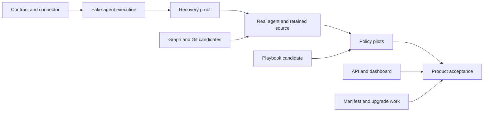

# Agent Q v2 implementation milestones

**Planning baseline:** 2026-10-30

This is the execution plan for the [implementation audit](../research/2026-10-30-v2-implementation-audit.md). The [JSON task graph](0001-v2-milestones.json) is the canonical planning source. This Markdown view is generated with `python3 scripts/check-v2-plan.py --render`; edit the JSON and regenerate it.

Repository planning format; not an AQ daemon import schema. No live tasks or issues are created by this file.

## How to execute this plan

Start with the ready tasks below. Before claiming a task, compare the [audit snapshot](../research/2026-10-30-implementation-audit-snapshot.json) with current work and identify any overlapping implementation. Qualify existing component code rather than rebuilding it. Pin contract/candidate revisions in each task's evidence.

depends_on contains hard prerequisites. Milestones group acceptance, not automatic start barriers. Ready means planned with all explicit dependencies complete; it is not permission to deploy or publish.

Each task has one owning repository. Contract work is reviewed by both endpoints, while integration gates are owned by agent-q. When a task is too broad after investigation, split it into bounded child tasks with explicit dependencies and keep the original gate dependent on them. A failed benchmark or newly discovered capability gap adds work to the graph; it is not grounds to mark a gate complete.

The original planning baseline completed AUD-00; current statuses below record subsequent implementation and qualification. Existing code and recorded tests are reusable evidence, not proof that the new product integration tasks have already passed. No elapsed-time estimates or staffing assumptions are encoded.

### Definition of done

- Implementation and tests reviewed in the owning repository against an immutable source revision.
- Acceptance evidence records exact commands, environment, artifact identity and remaining limits.
- Consume public interfaces only; no sibling private state or mandatory sibling source checkout.
- Update requirement evidence and dependent product pins when applicable. A passing component suite does not close a product gate.

### Ready work

| Task | Owner | Deliverable |
| --- | --- | --- |
| [API-01](#api-01) | agent-q | Publish scoped agent API contracts |
| [AQ-09](#aq-09) | agent-q | Implement authenticated source transfer and central retention |
| [PB-02](#pb-02) | aq-playbooks | Establish the playbook storage and scheduling operating envelope |

The daemon authority track can start after BASE-01 and CON-01. The worker runtime track follows connector extraction. Graph, Git and playbook qualification are independent early tracks; they are not artificial prerequisites for fake-agent execution. Dashboard work waits for a versioned inspection/action API, but does not wait for production deployment.

## Milestone outcomes

| Milestone | Acceptance gate | Observable result |
| --- | --- | --- |
| M0: Implementation audit and executable task plan | [AUD-00](#aud-00) | Evidence-labelled baseline and validated dependency graph. |
| M1: Execution contract and independently packaged connector | [GATE-01](#gate-01) | Compatible foundation connector extracted and consumed as a pinned artifact; execution contract shared by both sides. |
| M2: Minimal distributed fake-agent execution | [GATE-02](#gate-02) | One daemon and worker complete a durable synthetic assignment without duplicate launch. |
| M3: Recovery and cancellation proof | [GATE-03](#gate-03) | Ambiguous launch, restart, lease expiry, cancellation and late results remain safe and explicit. |
| M4: Real agent context, source handoff and graph outcome | [GATE-04](#gate-04) | One supported harness reads scoped graph context, edits a supported repository, hands source off and records a version-checked outcome. |
| M5: Policy-driven coding and operational workflows | [GATE-05](#gate-05) | Embedded playbooks invoke real AQ adapters for coding/review/check, routing, watcher and reporting pilot flows. |
| M6: Usable, measured and upgradeable product candidate | [GATE-06](#gate-06) | Dashboard, exact-artifact assembly, upgrades, target-host recovery and a declared capacity envelope pass product acceptance. |

The milestone spine below is a summary. The task dependencies in the JSON are authoritative.



## Task graph

Requirements name implementation responsibility, not passing test coverage. E refers to ecosystem acceptance; X to shared failure scenarios; D to daemon requirements; W to worker requirements; U to dashboard acceptance.

### M0 overview

| Task | Owner | Hard prerequisites | Status |
| --- | --- | --- | --- |
| [AUD-00](#aud-00): Record implementation audit and validate the task graph | agent-q | None | complete |

### M1 overview

| Task | Owner | Hard prerequisites | Status |
| --- | --- | --- | --- |
| [BASE-01](#base-01): Qualify the existing foundation baseline | agent-q | [AUD-00](#aud-00) | complete |
| [CON-01](#con-01): Publish the execution contract and conformance fixtures | aq-worker | [AUD-00](#aud-00) | complete |
| [WRK-01](#wrk-01): Extract the foundation connector into aq-worker | aq-worker | [BASE-01](#base-01), [CON-01](#con-01) | in_progress |
| [AQ-01](#aq-01): Consume the standalone connector and remove duplicate ownership | agent-q | [WRK-01](#wrk-01) | in_progress |
| [INT-01](#int-01): Add reproducible integration assembly and explicit local overrides | agent-q | [AQ-01](#aq-01) | in_progress |
| [GATE-01](#gate-01): Accept contract and connector compatibility | agent-q | [INT-01](#int-01), [CON-01](#con-01), [BASE-01](#base-01) | in_progress |

### M2 overview

| Task | Owner | Hard prerequisites | Status |
| --- | --- | --- | --- |
| [AQ-02](#aq-02): Persist execution authority and immutable attempt inputs | agent-q | [BASE-01](#base-01), [CON-01](#con-01) | complete |
| [AQ-03](#aq-03): Implement worker exchanges and durable result dispositions | agent-q | [AQ-02](#aq-02) | complete |
| [WRK-02](#wrk-02): Implement local journal, capacity reservation and grant admission | aq-worker | [WRK-01](#wrk-01) | in_progress |
| [WRK-03](#wrk-03): Launch and report one deterministic fake agent | aq-worker | [WRK-02](#wrk-02) | in_progress |
| [AQ-04](#aq-04): Add test-only deterministic assignment scheduling | agent-q | [AQ-03](#aq-03) | complete |
| [GATE-02](#gate-02): Demonstrate minimal distributed execution | agent-q | [GATE-01](#gate-01), [AQ-04](#aq-04), [WRK-03](#wrk-03) | in_progress |

### M3 overview

| Task | Owner | Hard prerequisites | Status |
| --- | --- | --- | --- |
| [AQ-05](#aq-05): Implement cancellation, reconciliation and bounded retry policy | agent-q | [AQ-03](#aq-03) | complete |
| [WRK-04](#wrk-04): Prove process ownership, expiry and restart recovery | aq-worker | [WRK-03](#wrk-03) | in_progress |
| [GATE-03](#gate-03): Accept distributed recovery and cancellation | agent-q | [GATE-02](#gate-02), [AQ-05](#aq-05), [WRK-04](#wrk-04) | planned |

### M4 overview

| Task | Owner | Hard prerequisites | Status |
| --- | --- | --- | --- |
| [GRAPH-01](#graph-01): Qualify an immutable graph integration candidate | aq-graph | [AUD-00](#aud-00) | complete |
| [GIT-01](#git-01): Qualify and package an immutable Git integration candidate | aq-git | [AUD-00](#aud-00) | complete |
| [API-01](#api-01): Publish scoped agent API contracts | agent-q | [AQ-02](#aq-02), [GRAPH-01](#graph-01) | planned |
| [AQ-06](#aq-06): Implement session credentials and scoped graph reads | agent-q | [API-01](#api-01), [AQ-03](#aq-03) | planned |
| [AQ-07](#aq-07): Implement durable graph mutation delivery and recovery | agent-q | [AQ-06](#aq-06) | planned |
| [AQ-08](#aq-08): Schedule real graph candidates with explicit eligibility | agent-q | [AQ-04](#aq-04), [AQ-07](#aq-07), [GATE-03](#gate-03) | planned |
| [WRK-05](#wrk-05): Provision the AQ agent client and bounded context cache | aq-worker | [WRK-04](#wrk-04), [AQ-06](#aq-06) | planned |
| [WRK-06](#wrk-06): Integrate local aq-git workspaces and storage admission | aq-worker | [WRK-04](#wrk-04), [GIT-01](#git-01) | planned |
| [AQ-09](#aq-09): Implement authenticated source transfer and central retention | agent-q | [AQ-03](#aq-03), [GIT-01](#git-01) | planned |
| [WRK-07](#wrk-07): Implement resumable artifact handoff and retention release | aq-worker | [WRK-06](#wrk-06), [AQ-09](#aq-09) | planned |
| [WRK-08](#wrk-08): Support one real harness with tested confinement | aq-worker | [WRK-05](#wrk-05), [WRK-06](#wrk-06), [GATE-03](#gate-03) | planned |
| [AQ-10](#aq-10): Apply evidence-based result disposition and graph completion | agent-q | [AQ-05](#aq-05), [AQ-07](#aq-07), [AQ-09](#aq-09) | planned |
| [GATE-04](#gate-04): Demonstrate a real agent with retained source and graph outcome | agent-q | [GATE-03](#gate-03), [AQ-08](#aq-08), [AQ-10](#aq-10), [WRK-07](#wrk-07), [WRK-08](#wrk-08) | planned |

### M5 overview

| Task | Owner | Hard prerequisites | Status |
| --- | --- | --- | --- |
| [PB-01](#pb-01): Qualify the existing playbook implementation as a library candidate | aq-playbooks | [AUD-00](#aud-00) | complete |
| [AQ-11](#aq-11): Implement durable supervisor and agent messaging | agent-q | [AQ-03](#aq-03), [API-01](#api-01) | planned |
| [WRK-09](#wrk-09): Deliver messages through the real harness safely | aq-worker | [WRK-08](#wrk-08), [AQ-11](#aq-11) | planned |
| [AQ-17](#aq-17): Host bounded supervisor sessions centrally | agent-q | [AQ-11](#aq-11), [AQ-06](#aq-06) | planned |
| [AQ-12](#aq-12): Embed the qualified playbook runner with bounded execution | agent-q | [PB-01](#pb-01), [AQ-07](#aq-07) | planned |
| [AQ-13](#aq-13): Implement core work, context and operation host adapters | agent-q | [AQ-12](#aq-12), [AQ-08](#aq-08), [AQ-05](#aq-05), [AQ-11](#aq-11) | planned |
| [AQ-14](#aq-14): Implement judgment, decision and check host adapters | agent-q | [AQ-13](#aq-13), [AQ-10](#aq-10), [AQ-17](#aq-17), [WRK-09](#wrk-09) | planned |
| [AQ-15](#aq-15): Implement candidate preparation and guarded publication policy | agent-q | [AQ-14](#aq-14), [AQ-09](#aq-09), [GIT-01](#git-01) | planned |
| [AQ-16](#aq-16): Implement findings reconciliation and durable calendar/report coordination | agent-q | [AQ-13](#aq-13), [AQ-14](#aq-14) | planned |
| [GATE-05](#gate-05): Accept real policy-driven pilot workflows | agent-q | [GATE-04](#gate-04), [AQ-15](#aq-15), [AQ-16](#aq-16), [WRK-09](#wrk-09) | planned |

### M6 overview

| Task | Owner | Hard prerequisites | Status |
| --- | --- | --- | --- |
| [PB-02](#pb-02): Establish the playbook storage and scheduling operating envelope | aq-playbooks | [PB-01](#pb-01) | planned |
| [API-02](#api-02): Expose task, attempt and workflow explanation views | agent-q | [AQ-10](#aq-10), [AQ-11](#aq-11), [AQ-12](#aq-12) | planned |
| [UI-01](#ui-01): Create the independent dashboard application and mock suite | aq-dashboard | [API-02](#api-02) | planned |
| [UI-02](#ui-02): Implement pending-safe actions and browser compatibility | aq-dashboard | [UI-01](#ui-01) | planned |
| [REL-01](#rel-01): Version the composite product manifest and component inventory | agent-q | [INT-01](#int-01), [GRAPH-01](#graph-01), [GIT-01](#git-01), [PB-01](#pb-01) | planned |
| [REL-02](#rel-02): Implement multi-component update and recovery orchestration | agent-q | [REL-01](#rel-01), [GATE-05](#gate-05) | planned |
| [REL-03](#rel-03): Package and verify the dashboard in the server release | agent-q | [REL-01](#rel-01), [UI-02](#ui-02) | planned |
| [PERF-01](#perf-01): Run the complete product capacity and recovery profile | agent-q | [GATE-05](#gate-05), [PB-02](#pb-02), [REL-03](#rel-03) | planned |
| [OPS-01](#ops-01): Qualify the deployment target and component recovery profile | agent-q | [BASE-01](#base-01), [REL-02](#rel-02), [REL-03](#rel-03), [GIT-01](#git-01), [GRAPH-01](#graph-01) | planned |
| [GATE-06](#gate-06): Accept a usable, measured and upgradeable AQ product candidate | agent-q | [GATE-05](#gate-05), [REL-02](#rel-02), [REL-03](#rel-03), [PERF-01](#perf-01), [OPS-01](#ops-01) | planned |

## Task contracts

### AUD-00

**Record implementation audit and validate the task graph**

Owner: `agent-q`. Milestone: M0. Kind: audit. Status: complete.

Hard prerequisites: None.

Inspect local source, test definitions and existing evidence; identify missing product behavior and hard dependencies.

Acceptance:

- Audit distinguishes implemented, recorded validation, partial, design-only and externally unverified behavior.
- Snapshot and graph are retained; all links, IDs, dependency edges, reachability and acyclicity validate.

Requirement links: E3.

Evidence: [2026-10-30-v2-implementation-audit.md](../research/2026-10-30-v2-implementation-audit.md), [2026-10-30-implementation-audit-snapshot.json](../research/2026-10-30-implementation-audit-snapshot.json), [0001-v2-milestones.json](0001-v2-milestones.json).

### BASE-01

**Qualify the existing foundation baseline**

Owner: `agent-q`. Milestone: M1. Kind: qualification. Status: complete.

Hard prerequisites: [AUD-00](#aud-00).

Select the current foundation revision and run its applicable Rust, PostgreSQL, connector and update-lifecycle checks; reconcile existing Phase 1 work before extraction.

Acceptance:

- Record exact revision, commands, outcomes and image identities; distinguish local evidence from hosted qualification.
- Retain compatibility fixtures for enrollment, heartbeat, probe, credential revocation, persisted identity and update state formats.

Requirement links: E4, E5, D8, W16.

Outside this task: Reimplementing working foundation features; Provisioning or changing a live deployment.

Evidence: [BASE-01.md](../implementation/BASE-01.md).

### CON-01

**Publish the execution contract and conformance fixtures**

Owner: `aq-worker`. Milestone: M1. Kind: implementation. Status: complete.

Hard prerequisites: [AUD-00](#aud-00).

Specify and implement wire schemas/types, explicit capability/version negotiation, replay identities, bounded exchanges, fake coordinator/worker fixtures and both-side review.

Acceptance:

- Fixtures cover changed-payload conflicts, grant/reservation expiry, observation sequencing, cancellation, retained-result reporting and reconciliation.
- Schema/type drift checks run standalone; foundation v1 meanings remain unchanged.

Requirement links: E1, E4, D2, D8, W2, W9, W16, W21, X1, X2, X6.

Evidence: [worker-candidate.md](../../../aq-worker/docs/implementation/worker-candidate.md), [execution-review.md](../implementation/execution-review.md), [worker-contracts.json](../../vendor/worker-contracts.json).

### WRK-01

**Extract the foundation connector into aq-worker**

Owner: `aq-worker`. Milestone: M1. Kind: implementation. Status: in_progress.

Hard prerequisites: [BASE-01](#base-01), [CON-01](#con-01).

Move compatible connector behavior into a standalone Rust workspace with published wire dependencies, configuration/identity continuity, independent CI and an immutable integration image.

Acceptance:

- Enrollment, reconnect, heartbeat and revocation tests run without the agent-q source checkout.
- Reusing an existing node configuration preserves identity; candidate artifact records exact source and dependency versions.

Requirement links: E1, E4, W12, W16, W21.

Outside this task: Launching agents during extraction; Changing foundation protocol semantics.

### AQ-01

**Consume the standalone connector and remove duplicate ownership**

Owner: `agent-q`. Milestone: M1. Kind: implementation. Status: in_progress.

Hard prerequisites: [WRK-01](#wrk-01).

Update development, smoke and release wiring to use the pinned worker candidate and shared public wire contract; retire the duplicate production connector source after compatibility passes.

Acceptance:

- Existing enroll/heartbeat/restart/revoke smoke passes with the standalone artifact.
- Normal AQ builds no longer require an in-tree worker implementation or sibling source path.

Requirement links: E1, E4, E7, D8, W16.

### INT-01

**Add reproducible integration assembly and explicit local overrides**

Owner: `agent-q`. Milestone: M1. Kind: implementation. Status: in_progress.

Hard prerequisites: [AQ-01](#aq-01).

Provide a small product fixture selecting exact server/worker artifacts and contract versions, with reusable slots for later graph/Git/playbook dependencies.

Acceptance:

- One documented command assembles an isolated fixture without changing developer or production state.
- Official candidate inputs reject floating references/local overrides; explicit development overrides identify their source.

Requirement links: E1, E2, E7.

Outside this task: Requiring all component source checkouts; Completing the composite updater.

### GATE-01

**Accept contract and connector compatibility**

Owner: `agent-q`. Milestone: M1. Kind: gate. Status: in_progress.

Hard prerequisites: [INT-01](#int-01), [CON-01](#con-01), [BASE-01](#base-01).

Run both-side contract checks and the existing foundation lifecycle using the pinned standalone worker.

Acceptance:

- Exact-artifact enrollment, reconnect and revocation pass; unsupported execution is declined while allowed foundation connectivity remains visible.
- Publish the tested contract/candidate references for downstream tasks.

Requirement links: E1, E4, D8, W16, W21.

### GRAPH-01

**Qualify an immutable graph integration candidate**

Owner: `aq-graph`. Milestone: M4. Kind: qualification. Status: complete.

Hard prerequisites: [AUD-00](#aud-00).

Reuse the existing service; select an exact candidate, reproduce current contract/storage checks, and document receipt, principal, API and schema compatibility for AQ.

Acceptance:

- Retain current tests and an isolated backup/restore result for the selected artifact; do not substitute old benchmark evidence.
- Consumer contract documents version conflicts, identical-key replay, credential lifecycle and receipt retention; versioned image is reproducible.

Requirement links: E1, E2, D5, D6.

Outside this task: Offline replicas; V1 migration; Execution claims in aq-graph.

Evidence: [GRAPH-01.md](../../../aq-graph/docs/implementation/GRAPH-01.md).

### GIT-01

**Qualify and package an immutable Git integration candidate**

Owner: `aq-git`. Milestone: M4. Kind: qualification. Status: complete.

Hard prerequisites: [AUD-00](#aud-00).

Preserve the current implementation, select a committed candidate, verify correctness/process handoff and package a checksummed executable with honest profile/compatibility limits.

Acceptance:

- Run the retained-source worker-loss scenario and current required correctness checks against the candidate.
- Manifest ties binary to build/source; unsupported repository features are explicit and rejected; remaining performance, host-power-loss and hosted-transport gates remain named.

Requirement links: E1, E2, W7, X12.

Outside this task: Claiming local process tests certify host power loss; Adding every unsupported Git feature.

Evidence: [GIT-01.md](../../../aq-git/docs/implementation/GIT-01.md).

### PB-01

**Qualify the existing playbook implementation as a library candidate**

Owner: `aq-playbooks`. Milestone: M5. Kind: qualification. Status: complete.

Hard prerequisites: [AUD-00](#aud-00).

Reconcile concurrent implementation work, select the revision beyond the design-only commit, qualify library/CLI artifacts and current core/PostgreSQL/pilot evidence, and publish the Host/storage contract.

Acceptance:

- Database-free tests and explicitly enabled isolated PostgreSQL tests pass on the selected candidate.
- Limits and evidence for synchronous storage, snapshot/index/retention behavior, exact pins, join typing, optional protection and host-only functionality are included in compatibility metadata; the old test report does not certify new code.

Requirement links: E1, E2.

Outside this task: Rewriting the engine; Claiming fake-host pilots are AQ integration.

Evidence: [PB-01.md](../../../aq-playbooks/docs/implementation/PB-01.md).

### AQ-02

**Persist execution authority and immutable attempt inputs**

Owner: `agent-q`. Milestone: M2. Kind: implementation. Status: complete.

Hard prerequisites: [BASE-01](#base-01), [CON-01](#con-01).

Add migrations and transactional transitions for attempts, sessions, node incarnations, offers, generations, grants and resolved specification digests.

Acceptance:

- Concurrent claims/acceptances cannot grant conflicting authority; duplicate IDs with different bytes fail.
- Restart preserves authority and deadlines; state-format/recovery rules are updated with the migration.

Requirement links: D1, D2, W9, W10, X1, X2, X8.

Evidence: [execution-authority.md](../implementation/execution-authority.md), [execution-validation.json](../implementation/execution-validation.json), [execution-review.md](../implementation/execution-review.md).

### AQ-03

**Implement worker exchanges and durable result dispositions**

Owner: `agent-q`. Milestone: M2. Kind: implementation. Status: complete.

Hard prerequisites: [AQ-02](#aq-02).

Implement incarnation registration, bounded poll/accept/decline, renewal, sequenced progress and immutable report admission with fake-worker tests.

Acceptance:

- Lost acceptance/report acknowledgements return original committed dispositions without duplicate launches or outcomes.
- Stale boot/generation and expired local reservation reports cannot settle a current attempt.

Requirement links: D1, D2, D3, D8, W2, W9, W10, X1, X2, X7.

Evidence: [execution-authority.md](../implementation/execution-authority.md), [execution-validation.json](../implementation/execution-validation.json), [execution-review.md](../implementation/execution-review.md).

### WRK-02

**Implement local journal, capacity reservation and grant admission**

Owner: `aq-worker`. Milestone: M2. Kind: implementation. Status: in_progress.

Hard prerequisites: [WRK-01](#wrk-01).

Add versioned durable records, exclusive runtime ownership, bounded node-wide resource reservations and acceptance/grant validation using the fake coordinator.

Acceptance:

- Crash/replay and racing offers cannot over-allocate capacity; durable state survives full-disk/write-failure injection.
- Late grants cannot resurrect expired reservations; no project-by-slot preallocation is introduced.

Requirement links: W3, W4, W5, W9, W15, W17, X1, X2.

### WRK-03

**Launch and report one deterministic fake agent**

Owner: `aq-worker`. Milestone: M2. Kind: implementation. Status: in_progress.

Hard prerequisites: [WRK-02](#wrk-02).

Implement a deterministic harness/execution adapter and journaled launch identity, phase observations, writer-stop proof and report retry.

Acceptance:

- Fixture process completes through collecting/reporting/acknowledgement with one session per attempt.
- Launch-window uncertainty never causes blind relaunch; confirmed stopped writers are required before resource reuse.

Requirement links: W9, W10, W14, W17, X1, X3.

### AQ-04

**Add test-only deterministic assignment scheduling**

Owner: `agent-q`. Milestone: M2. Kind: implementation. Status: complete.

Hard prerequisites: [AQ-03](#aq-03).

Drive the initial execution fixture from explicitly preapproved synthetic task/context inputs and deterministic compatible-node selection.

Acceptance:

- Fixture assignments use production authority transitions and worker local admission.
- Synthetic task provider is excluded from production configuration and cannot imply graph completion.

Requirement links: D1, W4, W5, W13.

Outside this task: Production graph-ready scheduling; Optimized fleet placement.

Evidence: [execution-authority.md](../implementation/execution-authority.md), [execution-validation.json](../implementation/execution-validation.json), [execution-review.md](../implementation/execution-review.md).

### GATE-02

**Demonstrate minimal distributed execution**

Owner: `agent-q`. Milestone: M2. Kind: gate. Status: in_progress.

Hard prerequisites: [GATE-01](#gate-01), [AQ-04](#aq-04), [WRK-03](#wrk-03).

Extend the product fixture to run the deterministic fake agent through actual daemon/worker transport and persisted state.

Acceptance:

- One assignment completes; repeated polls, lost acceptance response and lost report acknowledgement do not create duplicate execution.
- Retain an executable demonstration with exact images, logs and correlation IDs; no model provider is required.

Requirement links: E3, D2, W9, X1, X2.

### AQ-05

**Implement cancellation, reconciliation and bounded retry policy**

Owner: `agent-q`. Milestone: M3. Kind: implementation. Status: complete.

Hard prerequisites: [AQ-03](#aq-03).

Serialize cancellation/result eligibility, persist directives and retry lineage/budgets, reconcile old boots/grants and keep uncertain attempts visible.

Acceptance:

- Cancellation/completion races and late superseded reports have stable outcomes; expiry never proves physical termination.
- Daemon restart replays outstanding intents without extending old grants; unsafe overlapping attempts remain held.

Requirement links: D1, D2, D3, D9, W10, W17, X5, X6, X7, X8, X9.

Evidence: [execution-authority.md](../implementation/execution-authority.md), [execution-validation.json](../implementation/execution-validation.json), [execution-review.md](../implementation/execution-review.md).

### WRK-04

**Prove process ownership, expiry and restart recovery**

Owner: `aq-worker`. Milestone: M3. Kind: implementation. Status: in_progress.

Hard prerequisites: [WRK-03](#wrk-03).

Implement discoverable process ownership across parent-only crashes, suspend-aware grant deadlines, stop escalation, reattachment checks and drain recovery.

Acceptance:

- Inject crashes before/after spawn and restart with surviving descendants; uncertain writers keep reservations/workspaces protected.
- Expiry/revocation stops execution; reattachment requires renewed authority; new execution uses a new attempt/session.

Requirement links: W8, W9, W10, W11, W14, W17, X3, X4, X5, X9, X11.

### GATE-03

**Accept distributed recovery and cancellation**

Owner: `agent-q`. Milestone: M3. Kind: gate. Status: planned.

Hard prerequisites: [GATE-02](#gate-02), [AQ-05](#aq-05), [WRK-04](#wrk-04).

Inject transport loss, cancellation races, daemon/worker restarts and expired authority against the real execution fixture.

Acceptance:

- X1-X3 and X5-X9 pass with explicit uncertainty; no duplicate settlement or unsafe reuse.
- Control requests retain capacity under synthetic transfer load; injected failures are repeatable without wall-clock sleep races.

Requirement links: E3, D3, D7, W17, X1, X2, X3, X5, X6, X7, X8, X9, X14.

### API-01

**Publish scoped agent API contracts**

Owner: `agent-q`. Milestone: M4. Kind: implementation. Status: planned.

Hard prerequisites: [AQ-02](#aq-02), [GRAPH-01](#graph-01).

Define versioned graph context/search/mutation and operation-status schemas, capability scopes, provenance, expected versions, node recovery and CLI client contracts.

Acceptance:

- Schema fixtures cover every batch/edge/context scope and pending/conflict/confirmed distinction.
- No raw arbitrary graph proxy or worker graph credential is required; public contract supports independently generated clients.

Requirement links: D4, D5, D6, D9, W18, W19, W20.

### AQ-06

**Implement session credentials and scoped graph reads**

Owner: `agent-q`. Milestone: M4. Kind: implementation. Status: planned.

Hard prerequisites: [API-01](#api-01), [AQ-03](#aq-03).

Provision protected per-attempt credentials, enforce current generation/expiry/revocation, and expose bounded authorized context/search/revision reads through the graph service.

Acceptance:

- Search snippets, pagination, context expansion and relationship endpoints cannot leak out-of-scope data.
- Cached context is revision-labelled; worker/node/graph service identities cannot be substituted for agent authority.

Requirement links: D4, D9, W1, W18, W19, X5, X11.

### AQ-07

**Implement durable graph mutation delivery and recovery**

Owner: `agent-q`. Milestone: M4. Kind: implementation. Status: planned.

Hard prerequisites: [AQ-06](#aq-06).

Persist authorized immutable graph intent, expected versions and idempotency keys; reconcile uncertain outcomes, produce confirmed outbox events and expose bounded operation lookup.

Acceptance:

- Commit-before-response-loss replays the identical intent without duplicate graph history; version conflict never becomes blind overwrite.
- Cancelled/expired sessions cannot admit new writes; node recovery can inspect existing attempt operations without renewed agent mutation access.

Requirement links: D2, D4, D5, D6, W20, X10, X11.

### AQ-08

**Schedule real graph candidates with explicit eligibility**

Owner: `agent-q`. Milestone: M4. Kind: implementation. Status: planned.

Hard prerequisites: [AQ-04](#aq-04), [AQ-07](#aq-07), [GATE-03](#gate-03).

Replace test-only task input with bounded graph-ready/context queries and central eligibility/priority/locality decisions; preserve independent local admission.

Acceptance:

- Readiness alone never claims execution; admitted revisions are recorded and invalidating changes prevent stale settlement.
- Multiple projects share capacity, cold eligible nodes can prepare work, and decisions/refusals expose reasons without full Git scans.

Requirement links: D1, D6, D9, W3, W4, W5, W13.

### WRK-05

**Provision the AQ agent client and bounded context cache**

Owner: `aq-worker`. Milestone: M4. Kind: implementation. Status: planned.

Hard prerequisites: [WRK-04](#wrk-04), [AQ-06](#aq-06).

Package the compatible AQ client, supply protected per-session credential bindings and labelled context snapshots, and handle expired/uncertain request responses.

Acceptance:

- Fake AQ API tests run without the daemon or graph; session/node credential separation is preserved.
- Offline proposed edits are never reported as applied; runtime can recover known or centrally listed attempt operations without renewing agent writes.

Requirement links: W18, W19, W20, X10, X11.

### WRK-06

**Integrate local aq-git workspaces and storage admission**

Owner: `aq-worker`. Milestone: M4. Kind: implementation. Status: planned.

Hard prerequisites: [WRK-04](#wrk-04), [GIT-01](#git-01).

Consume the qualified binary through its public local API for base import, on-demand workspace, checkpoint, retention and safe cache eviction.

Acceptance:

- All ambiguous calls reuse operation IDs; writers stop before checkpoint/retirement.
- Alternating projects and disk pressure preserve active/pending data, bound caches and refuse new work when protected storage fills.

Requirement links: W3, W6, W7, W8, W14, W15, X4.

### AQ-09

**Implement authenticated source transfer and central retention**

Owner: `agent-q`. Milestone: M4. Kind: implementation. Status: planned.

Hard prerequisites: [AQ-03](#aq-03), [GIT-01](#git-01).

Implement bounded attempt/repository-scoped artifact endpoints, staging, central aq-git import and retained receipts distinct from upload acknowledgements.

Acceptance:

- Server maps trusted assignment metadata to allowed Git operations and rejects arbitrary worker paths/URLs/commands.
- Stale attempts may retain authorized recovery source but cannot restore execution authority or settle newer work.

Requirement links: D2, D3, W7, W8, W9, X7, X12.

### WRK-07

**Implement resumable artifact handoff and retention release**

Owner: `aq-worker`. Milestone: M4. Kind: implementation. Status: planned.

Hard prerequisites: [WRK-06](#wrk-06), [AQ-09](#aq-09).

Add authenticated download/upload, offsets/digests, checkpoint receipts, result attachment and safe local retirement using separate transfer budgets.

Acceptance:

- Restart mid-checkpoint/upload/report preserves IDs and required data; transport success is never central retention.
- Central retention survives deletion of stopped worker storage; full pending-result storage blocks admission without blocking control.

Requirement links: W7, W8, W9, W14, W15, X4, X12, X14.

### WRK-08

**Support one real harness with tested confinement**

Owner: `aq-worker`. Milestone: M4. Kind: implementation. Status: planned.

Hard prerequisites: [WRK-05](#wrk-05), [WRK-06](#wrk-06), [GATE-03](#gate-03).

Select and document one CLI harness/model configuration and implement configuration, process ownership, results, default workspace confinement and explicit folder grants.

Acceptance:

- Real harness compatibility proves launch/stop/reattach capability and refusal of unsupported grant configurations.
- Agent reads scoped context and edits only its configured writable roots in the supported cooperative model; credentials are not put in prompts/logs.

Requirement links: W1, W6, W11, W17, W18.

Outside this task: Multiple harness parity; Claiming hostile-code isolation.

### AQ-10

**Apply evidence-based result disposition and graph completion**

Owner: `agent-q`. Milestone: M4. Kind: implementation. Status: planned.

Hard prerequisites: [AQ-05](#aq-05), [AQ-07](#aq-07), [AQ-09](#aq-09).

Connect immutable worker reports and retained source to pinned outcome/evidence contracts and an authorized version-checked task completion operation.

Acceptance:

- Success text/exit status alone cannot complete a task; stale revisions or cancelled-before-acceptance attempts cannot auto-settle.
- Graph completion remains pending until confirmed; crash/replay emits one logical completion event.

Requirement links: D3, D5, D6, D9, X6, X7, X10, X12.

### GATE-04

**Demonstrate a real agent with retained source and graph outcome**

Owner: `agent-q`. Milestone: M4. Kind: gate. Status: planned.

Hard prerequisites: [GATE-03](#gate-03), [AQ-08](#aq-08), [AQ-10](#aq-10), [WRK-07](#wrk-07), [WRK-08](#wrk-08).

Run one supported repository/task through actual agent context access, code change, source handoff, result policy and confirmed graph mutation.

Acceptance:

- Delete stopped worker data after central retention and show the result remains usable; inject a lost graph response.
- Observe explicit authorization/version checks and retain exact source/evidence identities without a worker graph database.

Requirement links: E3, D4, D5, D6, W7, W18, W19, W20, X4, X10, X12.

### AQ-11

**Implement durable supervisor and agent messaging**

Owner: `agent-q`. Milestone: M5. Kind: implementation. Status: planned.

Hard prerequisites: [AQ-03](#aq-03), [API-01](#api-01).

Add scoped task/session mailboxes, durable delivery IDs/cursors and acknowledgement states separate from typed cancellation directives.

Acceptance:

- Old-session messages cannot land in a reused slot; sender/recipient scopes are authenticated.
- Replay distinguishes received, handed-to-harness, unknown and stale delivery; replies cannot impersonate another session.

Requirement links: D2, D9, W1, W9, X13.

### WRK-09

**Deliver messages through the real harness safely**

Owner: `aq-worker`. Milestone: M5. Kind: implementation. Status: planned.

Hard prerequisites: [WRK-08](#wrk-08), [AQ-11](#aq-11).

Persist mailbox receipt, integrate input at supported harness boundaries and report ambiguous injection without automatic duplicate delivery.

Acceptance:

- Crash between injection and acknowledgement yields explicit uncertainty unless harness IDs prove deduplication.
- Cancellation and renewals remain responsive during chat/log/transfer activity.

Requirement links: W1, W9, W11, W17, X13, X14.

### AQ-17

**Host bounded supervisor sessions centrally**

Owner: `agent-q`. Milestone: M5. Kind: implementation. Status: planned.

Hard prerequisites: [AQ-11](#aq-11), [AQ-06](#aq-06).

Implement the first central supervisor/assessment execution adapter with resolved role configuration, isolated provider credentials and normal AQ message/API access.

Acceptance:

- Supervisor communicates with remote sessions through durable messaging without entering a worker node.
- Bounded session cancellation/results and credential separation are tested; no supervisor secret is provisioned to workers.

Requirement links: D4, W1, X11, X13.

Outside this task: General supervisor autonomy or all v1 profiles.

### AQ-12

**Embed the qualified playbook runner with bounded execution**

Owner: `agent-q`. Milestone: M5. Kind: implementation. Status: planned.

Hard prerequisites: [PB-01](#pb-01), [AQ-07](#aq-07).

Pin runner/compiler/storage libraries, bind host authority and outbox input, and isolate synchronous storage/host work from async control handlers.

Acceptance:

- Exclusive ownership, startup/restart recovery, immutable artifacts and activation are integrated without reading AQ tables from the engine.
- A blocked storage/host operation cannot stall lease renewal or cancellation; synthetic host commands are not registered as production adapters.

Requirement links: E1, D2, D6, D7, X8, X14.

### AQ-13

**Implement core work, context and operation host adapters**

Owner: `agent-q`. Milestone: M5. Kind: implementation. Status: planned.

Hard prerequisites: [AQ-12](#aq-12), [AQ-08](#aq-08), [AQ-05](#aq-05), [AQ-11](#aq-11).

Register context.read, work.ensure, work.change, operation.get, operation.cancel and message.send against typed AQ services with durable request IDs and finite contracts.

Acceptance:

- Work creation and completion have distinct dispositions; retries cannot create another task/attempt or widen authority.
- Host contract fixtures exercise scoped context, owned cancellation, pending effects and exact revision conflicts.

Requirement links: D2, D4, D5, D6, W10, X6, X10.

### AQ-14

**Implement judgment, decision and check host adapters**

Owner: `agent-q`. Milestone: M5. Kind: implementation. Status: planned.

Hard prerequisites: [AQ-13](#aq-13), [AQ-10](#aq-10), [AQ-17](#aq-17), [WRK-09](#wrk-09).

Implement judgment.request, decision.request and check.request with bounded central assessments, durable human decisions and actual check execution bound to exact subjects.

Acceptance:

- A model assessment cannot impersonate human approval; stale decisions and checks do not authorize changed source.
- Async acceptance, completion, cancellation and late outcomes remain distinct and replayable.

Requirement links: D2, D3, D6, W1, X6, X7.

### AQ-15

**Implement candidate preparation and guarded publication policy**

Owner: `agent-q`. Milestone: M5. Kind: implementation. Status: planned.

Hard prerequisites: [AQ-14](#aq-14), [AQ-09](#aq-09), [GIT-01](#git-01).

Implement candidate.prepare and candidate.publish with central aq-git, exact retained inputs, required check/review evidence and current destination preconditions.

Acceptance:

- Disposable-remote pilot repairs a conflict with a new candidate and new applicable evidence; publication never runs on workers.
- Lost publication acknowledgement reconciles the same operation rather than pushing again; stale evidence blocks publication.

Requirement links: E3, D3, D6, W7, X7.

Outside this task: Publishing user production branches during qualification.

### AQ-16

**Implement findings reconciliation and durable calendar/report coordination**

Owner: `agent-q`. Milestone: M5. Kind: implementation. Status: planned.

Hard prerequisites: [AQ-13](#aq-13), [AQ-14](#aq-14).

Implement findings.reconcile, complete scoped observation inputs, finding episodes/notification outbox, and host-owned schedule occurrence cursors for watcher/report pilots.

Acceptance:

- Partial scans cannot clear unseen findings; reminders and notification retries produce one logical message.
- Report timeout/fallback and late author completion cannot double-send; timezone/misfire behavior is tested with frozen time.

Requirement links: D2, D6, D9, W1, X6, X13.

### GATE-05

**Accept real policy-driven pilot workflows**

Owner: `agent-q`. Milestone: M5. Kind: gate. Status: planned.

Hard prerequisites: [GATE-04](#gate-04), [AQ-15](#aq-15), [AQ-16](#aq-16), [WRK-09](#wrk-09).

Run coding/review/check/repair, routing, watcher and report pilots against real AQ adapters and the pinned runner, with deterministic substitutes only for designated external model/provider calls.

Acceptance:

- Exactly the agreed twelve production host commands are registered; fake-host passing tests are not substituted for adapter tests.
- Crash between domain effect and runner receipt preserves child ownership, authority, deduplication and completion policy.

Requirement links: E3, D2, D3, D5, D6, W1, X6, X7, X8, X10, X13.

### PB-02

**Establish the playbook storage and scheduling operating envelope**

Owner: `aq-playbooks`. Milestone: M6. Kind: qualification. Status: planned.

Hard prerequisites: [PB-01](#pb-01).

Reconcile in-progress indexing/retention changes before assigning new work. Measure growing run/event/receipt history, pending children and concurrent admission; enforce tested namespace bounds and assess fairness/queue behavior against the intended AQ workload.

Acceptance:

- Retain scaling data and exact configuration, including synchronous storage costs and quotas; no unresolved work is discarded.
- Publish an admissible workload envelope and fail acceptance where required budgets are not met; add scoped optimization tasks to this graph before claiming broader scale.

Requirement links: E8, D7.

Outside this task: Treating the 100-admission microbenchmark as 500-agent product evidence; Silently widening limits after a failing benchmark.

### API-02

**Expose task, attempt and workflow explanation views**

Owner: `agent-q`. Milestone: M6. Kind: implementation. Status: planned.

Hard prerequisites: [AQ-10](#aq-10), [AQ-11](#aq-11), [AQ-12](#aq-12).

Publish bounded browser/client contracts for tasks, attempts, workers, messages, runs and permitted actions with freshness, revision, pending-operation and reason metadata.

Acceptance:

- UI mocks derive from versioned schemas; authoritative state and last observations are distinct.
- CLI and dashboard routes share domain operations and authorization; every pending/unknown result is representable.

Requirement links: D9, U2, U3, U4, E6.

### UI-01

**Create the independent dashboard application and mock suite**

Owner: `aq-dashboard`. Milestone: M6. Kind: implementation. Status: planned.

Hard prerequisites: [API-02](#api-02).

Initialize the component repository, select a frontend framework, and implement authenticated task/attempt and worker inspection against contract-derived mocks.

Acceptance:

- Build/component/accessibility checks need no AQ daemon, graph or workers.
- Large paginated views render stale/unknown/truncated states and untrusted content safely.

Requirement links: U1, U2, U3, U6.

Outside this task: Separate dashboard backend; Full v1 UI parity.

### UI-02

**Implement pending-safe actions and browser compatibility**

Owner: `aq-dashboard`. Milestone: M6. Kind: implementation. Status: planned.

Hard prerequisites: [UI-01](#ui-01).

Add one decision/cancellation/message flow through the public API, operation recovery, conflict-preserving drafts and stale-tab compatibility handling.

Acceptance:

- Repeated clicks and lost responses do not duplicate actions or fabricate success; authorization failures are displayed accurately.
- Session changes clear protected caches, revision conflicts preserve drafts and incompatible API prompts safe reload.

Requirement links: U3, U4, U5, U6, U8.

### REL-01

**Version the composite product manifest and component inventory**

Owner: `agent-q`. Milestone: M6. Kind: implementation. Status: planned.

Hard prerequisites: [INT-01](#int-01), [GRAPH-01](#graph-01), [GIT-01](#git-01), [PB-01](#pb-01).

Extend the signed release format for exact deployable images, embedded library/binary/UI inventories, API/capability windows and per-owner persistent-state compatibility.

Acceptance:

- Old updaters reject unsupported formats and have a documented upgrade path; version ranges do not replace exact artifact pins.
- CI rejects missing/mismatched embedded inventories and local overrides; no second competing component lock authority is introduced.

Requirement links: E1, E2, E4, E7.

### REL-02

**Implement multi-component update and recovery orchestration**

Owner: `agent-q`. Milestone: M6. Kind: implementation. Status: planned.

Hard prerequisites: [REL-01](#rel-01), [GATE-05](#gate-05).

Extend the existing updater with ordered admission/drain, per-owner migrations, readiness and resumable steps for the assembled stack.

Acceptance:

- Interrupt each update boundary; restore/forward-repair decisions respect actual persistent-state compatibility.
- Updates protect renewal/reporting or explicitly drain first; offline older supported workers reconcile after central upgrade.

Requirement links: E4, E5, W16, X8, X9.

### REL-03

**Package and verify the dashboard in the server release**

Owner: `agent-q`. Milestone: M6. Kind: implementation. Status: planned.

Hard prerequisites: [REL-01](#rel-01), [UI-02](#ui-02).

Verify the static bundle digest/provenance/API metadata, embed it in the server image, and serve same-origin authenticated application assets.

Acceptance:

- Exact bundle/server browser smoke covers authentication, inspection and one authorized action.
- An existing tab detects changed API compatibility and refreshes matching assets without a stale success claim.

Requirement links: E2, E6, U7, U8.

### PERF-01

**Run the complete product capacity and recovery profile**

Owner: `agent-q`. Milestone: M6. Kind: qualification. Status: planned.

Hard prerequisites: [GATE-05](#gate-05), [PB-02](#pb-02), [REL-03](#rel-03).

Exercise 500 simulated agents across 50 logical workers for the declared duration, graph fixture, sustained/burst rates and network conditions, with real product adapters and measured background/UI traffic.

Acceptance:

- Report latency, failed arrivals, pool/lock/queue waits, control safety margins, retry amplification and retained storage against shared design budgets.
- Use restarts, contention, maintenance and reconnect storms; record any missed budget as a release blocker or explicitly narrower candidate scope, not a passing capacity claim.

Requirement links: E8, D7, W13, W15, X14, U3.

### OPS-01

**Qualify the deployment target and component recovery profile**

Owner: `agent-q`. Milestone: M6. Kind: qualification. Status: planned.

Hard prerequisites: [BASE-01](#base-01), [REL-02](#rel-02), [REL-03](#rel-03), [GIT-01](#git-01), [GRAPH-01](#graph-01).

On an explicitly selected disposable target, verify ingress/authentication, hosted credential paths, backup/restore, installed artifacts and the supported Git/repository/durability profile.

Acceptance:

- Retain actual host/resource/network/artifact evidence and restore results; local source/test reports do not stand in for deployment proof.
- Before any production readiness claim, resolve required component gates, qualify any protection facility used by workflows (otherwise refuse protected values), and document remaining unsupported capabilities.

Requirement links: E2, E4, E5, W6, W8, X11, X12.

Outside this task: Automatic production deployment; Changing live credentials or user repositories without deployment-task authorization.

### GATE-06

**Accept a usable, measured and upgradeable AQ product candidate**

Owner: `agent-q`. Milestone: M6. Kind: gate. Status: planned.

Hard prerequisites: [GATE-05](#gate-05), [REL-02](#rel-02), [REL-03](#rel-03), [PERF-01](#perf-01), [OPS-01](#ops-01).

Evaluate exact-artifact evidence for the selected capability/profile envelope and record the candidate release decision and unresolved exclusions.

Acceptance:

- All required gates and supported-version checks pass, including browser action, retained source, task policy, upgrade and recovery.
- Manifest, runbooks and measured capacity agree with actual artifacts; production publication/deployment is a separate explicitly scheduled action.

Requirement links: E1, E2, E3, E4, E5, E6, E7, E8, U7, U8.

## Validation and updates

```sh
python3 scripts/check-v2-plan.py
python3 scripts/check-v2-plan.py --ready
python3 scripts/check-v2-plan.py --render
```

The checker verifies unique IDs, known requirements, evidence references, acyclicity, hard prerequisites for completed tasks, milestone gate coverage, final-gate reachability and generated-document consistency. It never creates live AQ tasks or starts implementation.

When implementation work is admitted to AQ later, retain these stable plan IDs as provenance. Use one task-status authority; explicitly replace this file's planning statuses with links to that execution system rather than maintaining two independently writable queues.
