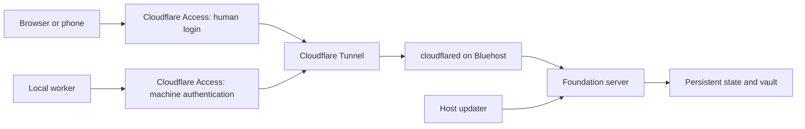

# Phase 1: Infrastructure foundation

**Status:** Draft

**Project:** Agent Q (`agent-q`), the new Agent Queue version

**Scope:** Infrastructure and deployment only

Phase one establishes the infrastructure on which Agent Queue v2 will run: local development, a Docker deployment on a VPS, human login, local worker connectivity, release delivery, self-update, and recovery.

Success means the owner can open a secure URL from a phone, log in, see a registered desktop worker, install a new version, and reconnect after the restart. Task scheduling and agent execution belong to subsequent specifications.

The initial deployment targets a Bluehost self-managed Linux VPS with Cloudflare DNS, Tunnel, and Access. Standard Docker Compose keeps the application portable to another VPS. Self-update means installing a new version of Agent Queue’s own software and restarting it. Whether installation starts manually or automatically remains an open policy decision.

## Scope

The phase delivers the `agent-q` foundation repository, a minimal server, a minimal worker connector, a small administration page, deployment configuration, and operating instructions. Future components may live in separate repositories and plug into this foundation.

The server exposes only foundation operations: identity, worker enrollment and status, health, version information, and update status. The worker registers, authenticates, sends heartbeats, reconnects, and reports its version. A bounded connectivity probe demonstrates communication; there is no remote shell or job runner.

Deferred work includes task storage, scheduling, agent harnesses, disposable execution sandboxes, knowledge, playbooks, integration trains, the full dashboard, billing, and multi-tenant hosting. Foundation persistence does not determine the future task database.

## Proposed deployment

Use one Bluehost self-managed Linux VPS running Docker Compose. The proposed starting size is NVMe 4 (2 vCPU, 4 GB RAM); the actual purchase, region, term, and operating-system image remain to be selected. cPanel is unnecessary for this deployment.

Run the foundation server and a `cloudflared` tunnel connector in separate containers. A small host service performs installation and updates independently of the application container. Persistent state and secrets live outside container filesystems.

Cloudflare DNS supplies the public hostnames, Tunnel connects the VPS outward to Cloudflare, and Access authenticates approved humans before requests reach the administration API. The browser-facing HTTPS endpoint is provided through Cloudflare. The server has no publicly published application port; only the tunnel connector reaches it over the private Compose network. Administrative SSH access is separate and restricted.

Cloudflare Tunnel uses outbound connections, allowing the application origin to stay closed to inbound public traffic. [Tunnel documentation](https://developers.cloudflare.com/cloudflare-one/networks/connectors/cloudflare-tunnel/)

Compose supports shared configuration with environment-specific overrides. Production code belongs in immutable images; local source mounts are for development. [Docker Compose production guidance](https://docs.docker.com/compose/how-tos/production/)

Keep identity verification behind an adapter, and keep the application runnable without Cloudflare in local development. Moving to another VPS should require new provisioning and tunnel configuration, without changing domain logic. This phase does not target Cloudflare Workers or Containers.

The administration page contains login, current version, server health, workers, and update progress. It must work on a phone. The same authenticated API will support later clients.

## VPS provisioning and installation

Use Bluehost's self-managed VPS offering with full root access and Docker support. Before purchase, verify the current billing term, renewal price, available region, supported Linux image, and sustained-resource rules. The Docker sales page and VPS resource terms use different resource-limit wording; resolve applicability for an always-running orchestration service before committing to a prepaid term. [Bluehost Docker hosting](https://www.bluehost.com/vps-hosting/docker), [VPS resource terms](https://www.bluehost.com/terms/user-agreement)

Document a reproducible sequence:

1. Create the VPS and establish administrator SSH access and recovery-console access.
2. Configure the host firewall, a supported Linux image, Docker, Compose, and the host updater.
3. Add the chosen domain to Cloudflare DNS and configure the tunnel and separate human and machine Access applications.
4. Install tunnel credentials, the release reference, persistent data paths, and owner bootstrap configuration.
5. Start the stack and verify the public HTTPS endpoint, Access authentication, and application authorization.
6. Enroll a desktop worker and verify its authenticated heartbeat.
7. Reboot the VPS and verify automatic recovery of the server and tunnel.

Installation must be repeatable without deleting state or rotating identities unexpectedly. Failures identify the step and corrective action. Infrastructure configuration belongs in version control; credentials do not.

Buying hosting, registering a domain, configuring external accounts, and deploying are implementation actions. Saving this specification does not perform them. Provider pricing is not an architectural dependency.

## Human login and machine identity

Cloudflare Access handles human authentication. Initially use an explicit email allowlist with email one-time codes; another supported identity provider can be added later. Agent Q owns authorization inside the application. Access groups control entry and do not automatically become application roles. [Email-code login](https://developers.cloudflare.com/cloudflare-one/integrations/identity-providers/one-time-pin/), [Access policies](https://developers.cloudflare.com/cloudflare-one/access-controls/policies/)

Validate the signed `Cf-Access-Jwt-Assertion` using configured issuer, audience, expiration, and signing keys. Never trust an email header alone. Bind the validated issuer and subject to the application's user record. Initial owner bootstrap requires both the configured verified email and an explicit one-time bootstrap configuration; the first visitor is never automatically the owner. Identity-provider changes require explicit rebinding. [Token validation](https://developers.cloudflare.com/cloudflare-one/access-controls/applications/http-apps/authorization-cookie/validating-json/)

The proposed initial roles are:

| Role | Permissions |
| --- | --- |
| Owner | Manage enrollment, revocation, configuration, roles, and updates; inspect status. |
| Viewer | Read permitted status and version information; no mutations or secret access. |

A narrowly scoped Operator role and project-specific grants can follow. Enforce permissions on every server operation, including direct API requests. Protect browser mutations against forged cross-origin requests and document login expiration and logout behavior.

Use a separate hostname and Cloudflare Access application for worker endpoints. Its Service Auth policy accepts machine credentials, avoiding interactive redirects. Issue a distinct Cloudflare service token per node, initially through the operator's Cloudflare dashboard. Human administration routes must not be reachable through this hostname. [Service tokens](https://developers.cloudflare.com/cloudflare-one/access-controls/service-credentials/service-tokens/)

Cloudflare machine authentication is an outer gate. Agent Q independently validates the worker's enrollment or node credential:

1. An owner creates a short-lived, single-use Agent Q enrollment code.
2. The worker receives the API URL, its Cloudflare service token, and the enrollment code through a secret-safe local setup command.
3. Over HTTPS, the worker exchanges the enrollment code for a unique Agent Q credential.
4. Subsequent status requests carry both machine authentication and the Agent Q credential.

The server stores a non-reusable verifier for opaque Agent Q credentials. The worker stores secrets locally with restricted permissions; setup must avoid exposing them in shell history, process arguments, or logs. Cloudflare credentials and application credentials have separate expiration and rotation procedures.

A node may access only its own connection and status operations. It cannot enroll other nodes, manage human access, or update the server. Application revocation immediately rejects subsequent requests and closes any active connection. Removing a node also revokes its Cloudflare token; a stale outer token alone must confer no application access.

Operator recovery through SSH must allow correcting login configuration without exposing an unauthenticated web administration path.

## Local worker connectivity

The worker initiates all communication to the VPS over HTTPS on port 443. The desktop needs no inbound port forwarding or public IP address.

Start with periodic authenticated HTTPS requests for registration status, heartbeats, and a fixed connectivity probe. Add a persistent stream only when a later execution specification needs it. Reconnection uses bounded backoff with jitter; sleep, network loss, and server restart are ordinary conditions.

Proposed heartbeat interval is 15 seconds; the server marks a worker offline after 60 seconds without a heartbeat. Offline status does not delete its identity. Reconnection restores the same identity.

The handshake includes worker identity, software version, and protocol version. Unsupported versions receive an actionable compatibility response. A server release must declare supported worker protocol versions; updating the server must not require simultaneous updates on disconnected desktops.

The initial desktop target is provisionally Linux or WSL2, consistent with the current development environment. The installation guide must explain whether the worker runs as a local service or container and what happens when Windows or WSL shuts down. Native Windows and macOS support are separate decisions.

This phase proves connectivity. Filesystem access, Docker access, and sandbox privileges for future agent execution require a later worker specification.

## Configuration and persistent state

Retain a vault directory for editable, non-secret configuration. Mount it separately from application code, validate it at startup, and version its format. Local development and the VPS use separate vaults.

Use a small private foundation store for user identities and role assignments, worker identities, credential verifiers, and enrollment records. SQLite on a persistent volume is a proposed single-instance default, pending implementation review. This choice imposes no storage requirement on the future task service.

Keep the updater’s deployment journal on the host so it remains readable when the application cannot start. Separate secrets from the vault, image, repository, and ordinary logs.

Back up configuration and foundation state to a destination outside the VPS, with encryption and retention defined before pilot use. Credentials or encryption keys needed for recovery require a separately documented recovery procedure. Restore testing must account for credentials revoked since the backup; revoke and re-enroll workers when that history cannot be trusted.

Container replacement must preserve state, configuration, and worker identities. Log rotation and storage limits are configured from the first deployment.

## Development and release delivery

Use this `agent-q` repository for the foundation, containing the server shell, worker connector, protocol definitions, minimal UI, Compose files, installer, updater, and smoke checks. Keep internal boundaries explicit so later components can be released separately.

A new developer should be able to clone the repository, provide development configuration, and run one documented command to start the local stack. A second command starts a local worker against it. Any local authentication substitute is bound to the local environment and cannot be enabled in the production configuration.

Daily development uses disposable local state and fast reload where useful. Release verification runs the built images rather than source mounts.

The initial delivery path is:

1. Make and review a source change.

2. Run focused checks and the foundation lifecycle smoke test.

3. Build versioned server and worker artifacts in CI.

4. Publish artifacts and a release manifest.

5. Exercise the candidate in an isolated test deployment.

6. Promote the exact tested artifacts to the release channel.

7. Let the installed system fetch and apply the release.

The manifest records source revision, immutable artifact digests, protocol compatibility, state-format compatibility, and supported upgrade paths. Releases must be authenticated using a configured trust mechanism. Registry, CI provider, signing implementation, and branch conventions remain open.

Production does not build from an uncommitted checkout. Future agents can author changes through this same pipeline; automatically authoring code is outside the foundation phase.

## Self-update and restart

The owner can request an update through the administration page. The server records the request and hands it to the host updater, which remains running while the application is replaced. Polling for releases and automatic installation are separable policies; the trigger policy is still undecided.

The application container does not receive the Docker socket. Docker daemon access carries substantial host authority, so the proposed design confines that access to the installation and update service. [Docker Engine security](https://docs.docker.com/engine/security/)

The host updater accepts only validated releases for the configured Agent Queue installation. It must not expose arbitrary shell commands, arbitrary images, or user-supplied Compose definitions through the web API.

The update sequence is:

1. Acquire an update lock and persist the target release and previous working release.

2. Validate release authenticity, upgrade compatibility, available disk space, and required artifacts.

3. Download and verify the new image before stopping the running application.

4. Enter maintenance mode, block foundation mutations, and take a consistent state backup.

5. Replace the application container and wait for readiness within a configured deadline.

6. Check state access, authentication configuration, protocol compatibility, and a local API probe.

7. Mark the release active and leave maintenance mode, or restore the previous compatible release.

The browser may disconnect during replacement and reconnect to show the persisted outcome. Workers retry and retain their identities. Brief downtime is acceptable in phase one.

Recovery must handle failure after every persisted update step, including host reboot. Repeating an update request must not start concurrent replacements. Failed health checks trigger bounded rollback, not an endless restart loop.

Phase-one upgrades must preserve compatibility with the previous state format. A downgrade cannot simply point an old binary at incompatible migrated data. An incompatible release must be refused by the automatic path until a separately tested migration and restore procedure exists.

The host updater itself is initially upgraded through a documented administrator procedure. Automatic replacement of the updater is deferred. Worker releases use the same version and integrity rules, with manual installation acceptable initially; unattended worker self-update can follow.

A documented SSH command must show update state and restore the last working release even when login and the application are unavailable.

## Verification and completion

The phase is complete when these demonstrations pass against a real VPS:

| Demonstration | Required outcome |
| --- | --- |
| Fresh installation | The documented procedure produces an HTTPS endpoint from a clean supported host. |
| Owner login | The configured owner can sign in from desktop and phone; an unrelated identity is rejected. |
| Role enforcement | A Viewer cannot mutate state or initiate updates through the UI or direct API calls. |
| Origin isolation | The public internet cannot bypass Access to reach the server; the machine hostname cannot reach human administration routes. |
| Worker enrollment | A local worker joins through outbound HTTPS; expired and reused enrollment codes fail. |
| Disconnect and reconnect | Network interruption marks the worker offline; reconnection preserves its identity. |
| Credential revocation | A revoked worker loses access and cannot reconnect using the old credential. |
| Server and host restart | Configuration, owner access, and worker identities survive. |
| Successful self-update | Release A installs release B and restarts; version and update history reflect B. |
| Failed update | An unhealthy B restores A within a configured deadline and records the failure. |
| Interrupted update | Killing the updater or rebooting the host mid-update recovers to a known release. |
| Compatibility refusal | An unsupported worker or unsafe state upgrade receives an explicit diagnostic. |
| Backup restoration | An isolated fresh installation restores required state with an explicit credential recovery decision. |
| Developer setup | A clean checkout can run the local stack and worker using the documented commands. |

CI runs focused server, worker, and updater checks plus a small lifecycle suite. Live VPS verification covers DNS, TLS, actual networking, host restart, and recovery. No agent task or code merge is required for completion.

## Implementation order and open decisions

Build the phase in four increments:

1. **Local foundation:** repository, container image, Compose setup, health and version endpoints, and a local worker heartbeat.

2. **Hosted access:** Bluehost provisioning, Cloudflare DNS/Tunnel/Access, owner login, and authenticated enrollment.

3. **Release lifecycle:** CI artifacts, deployment manifest, update request, external updater, restart, and rollback.

4. **Recovery proof:** reboot tests, credential revocation, off-host backup and restore, and concise operating instructions.

Before implementation, resolve the Bluehost plan and region, supported Linux image, domain, Cloudflare account setup, initial desktop operating mode, artifact registry, and implementation language for the shell and connector. Bluehost plus Cloudflare is the initial deployment direction; specific purchases and accounts remain unset. Select the backup destination and authenticated release mechanism before pilot deployment.

The remaining update-policy question is whether the owner initiates each installation or enables automatic installation from a selected release channel. Both use the same update mechanism.

Later specifications can add tasks, workers that execute agents, playbooks, and integration while reusing this foundation’s deployment, authentication, connectivity, and release lifecycle.

## Relationship to the existing system

Build AQ v2 as a fresh start alongside the existing Agent Queue installation. This phase does not change its database, configuration, daemon, or task ownership. New v2 workspaces do not require importing v1 data or achieving full v1 feature parity.

Do not include a v1 importer or supported migration workflow in aq-graph. If the owner later chooses to transfer selected data, use a separately maintained external one-off script. Supporting migration for other installations is outside the product scope. Normal v2 state/schema upgrades, backups, and recovery remain part of deployment operations.

This repository's specification is the implementation reference. It incorporates the subsequent Bluehost and Cloudflare decisions from the discussion after the [original brainstorming draft](https://chatgpt.com/space/page_232b155a4fc48191ad7bfab383f1093d).
