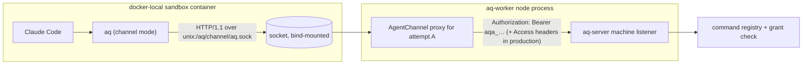

# Agent channel: the `aq` CLI from inside a sandbox

**Status:** Proposed design. The owner reviews it before implementation starts.

**Date:** 2026-11-06

**Scope:** aq-server (authorization, command registry, grants, startup context), aq-worker (sandbox channel, credential custody, template), the v2 CLI (`aqv2` crate). aq-graph, aq-git and aq-playbooks are unchanged except where noted.

## 1. Intent

An agent running inside a sandbox must be able to use AQ the way a person at a terminal does: read its task and the knowledge base, create subtasks, comment, ask the owner a question and wait for the answer, message the supervisor or other agents. The rules for what it may do live on the server and are expressed as grants. Adding a command to AQ must not require any change to the channel for agents to use it.

Owner requirements, 2026-11-06:

> "I would expect the AQ channel to allow for all aq command line operation to work, without having to need to explicitly add them, so when we add commands in the future they can be utilized by agents inside sandboxes when permitted. Agents often need to do more than just communicate with a supervisor, or one another, like create additional tasks or subtasks. Perform queries to learn about knowledgebase information, etc."

Earlier:

> "I think the agents talking back is one of the most important parts."

Standing rule: this spec contains no time estimates.

## 2. Current state

### 2.1 Three CLIs, none usable from a sandbox

| CLI | Where | What it calls | Limits |
| --- | --- | --- | --- |
| `aqv2` | aq-server `crates/aqv2` | Owner routes on the admin listener: `/api/v1/actions` (action union), `/api/human/*` and `/api/v1/*` reads | Owner only. Authenticates with a Cloudflare Access JWT file (`aq-human-http`). It sends only 3 action kinds (`task.create`, `decision.resolve`, supervisor message). |
| `aq-agent` | aq-worker `crates/aq-agent-client` | Agent routes on the machine listener: `/v1/agent/context`, `graph/read`, `graph/commands`, `messages/*`, `comments`, `operations/{id}`; also the worker-local result channel | Each command is hand-written against its own route. It has no `question`, `wait` or `task create` command. It only accepts HTTPS or a loopback origin. |
| `aq-session` | aq-server `crates/aq-session-cli` | Terminal relay | Not relevant here. |

v1 owns the name `aq` on the owner's host. The B7 runtime bundle build fails if `/opt/aq/bin/aq` exists, so sandboxes ship only `aq-agent` (aq-worker `docs/implementation/B7.md`).

### 2.2 The server already has a generic command boundary, for owners

- **The action union.** Mutations go through one route, `POST /api/v1/actions`. It carries a `kind` such as `task.create`, `task.comment.add`, `knowledge.author`, `question.answer` or `task.dependency.add`; 32 kinds are published in `protocol/dashboard-actions/v1/schema.json`.
  - Each kind is an `ActionKind` (`crates/aq-server/src/dashboard_api/actions/registry.rs`) with `authorize`, `authorize_lookup`, `reconcile` and `execute`. Every kind gets an operation journal, idempotency by `operation_id`, and the pending/confirmed/conflict/rejected/unknown dispositions.
  - Every `authorize` takes `&User` and starts with `existing::owner(state, user)`.
- **Reads are not a union.** They are individual GET routes behind `RequireOwner`: `/api/human/projects/{p}/tasks/{node}`, `.../comments`, `.../knowledge`, `/api/v1/search`, and others in `crates/aq-server/src/agent_access/human.rs`.
- **A non-owner principal already reuses the union.** The F1b supervisor credential is served at `/api/v1/actions` on the machine listener with its own per-principal `Registry`, which holds only `task.create` and `task.graph.create` (`agent_access/human/enqueue/supervisor.rs`).
  - It reaches owner adapters through a synthetic journal `User` with role `Viewer`. That works, but it is a workaround rather than a principal model.

### 2.3 Agent access today: per-route, partly unchecked

- **Credential.** Each attempt gets an `aqa_…` bearer credential. The server stores only its verifier, in `agent_launch_bindings`.
  - The node is issued it by `POST /v2/worker/agent-session`, rotated through `expected_credential_version` (`crates/aq-server/src/agent_access.rs`).
  - It is revoked on closure, cancellation and disposition (`profiled_execution/{closure/service.rs,cancellation.rs,disposition.rs,phase_terminal/closure.rs}`).
  - Its expiry is `min(ttl, grant_expires_at_ms)`.
  - These lifecycle rules are sound and are kept.
- **Grants are a fixed list.** The grant vocabulary is `ResolvedProfile.capabilities`, a closed enum of 14 values in `protocol/agent-access/v1/schema.json`: `read.*`, `write.*`, `message.*`. It has no `question.*`, `wait.*`, `comment.*` or `task.create*`.
- **Authorization is per handler and not uniform:**

  | Routes | Checks the profile? |
  | --- | --- |
  | `graph/read`, `graph/commands`, `messages/*` | Yes (`capability()` in `messaging.rs`, `cap()` in `mutations/authorize.rs`, inline in `agent_access.rs`) |
  | `/v1/agent/questions*` | No. The handler authenticates and proceeds (`questions.rs` `caller()`). The F5 follow-up noted this. |
  | `/v1/agent/comments*` | No. The capability names in `aq-task-comments` `AGENT_ROUTES` are ignored (`human/comments.rs` `agent()`). |
  | `/v1/agent/waits/*` | Only checks that the command matches the route, not that the profile grants it (`waits/routes.rs`). |

- **Refusals give no reason.** Every refusal body says `"agent access request refused"`; only the `code` differs (`agent_access.rs` `Error::respond`).
- **Native launches can only read.** They resolve a read-only profile: the six `read.*` capabilities, an explicit record set of at most 256 records, and an empty write scope (`crates/aq-profiles/src/graph_policy.rs` `resolve_profile`). A real attempt therefore cannot message, write knowledge or search the project's knowledge, even with a working channel.
- **The right permission shape already exists upstream.** aq-profiles modules and execution profiles declare `Permission { operation, scope_reference }`, for example `task.read @ project:…` or `wait.register @ attempt:self`. The compiler already produces `effective_permissions`: what the modules request, intersected with what the execution profile grants (`crates/aq-profiles/examples/catalog/catalog.toml`). The launch reduces this to "readable or not" and drops the rest.

### 2.4 The sandbox has no path to the server

- **No channel at launch.** The MS1 docker-local driver (aq-worker `crates/aq-worker/src/sandbox_driver.rs`) uploads the worktree, prompt and settings, and delivers the Claude token as private material. It "never talks to aq-server": it issues no agent credential, uploads no state directory and provides no endpoint.
- **No route to the server.** The container uses `NetworkMode: bridge` (`backend/docker_local/policy.rs`). The local server listens on host loopback, which a bridge container cannot reach. `aq-agent` also refuses plain HTTP to anything but loopback.
- **B7 and B6b are library-only.** B7 (`native/runner/sandbox/agent_access.rs`, `aq-agent-client/src/provision.rs`) installs a delivered credential for the agent. B6b `AqApiProxy` (`native/runner/sandbox/proxy.rs`) is a fixed-upstream, route-agnostic loopback forwarder that injects the runner's Access headers. Both are tested but not wired into any launch (B7 "Limits"). MS1 has no in-sandbox runner process or runner user to host them: the runner is a bash script.
- **Retrospective W77** records the gap: every agent-side feature (comments, F5 questions, H4 waits, messaging) has server routes and no working path from a real sandbox.

### 2.5 v1, the reference the owner likes

- **One CLI.** `aq` is generated from the command catalogue (`src/cli/auto_commands.py`, `src/tools/command_catalogue.json`). It calls one generic execute route with the session's `AQ_API_TOKEN`.
- **Two server-side gates:**
  - Scope: `check_command_scope` in `src/api/scope.py`. It injects and pins `task_id`, `project_id` and `session_id` from the token, and allows worker sessions only commands in `AGENT_COMMAND_SET`.
  - Capability: `authorize_command` in `src/commands/authorization.py`. The contract declares the required capability, the profile policy allows it, and the same predicate filters what discovery publishes.
- **Resource classes.** `src/commands/resource_authorization.py` puts every command in a class: system, project, held, session or public. An unclassified command is `resource_audit_required`, which means deny.

v1 did not make new commands agent-usable automatically. The central allowlist `AGENT_COMMAND_SET` still had to be edited. What it got right was a single transport and a generated CLI, so the only decision left was whether the command was allowed. This design keeps that and moves the decision into the command's own declaration.

## 3. Decisions

| # | Decision | Instead of |
| --- | --- | --- |
| D1 | **One CLI.** The `aqv2` crate becomes the only v2 CLI. In sandboxes it is installed as `/opt/aq/bin/aq`; on hosts it stays `aqv2` until v1 retires. `aq-agent` is retired (§9). | Keeping two clients that drift apart, which is how questions and waits ended up missing from `aq-agent`. |
| D2 | **One generic command surface.** Every command, read or mutation, is registered once in a server command registry. It is invocable as `POST /api/v1/commands/{name}` and discoverable at `GET /api/v1/commands`. | Adding agent-specific routes per feature (`/v1/agent/*`). |
| D3 | **The channel is route-agnostic transport.** The worker exposes a per-attempt endpoint inside the sandbox that forwards to aq-server's machine listener without knowing any commands. | A per-command proxy or allowlist. |
| D4 | **The proxy holds the credential.** The agent holds no secret. The proxy strips any caller `Authorization` and injects the attempt's credential (and Access headers in production). | Installing the credential in the agent's home (B7). See §5.2. |
| D5 | **Grants are enforced server-side, uniformly.** One `Caller` extractor and one `authorize(caller, grant, target)` check run for every registered command. A command without a declared grant cannot be registered. | Capability checks written by hand inside each handler. |
| D6 | **Grants are `(operation, scope)` pairs.** They reuse aq-profiles `Permission`, resolved at launch and frozen for the attempt. They can be narrowed live but never widened. | Extending the closed `ResolvedProfile.capabilities` enum, which would break agent-access-1 digests. |
| D7 | **Refusals give the reason.** A refusal names the command, the missing grant and the scope the caller holds. It never reveals other resources. | The generic "request refused" (v2), or v1's "leak nothing". |

## 4. CLI and command contract

### 4.1 One binary, two credential modes

`aq` (the `aqv2` crate) selects its mode at startup:

- **Owner mode.** Used when `--origin` and `--cf-access-token-file` are given. This is today's behaviour.
- **Channel mode.** Used when `AQ_CHANNEL` is set, for example `AQ_CHANNEL=unix:/aq/channel/aq.sock` (§5).
  - The CLI sends no credential and refuses `--cf-access-token-file`.
  - Every command is otherwise identical. Output, exit codes, `--json`, operation IDs and recovery hints all come from the same code.

Both modes share the existing rules in `aq-human-http`: bounded bodies, no redirects, no environment proxies, no automatic resend of mutations, and never echoing raw error bodies or credential material. The B6b rule that refuses plain HTTP to non-loopback origins applies only to TCP origins. A Unix socket origin is local by construction.

### 4.2 The command registry is the contract

aq-server gets one registry that every surface uses: the dashboard, the CLI, the supervisor and agents. A registered command declares:

```rust
pub struct CommandSpec {
    pub name: &'static str,          // "task.create", "knowledge.search", "question.ask"
    pub kind: Kind,                  // Read | Mutation (Mutation = an ActionKind with journal)
    pub grant: &'static str,         // operation the caller must hold, e.g. "task.create"
    pub target: TargetRule,          // how the scope target is derived from the payload (§6.4)
    pub principals: Principals,      // Owner | Supervisor | Agent (default: all three, gated by grants)
    pub schema: SchemaRef,           // request/response JSON Schema (schemars)
}
```

- **Mutations** are the existing `ActionKind`s. They gain associated constants for `GRANT` and `TARGET`. The trait gives these no default, so a kind without them does not compile.
- **Reads** become `ReadKind`s, with the same declarations, wrapping today's handlers.
- **The REST paths stay.** The dashboard keeps `/api/human/*` and `/api/v1/*`. They route to the same handlers through the same check.

The published contract is `protocol/commands/v1/commands.json`. It is generated from the registry: name, kind, grant, target rule, schema digests and CLI tokens. A CI drift test fails if the file and the registry disagree, the same pattern the per-route `routes.json` tests use in questions, waits and comments.

### 4.3 Generic invocation and discovery

- **`POST /api/v1/commands/{name}`** takes a body `{ "operation_id"?: uuid, "subject"?: …, "expected_versions"?: …, "params": {…} }`.
  - For a mutation, it builds the same `ActionRequest` and runs the normal action pipeline: journal, idempotency, dispositions.
  - For a read, it validates `params` against the schema and calls the read handler.
  - `POST /api/v1/actions` remains as the owner and dashboard form of the same pipeline.
- **`GET /api/v1/commands`** returns the commands this caller may run, with the scope each grant has. It is filtered by the same predicate that authorizes execution, so "published means runnable" (the v1 rule). `?all=true` also lists commands the caller cannot run, each with its missing grant, so an agent can ask for it.
- **`aq whoami`** returns the principal: attempt, task, project, profile, grants, credential expiry and authority revision.

### 4.4 How the CLI covers new commands

- **Generic form.** `aq run <name> [--param k=v …] [--json FILE|-]` invokes any registered command. `aq commands` lists them, and the help text comes from the schema descriptions.
- **Typed subcommands.** Commands with ergonomic syntax, such as `aq task create --parent self --title …`, `aq knowledge search "…"`, `aq comment add`, `aq question ask` and `aq question wait`, are thin wrappers over the same call. They are optional.
- **CI check.** Every command in `commands.json` must be reachable through `aq run`. A golden test also covers each typed subcommand's mapping.

A command added to the server registry is usable at once through `aq run`, by any principal that holds its grant. It needs no CLI release, proxy change, worker change or agent route.

## 5. The channel

### 5.1 Placement: node-side proxy over a per-attempt Unix socket (docker-local)



1. **Credential.** At launch, the sandbox driver asks the node for attempt A's agent credential. The node uses the existing `/v2/worker/agent-session` issuance under its node credential (`aq_agent_client::provision::Allocator`).
2. **Proxy.** The node starts `AgentChannel(A)`, an `AqApiProxy` generalized to listen on a Unix socket. It holds the credential in memory only, zeroized on drop.
3. **Socket mount.** The node creates `<node-state>/channels/<attempt>/aq.sock`, in a directory with mode 0711 and the socket set to the agent's uid. It bind-mounts the directory, not the socket file, read-write at `/aq/channel`.
   - This needs a new fixed mount kind in the docker-local launch policy, beside `mount_aliases`. It always targets `/aq/channel` and its source is always the attempt's own directory.
4. **Endpoint.** `AQ_CHANNEL=unix:/aq/channel/aq.sock` goes into `/aq/in/env`. It is not secret. The runner note (`RUNNER_NOTE`) tells the agent the CLI is available.
5. **Forwarding.** For each request, the proxy:
   - enforces the existing B6b framing rules: fixed upstream, no `Transfer-Encoding`, `Upgrade` or `Expect`, bounded head and body, bounded concurrency;
   - removes any `Authorization` and `cf-access-*` headers the caller sent;
   - injects the attempt credential, and the node's runner Access token when the upstream is the production hostname;
   - forwards to the node's configured server origin.

   It forwards every path under the agent-facing prefixes (`/api/v1/commands`, `/api/v1/operations/`, `/v1/agent/` while §9 runs) and refuses the node and worker namespaces (`/v1/worker/`, `/v2/worker/`, `/v1/execution/`) with a typed `channel_refused`. This is a coarse prefix rule, not a command list. New commands live under `/api/v1/commands`, so they never need a proxy change.

**Why a Unix socket rather than TCP:**

- It needs no network path from the container. The bridge-to-host-loopback problem disappears on Docker and rootless Podman (the VPS) alike.
- The socket is per attempt, so the proxy knows which attempt is calling without any token in the sandbox. Another container cannot reach it.
- It leaves the container's network mode unchanged.

A TCP listener on the bridge gateway would need per-attempt ports, would differ between Docker and Podman/pasta, and would expose the listener to every container on the bridge.

### 5.2 Why the proxy, not the agent, holds the credential

The direction proposed to the owner was to give the sandbox the credential plus a proxy. The evidence favours keeping the credential in the proxy:

- **No secret, no leak.** The driver already goes to lengths to keep the Claude token out of argv, disk and retained output, and scans the transcript for leaks (aq-worker review S3; `Drove`'s leak field in `sandbox_driver.rs`). With no AQ secret in the sandbox, nothing new needs guarding. The guard's check becomes "no `aqa_` string anywhere in transcript or `/aq/out`".
- **Invisible rotation.** The node rotates through `expected_credential_version` before expiry and swaps the token in the proxy. The agent never sees it change.
- **Instant revocation.** On cancel, expiry or closure, the node closes the socket, and the server has already revoked the verifier.
- **No impersonation.** Because the proxy overwrites `Authorization`, even a stolen `aqa_` token is useless from inside the sandbox.

Cost: it relies on one sandbox per attempt, which is already the rule (0005 §4). Agent-held credentials (B7 `install_delivered`) remain only as a fallback for a backend that cannot run a per-attempt proxy.

### 5.3 Remote backends (boat, later Cloudflare)

When the node is not on the data path, the same forwarding code runs inside the sandbox as the runner user (0005 §7). It listens on a Unix socket readable by the agent user and holds the agent credential and the runner Access token. The agent-side contract is identical: `AQ_CHANNEL=unix:/aq/channel/aq.sock`. This is B6b `AqApiProxy` with a socket listener and credential injection. B7's install step is no longer needed.

### 5.4 Lifetime, revocation and node restart

| Event | Channel behaviour |
| --- | --- |
| Launch | Credential issued, proxy started, socket mounted. All three happen before the harness starts. If any is missing, launch fails with `agent_channel_unavailable` instead of running an agent that cannot talk back (W77). |
| Credential nears expiry | The node rotates it. The new expiry is never later than the grant expiry or the hard deadline (the B7 rule). |
| Cancel, closure, expiry, revocation | The server revokes the verifier (existing code). The node stops the proxy and removes the socket directory. Later calls fail with `channel_closed`, or with `session_revoked` if a call was in flight. |
| Node restart | Today `reconcile-native` stops the attempt's sandbox and the attempt closes, which revokes the credential. If sandbox readoption (`/v2/worker/readopt`) later keeps sandboxes alive, the new incarnation rotates the credential (the version fence stops a stale node) and recreates the socket in the same mounted directory. Calls in flight during the gap fail at the transport. For a mutation, the CLI prints the operation ID and `aq operations show <id>`; it never resends. |
| Agent process exits | Nothing changes until the attempt closes. Commands still work from a second process in the same attempt, such as a hook. |

### 5.5 Secrets rule

The credential and Access token never appear in argv, environment variables, `/aq/in`, `/aq/out`, container labels, the pane, proxy logs or the transcript. Proxy logs record method, command name (taken from the path), status and duration, never headers or bodies.

## 6. Authorization

### 6.1 Principals

`Caller` is an enum resolved by one extractor on both listeners:

- `Owner(User)` and `Viewer(User)`: from the Cloudflare Access JWT, on the admin listener.
- `Supervisor(SupervisorPrincipal)`: from the F1b bearer, on the machine listener.
- `Agent(AttemptPrincipal)`: from the `aqa_` bearer, on the machine listener. It carries the binding, the grants, the authority revision and expiry.

Every `ActionKind` and `ReadKind` takes `&Caller` instead of `&User`. Owner adapters keep their current checks under `Caller::Owner`. The supervisor's synthetic Viewer workaround is removed.

### 6.2 Grant vocabulary

A grant is an `operation` plus a `scope`. Scopes are:

- `attempt:self`
- `task:self`: the attempt's task
- `task:subtree`: the attempt's task and its descendants, including tasks this attempt created
- `project:self`
- `project:<id>`: owner override only

| Operation | Commands it unlocks |
| --- | --- |
| `task.read` | Show a task, its work, history, summary and graph; list tasks |
| `task.create.subtask` | `task.create` / `task.graph.create` with a `parent_id` inside the scope |
| `task.create.project` | `task.create` with no parent, or under any parent in the project |
| `task.edit` | `task.edit`, `task.dependency.add`/`remove`, `task.reprioritize` on tasks in scope |
| `comment.read` / `comment.write` | Comment list / `task.comment.add`; edits and deletes are limited to the caller's own comments |
| `knowledge.read` | Knowledge list, show and search, graph `read.*` |
| `knowledge.author` | `knowledge.author`, and `knowledge.correct` on the caller's own records (the graph author rules still apply) |
| `question.ask` / `question.read` | Ask the owner; show or wait on the caller's own questions |
| `wait.register` / `wait.read` / `wait.ack` | H4 waits for the caller's own attempt |
| `message.send` / `message.read` / `message.ack` | Mailboxes. Scope `project:self` means any session or task mailbox in the project plus the current supervisor conversation. |
| `result.read` | Results for tasks in scope |

Operations that are never grantable to an agent are marked owner-only in the registry, and `authorize` refuses them for any `Caller::Agent`:

- answering questions and resolving decisions: `question.answer`, `decision.resolve`;
- `knowledge.verify`, `knowledge.retire`, `result.evidence_waive`;
- playbook activation and runs;
- worker, project and credential administration;
- changing grants.

### 6.3 Where grants come from

The effective grant set for an attempt is built in four steps:

1. **Profile.** aq-profiles `effective_permissions`: what the modules request, intersected with what the execution profile grants. This already exists; launch stops discarding it.
2. **Project ceiling.** The intersection with the project policy ceiling: a new `agent_grants` ceiling in `ProjectPolicy`, set by the project's coding binding or playbook policy (the `aq.coding` binding, 0002 §7.1).
3. **Owner overrides.** Owner additions or removals for this task, through a new owner-only action `task.agent_grants.set`. It is audited, and only an owner can widen a grant beyond the ceiling.
4. **Inheritance.** If the task was created by an agent, the result is also intersected with the creating attempt's grants (§8). A child can never hold more than its creator.

- **Freezing.** The set is resolved at offer and sealed with the launch in `agent_launch_bindings.grants`, beside the existing `profile` and `context`, with its own digest. Changing an attempt's authority is the existing "new attempt" rule.
- **Narrowing.** An owner removal or a project ceiling reduction narrows a live attempt immediately: `authority_revision` is bumped and the next call sees it. Widening takes effect from the next attempt.
- **Compatibility.** The agent-access-1 `ResolvedProfile` and `Binding` documents are untouched, so their digests and fixtures stay valid. The graph routes keep checking their own `read.*`/`write.*` capabilities, derived from the grants at launch.

### 6.4 Scope check

Each command's `TargetRule` derives the target from the request:

- `Task(id)`, `ParentTask(parent_id)`, `Project(id)`, `Comment(id)`, `Decision(id)`, `Mailbox(recipient)`, or `Own` (implicitly the caller's attempt or task);
- `params` gain defaults from the binding, as v1 did: `self` resolves to the attempt's task, and an omitted `project_id` is the attempt's project;
- a value that conflicts with the binding is refused.

The check `allows(grant, target)`:

- resolves the target's project and, for `task:subtree`, its ancestry through the parent edge already used by `authorize_parent`;
- is always pinned to `project:self` unless an owner override names another project;
- for list reads, filters to the scope before paging (agent-access-1 rule) and reports `coverage: authorized_projection`;
- for a target the caller cannot read, returns the same `not_found` as a missing one.

### 6.5 Uniform enforcement

- Commands are routed only through `CommandRouter` (the registry). Its single middleware runs `Caller` extraction, grant check, scope check and audit before any handler.
- A route mounted outside the registry must be listed in a short reviewed allowlist of node and worker protocol routes. A test enumerates the registry and the allowlist against the router and fails on anything unclassified: deny by default.
- The existing `/v1/agent/*` handlers get the same check now (§10, phase 0). This closes the unchecked question, comment and wait routes.

### 6.6 Default grant set for a coding agent

The `aq.coding` default, before owner overrides:

| Grant | Scope |
| --- | --- |
| `task.read`, `comment.read`, `knowledge.read`, `result.read` | `project:self` |
| `task.create.subtask` | `task:subtree`, at most N created tasks per attempt, depth ≤ D below the attempt's task (configurable; see Q1) |
| `comment.write` | `task:subtree` |
| `knowledge.author` | `project:self` (new findings; corrections of the caller's own records only) |
| `question.ask`, `question.read`, `wait.*` | `attempt:self` |
| `message.send`, `message.read`, `message.ack` | `project:self` (supervisor, own task mailbox, other sessions in the project; see Q4) |

Not granted by default: `task.create.project`, `task.edit`, anything owner-only.

### 6.7 Attribution and audit

- **Attribution.** Every effect records `actor = agent { attempt_id, session_id, task_id, profile_id }`, as comments already do with `Author::Agent`. The dashboard shows it as the agent on that task. Created tasks carry `created_by_attempt`.
- **Audit.** One `command_audit` row per authorization decision: caller, command, grant, target, allow or deny, reason code, operation ID. Denials also appear in the task's history ("agent was refused `task.cancel`: no grant") and in a counter.

### 6.8 Refusal shape

Every refusal on the generic surface, and on `/v1/agent/*` from phase 0, returns:

```json
{"code":"grant_missing","command":"task.create","grant":"task.create.project",
 "held":[{"operation":"task.create.subtask","scope":"task:subtree"}],
 "message":"This agent may create subtasks under its own task, not top-level project tasks. Use `aq question ask` to request it.",
 "effect":"not_applied","request_id":"…"}
```

| Code | Meaning |
| --- | --- |
| `grant_missing` | The caller holds no grant for this command |
| `scope_denied` | The caller holds the grant, but the target is outside its scope; `held` shows the scope it has |
| `owner_only` | The command can never be granted to an agent |
| `quota_exceeded` | A grant limit such as `max_created_tasks` was reached |
| `session_revoked` / `session_expired` | The attempt's credential is no longer valid |
| `channel_refused` | The proxy refused the path (§5.1) |

The CLI prints `message` and exits with a distinct code (14, kept from the aq-agent contract). Refusals describe only the caller's own authority, never other records.

## 7. Context at attempt start

The startup context, after the assignment section, gains a bounded **task thread** block:

- the newest comments on the task, owner and agent, with authors and times;
- open and answered questions for the task, with answers;
- unread task-mailbox messages, including F5 answers queued for a continuation after the asking attempt ended;
- a line saying `aq` is available, followed by the output of `aq commands` for this attempt.

The block has a byte budget, explicit truncation and "use `aq comment list` / `aq question show` for more". It is labelled context, never policy: text in it cannot grant anything (aq-profiles rule). The same data is available live through `task.read`/`comment.read`.

## 8. Security considerations

- **Prompt-injected agents.** Assume repository files, knowledge or comments can steer the agent. The defences are least-privilege defaults, subtree confinement, owner-only decisions, quotas and attributed, audited effects. Nothing an agent writes can approve its own work: answers, decisions, verification and waivers are owner-only.
- **Privilege escalation through task creation:**
  - Tasks an agent creates inherit its grant ceiling (§6.3, step 4).
  - The agent cannot set `profile_hint` or `intelligence_hint` to a profile whose grants exceed its own; such a request is refused with `scope_denied`.
  - Creation limits per attempt and a depth limit stop recursive fan-out.
- **Lateral movement.** `project:self` is pinned from the binding, and a project in the body that differs from it is refused. Cross-project access exists only through an explicit owner override.
- **Exfiltration.** The sandbox has internet egress for its provider, so any data the agent can read can leave. `knowledge.read @ project:self` widens what the agent can read compared with today's 256-record set. The owner can narrow it (Q2). Responses stay bounded, and reads are audited.
- **Rate limits.** A new admission class, `AgentCommand`, in `admission.rs` applies per-attempt budgets: request rate, concurrent requests and mutation rate. The proxy keeps its own concurrency and body caps. Exceeding a budget returns `overloaded` with `retryable`.
- **Token-leak guard.** No AQ secret exists in the sandbox (§5.2). The template and transcript scans also fail on any `aqa_` string, and the node never writes the credential to disk.
- **Confused deputy at the proxy.** The proxy forwards only to its fixed server origin and refuses node and worker namespaces. It never adds the node credential, so a forwarded worker route fails authentication anyway.
- **Graph authority.** aq-graph stays unreachable from the sandbox. All graph effects still go through AQ's service principal with the existing guards (0002 §6). The 0002 §5 rule "avoid a generic forward-any-route proxy" is about proxying aq-graph's own routes, and remains true: the channel forwards to aq-server, which authorizes every command.

## 9. Migration from `aq-agent`

1. **Phase 0.** The `/v1/agent/*` routes keep working and gain the uniform grant check and refusal shape.
2. **Map to registry commands.** Each existing agent route is mapped to a registry command:

   | Agent route | Registry command |
   | --- | --- |
   | comments | `task.comment.add`, `comment.list` |
   | questions | `question.ask`, `question.show` |
   | waits | `wait.register`, `wait.inspect`, `wait.ack` |
   | messages | `message.send`, `message.inbox`, `message.ack`, `message.body` |
   | graph read and commands | `knowledge.search`, `knowledge.show`, `graph.read`, `graph.command` |
   | context | `whoami` |

   Each runs the existing domain function, so receipts and idempotency are unchanged.
3. **Ship `aq` in the template.** The runtime bundle ships `aq` (the `aqv2` crate) at `/opt/aq/bin/aq`, and B7's "never `aq`" build check is inverted. `aq-agent` stays alongside for one template generation, as a wrapper that execs `aq`.
4. **Result submission.** Result submission is worker-local, not a server command. It stays in the worker (`aq-agent result` becomes `aq result submit` against the local result channel).
5. **Retire the old surface.** `/v1/agent/*` (except the node recovery routes) and `aq-agent` are removed once no supported template ships them. The agent-access-1 contract is marked superseded for these routes.

## 10. Delivery phases

Phases are ordered by dependency. A phase is done when its acceptance passes.

| Phase | Work | Depends on | Acceptance |
| --- | --- | --- | --- |
| 0. Close today's gaps | Grant checks on question, comment and wait routes; structured refusal reasons; audit rows | — | Tests: each `/v1/agent/*` route refuses without its capability, and the refusal names the missing grant |
| 1. Caller and registry | `Caller` enum; `CommandSpec` on `ActionKind`/`ReadKind`; `CommandRouter` with the deny-by-default route test; `protocol/commands/v1/commands.json` with a drift test; `/api/v1/commands` invoke and discovery; `whoami` | 0 | Every existing owner action and read is registered; the router test finds no unclassified route; owner behaviour is unchanged |
| 2. Grants | Grant vocabulary and scopes; resolution from `effective_permissions`, project ceiling, owner overrides and inheritance; `agent_launch_bindings.grants`; live narrowing; `AgentCommand` admission class | 1 | A native attempt carries the default coding grants; scope tests for self, subtree and project; escalation tests for hints and children |
| 3. Channel | `AgentChannel` Unix-socket proxy in aq-worker; credential issuance, rotation and stop in the docker-local driver; `/aq/channel` mount kind; `AQ_CHANNEL` env; launch fails without a channel; leak guard extended | 2 (issuance needs grants sealed) | Integration test: a container calls `whoami` through the socket; no `aqa_` string in the transcript or `/aq/out`; revocation closes the channel |
| 4. One CLI | Channel mode in `aqv2`; `aq run`, `aq commands`; typed task, knowledge, comment, question (with `question wait`), wait and message subcommands; template ships `aq` | 1, 3 | Every command in `commands.json` reachable through `aq run`; CLI golden tests |
| 5. Startup thread | Task-thread block in the startup context | 1 | Context fixture includes comments, questions and queued answers within budget |
| 6. Live proof | §11 on a real docker-local node; milestone acceptance gains "agent can call every granted command from inside its sandbox" (W77) | 3, 4, 5 | §11 evidence recorded in `docs/implementation/` |
| 7. Migration | §9 steps 2–5; boat runner proxy reusing phase-3 code | 6 | No supported template ships `aq-agent` |

## 11. Live proof scenario

**Setup.** A real Claude Code attempt runs in a docker-local sandbox on the owner's desktop node. The project has a seeded knowledge record, "Release checklist", and a task, "Draft release notes for X", with default coding grants. The prompt asks the agent to do the work and to use `aq` for each step below.

1. **Who am I.** `aq whoami` shows the attempt, the task and the default grants.
2. **Knowledge search.** `aq knowledge search "release checklist"` returns the seeded record, and `aq knowledge show <id>` reads it.
3. **Subtask.** `aq task create --parent self --title "Verify changelog links"` creates a subtask. The dashboard shows it under the task, attributed to the agent.
4. **Comment.** `aq comment add "Found the checklist; following it."` posts a comment, which appears in the task's comment thread with an agent author.
5. **Question.** `aq question ask "Should the notes include the deprecated API?"` creates a question, then `aq question wait <id>` blocks on `question.show` within its own bounded wait.
   - The owner answers in the dashboard Decisions view.
   - The CLI returns the answer, and the agent's final message reflects it.
   - If the wait outlives the attempt, the F5 path delivers the answer to the continuation's startup thread (§7).
6. **Refusal.** `aq task create --title "Unrelated top-level task"` (no parent) is refused. The response is `grant_missing`, `task.create.project`, with the "held" list and exit 14. The agent reports the refusal in its final message rather than retrying.

**Evidence:**

- `command_audit` rows for all six steps, including the denial;
- the task history in the dashboard;
- proxy logs containing no headers;
- a transcript and `/aq/out` scan with zero `aqa_` matches;
- after the attempt closes, the socket directory is gone and the credential verifier is revoked.

## 12. Changes to existing documents

- **0005 §7.** The "Scoped AQ agent credential" row becomes: held by the channel proxy (node-side for docker-local, the runner for remote backends); it never reaches the agent user.
- **0002 §5.** The sentence "Avoid a generic forward-any-route proxy" is clarified to mean aq-graph routes (see §8).
- **aq-worker B7 and `packaging/sandbox/README.md`.** The bundle ships `aq`. `aq-agent` is deprecated.
- **agent-access-1 README.** Points to this spec for the command surface; the node recovery routes are unchanged.

## 13. Open questions for the owner

1. **Agent-created subtasks.** Should they be schedulable at once (`ready`), or created as `draft` until you approve them? And what defaults do you want for the per-attempt creation limit and the depth limit? v1 let worker sessions create tasks directly.
2. **Default knowledge reach.** Should a coding agent read and search the whole project knowledge base (`knowledge.read @ project:self`, the v1 behaviour and needed for "queries to learn about knowledgebase information"), or only records linked to its task unless you widen it?
3. **Top-level tasks.** Should agents be able to create top-level project tasks by default (`task.create.project`), or only subtasks, with top-level creation granted per project or per task?
4. **Agent-to-agent messaging.** Should agents message any session in the same project by default, or only the supervisor and their own task, with peer messaging granted per project?
5. **The name `aq` in sandboxes.** Is it acceptable to install the v2 CLI as `aq` inside sandboxes now (reversing B7's rule), while hosts keep `aqv2` until v1 retires?
6. **Per-task grant overrides.** Do you want `task.agent_grants.set` and its dashboard control in the first delivery, or are project-level ceilings enough to start?
